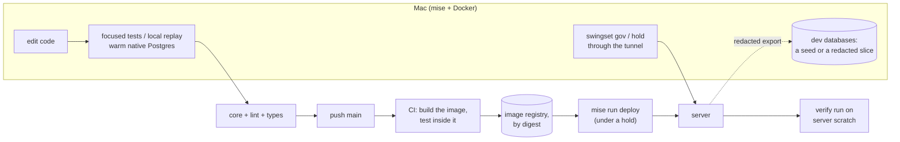

# 10. Local development after the switch

Read [9. After the switch](9-after-switch.md) first. This is the last page.

After the switch the Mac runs no production at all. It is where code is
written and tested, and where the owner reaches production through a
tunnel. Nix leaves the repo: mise and Docker do its work. Stage 1 builds
the everyday edit, test and replay loop before the port grows. Real-data
exports and production controls follow their later stages.

## Rules

- **The Mac never fetches.** There is one fetcher, the server (R11). Local
  code runs with fixtures, the mock transport and the 33-page cohort. A
  dev database refuses a real transport based on its stored environment
  identity, even if `SWINGSET_ENV` is absent or wrong; a conflicting flag
  also fails before any source or publication call.
- **The Mac never publishes.** No Hugging Face token is stored on it, and a
  dev database starts with publishing off in `gov.settings`.
- **Full-size checks run on the server,** not the Mac: the verify run after
  a deploy, the rebuild drill and release comparisons. The Mac needs no
  production-size data.

## The everyday loop

**Speed is an acceptance condition.** The last core run took 545.25
seconds for 2,147 cases ([measurement](../../../journal/investigations/2026/dokploy-plan-review-2026-11-04.md#validation-and-limits)).
That exceeds the repo's 180-second core budget and triggers this work.
Even the five normalization tests took 18.27 seconds in a focused run
on 2026-11-04. Neither measurement identifies the bottleneck: stage 1 measures collection,
database setup, test bodies and teardown before choosing further tuning.

These are proposed commands and warm-run targets, not implemented tools
or measured Postgres timings. First-time downloads are measured separately.

| Task                                       | Entry point                                                     | Feedback target                                             |
| ------------------------------------------ | --------------------------------------------------------------- | ----------------------------------------------------------- |
| start work                                 | `mise run dev`                                                  | ready in 30 s with dependencies and images cached           |
| edit and test one behavior                 | `mise run test -- <file-or-nodeid>`                             | under 10 s for the representative focused case              |
| keep that test running on edits            | `mise run test-watch -- <file-or-nodeid>`                       | same target; one run at a time, changes coalesced           |
| inspect one unit or a small event scenario | `swingset dev-replay <database> --unit <key>` or `--event <id>` | under 30 s for the bounded seed scenario                    |
| ready a change                             | `mise run check`, then `mise run fmt`                           | core under 180 s; lint and type timings reported separately |

`dev` checks the pinned tools and dependencies, starts or reuses the local
services, and creates the default seed only if absent. Python imports the
checkout directly: a code edit needs no image build, package reinstall,
migration replay or seed regeneration. A lockfile change resyncs dependencies;
a schema or seed change explicitly refreshes its own cache.

`test` forwards explicit pytest selectors and reports which tests ran.
With no selector it runs the reviewed core. Watch mode requires a selector;
it watches source and test changes, cancels or finishes the current run
before starting another, and cleans that run's databases. Focused passes
are feedback, not a substitute for the core before landing. Pure tests
start no database or Docker service; database fixtures are lazy.
Use pytest's existing [file and node selectors](https://www.pytest.org/en/latest/how-to/usage.html)
instead of building an automatic change-to-test dependency graph.

Measure cold startup once and three warm runs of a pinned focused case
and seed replay, reporting median and slowest, then one complete core
run with timings. Gate 1 requires the warm feedback targets and the core
budget; the slowest of the three warm runs decides each warm target.
Record the selected cases, hardware and cache state. Keep
the reviewed coverage: a slow test needs measured setup or execution work,
not silent deselection. Extra parallel workers are not the initial remedy.

## Tests

- **No Nix.** mise pins Python 3.12, uv and node beside the formatters it
  already pins, and `uv.lock` pins every Python dependency. Docker
  (OrbStack on the Mac) runs Postgres and the image. After stage 0 the
  server's runtime identity is the image digest, so Nix's stricter pinning
  of the Mac's environment buys nothing the verify run needs.
- **Run native locally.** Python runs on the Mac, with uv's cache;
  Postgres runs as ARM64 on an ARM64 Mac. Match production's Postgres
  patch release, extensions, locale and relevant settings, and pin both
  architecture image digests (or their shared multi-platform index).
  Local tests do not claim the exact AMD64 build. CI and the server's
  proofs supply that check. Avoid a local emulated image build on each
  edit ([Docker's architecture guidance](https://docs.docker.com/build/building/multi-platform/)).
- **Reuse the local test server, isolate each run's data.** A dedicated
  localhost-only test container stays warm across runs, separate from
  the dev-data container, under the existing 2 GiB limit. Its disposable
  data uses tmpfs with fsync and full-page writes off. A restart simply
  rebuilds its template. Cache migrated templates by image digest,
  migration checksums, role definitions and database settings; seeded
  templates also include fixture hashes. Never reuse a mismatched cache.
  Templates are immutable after creation and have no open connections
  during cloning ([Postgres template rules](https://www.postgresql.org/docs/17/manage-ag-templatedbs.html)).
- **Validate the warm server too.** Roles and server settings are shared
  across databases. Key and check the server's image, role definitions
  and relevant settings before reuse. An incompatible server is replaced
  only after all run owners have stopped; otherwise fail clearly or use
  a separate throwaway container within the resource budget. Tests that
  mutate cluster-wide roles/settings use a throwaway container. Test
  consecutive runs across a role or configuration change.
- **CI and server-lifecycle fault tests use throwaway containers.** They
  cannot restart or damage the warm local server. Both paths use the same
  migrations, fixtures and per-test isolation. Database tests fail clearly
  if Docker is unavailable; pure tests still work.
- **One database per test,** copied from the template with
  `CREATE DATABASE … TEMPLATE`, because advisory locks are per database.
  Tests that touch no database get none. Concurrency and crash tests use
  real commits in separate processes, as today. Every run owns unique
  database names and file directories. Cleanup drops only its own data;
  a killed run's leftovers are removed by exact ownership after confirming
  the run is dead. No shared writable test database, global prune or
  transaction-rollback substitute for commit and lock tests.
- **CI builds the image and tests inside it:** a test stage of the same
  Dockerfile (the shipped image plus dev dependencies) runs ruff, mypy and
  the core suite against a Postgres service container. So CI tests what
  ships, on `linux/amd64`, the server's CPU type.
- **Measure setup separately.** Template reuse should avoid repeating
  migrations; whether database cloning dominates is unmeasured. If it
  does, measure a narrower fixture before changing isolation. The
  performance targets above never justify weakening crash or lock tests.
- **Object storage:** `state/objects.py`'s `Store`, which keeps files in a
  directory, stays the backend for tests and dev. The bucket backend has
  the same interface; its own tests run in the extended suite against an
  S3-compatible server in Docker, the same software as the production
  bucket where possible, and fail the same way when Docker is absent. Write-once
  (`If-None-Match: *`) is tested there.

## Dev data

Dev data is disposable and flows one way: from the server to the Mac,
never back. Nothing in a dev database is backed up; a lost one is made
again.

### Three kinds

| Kind          | Comes from                                                                                                               | Private data                                      | Size                                       | Used for                                                                   |
| ------------- | ------------------------------------------------------------------------------------------------------------------------ | ------------------------------------------------- | ------------------------------------------ | -------------------------------------------------------------------------- |
| **test data** | fixtures in the repo; each test's database is copied from a migrated template                                            | none                                              | tiny                                       | every test run, locally and in CI                                          |
| **seed**      | `swingset dev-seed`: the real loops over the fixtures and the 33-page cohort, with the mock transport and the fake clock | none                                              | small                                      | work that needs a realistic database but no production data; works offline |
| **slice**     | `swingset dev-export` on the server, from the latest backup, redacted                                                    | public pages and dancer names; decisions redacted | not measured; the first export measures it | debugging against real pages                                               |

Most work needs only test data or a seed.

**Keep a small useful seed ready.** Stage 1 provides the 33-page cohort
and named scenarios for a source parse, an event projection, an identity
correction and a release gate. A scenario includes the dependencies it
needs. Cache the completed seed by schema, fixture and transform-version
digests; reset experiments by creating a fresh database and files from
that seed. Do not rebuild it on every Python edit. A production slice is
optional for debugging a case the fixtures do not represent.

### Replay the behavior being edited

`dev-replay` runs the real selected transform and its required local
dependencies on disposable database and file copies of a seed or slice.
It reports the selected units before execution and refuses missing inputs;
an event selector cannot silently expand to the whole graph. Copy a
quiescent dev database, or export a consistent snapshot; never use an
active database as a Postgres template. Every copy retains `dev` identity
and mock-only transport.

Replay deliberately executes the selected code even without a version
bump, so an edit has immediate feedback. It assigns a unique scratch-only
recipe identity to the selected units: simply forcing the old fingerprint
would reuse its generation or fail the immutable-output check. Keep the
original generations for the diff, and let dependent units read the new
scratch generations. Compare by unit key and content; label changes caused
only by replay identities. Production's immutability checks stay enabled.
Test an edited producer and consumer with unchanged source version
constants, and prove that the baseline and other runs stay unchanged.
Replay shows changed output rows,
dependency changes, findings and elapsed time, and identifies the declared
version that needs a bump. Results remain local scratch; they cannot
authorize production acceptance, a re-key or publication. The ordinary
production version and verification rules stay intact. Repeat a seed
scenario offline to reproduce a failure, then add its smallest useful
case to the existing test file.

### Get a production slice when needed

**A slice** is made like this:

1. **On the server,** `swingset dev-export --events <ids>` (or a default
   sample: the cohort's events plus the most recent ten) restores the
   latest backup into scratch and writes the history rows and files those
   events need, with its schema version, to the `swingset-dev` bucket.
2. **It leaves out what is never published:** proposal notes, authors and
   evidence text; suppression reasons. Today there are no suppressions
   (0 rows); the export refuses while any is active, until a redaction rule
   for suppressed people is written into this page.
3. **On the Mac,** `swingset dev-restore` downloads it with a key that can
   only read that bucket, loads it, and re-derives it with fetching and
   publishing impossible. Minutes for a slice, not hours.

A slice is not a copy of production. A dancer's results cover only the
sampled events, so its outputs differ from the server's. Use it to run
code, not to compare outputs; the server's verify run does that. A full
redacted copy (`--all`) is possible and takes a local re-derivation of
hours (measured when first used), with the disk rules of
[6. Stage 1](6-stage-1.md#before-it-starts).

### Where it lives and how it changes

- **One long-lived container,** `mise run db`: `postgres:17` at the pinned
  native-architecture digest, a named volume, bound to localhost. It holds any number of
  databases named `dev_<name>`.
- **Each database has a files directory** of the same name under
  `~/.local/share/swingset/dev/`, which `state/objects.py`'s `Store`
  uses. A database and its files are made and dropped together.

| Action    | Command                                          | What happens                                                                        |
| --------- | ------------------------------------------------ | ----------------------------------------------------------------------------------- |
| create    | `dev-seed <name>`, `dev-restore <export> <name>` | a new database and files directory; a name already in use is refused                |
| list      | `dev-restore --list`                             | local databases, their kind, export, schema version and age                         |
| refresh   | `dev-restore <newer export> <new name>`          | restores never overwrite; drop the old one after                                    |
| drop      | `dev-drop <name>`                                | removes the database and its files directory                                        |
| migrate   | `swingset migrate`, the job production uses      | runs forward after a pull; opening never migrates, as on the server                 |
| re-derive | the derive loop, run by hand                     | after a restore, and after a local version bump; only that transform's units re-run |

- **A restore refuses an export newer than the code.** Pull `main` first.
  An older export migrates forward.

### Dev and production stay apart

- **Every database records what it is.** A row in `ops.meta`,
  `environment` = `dev`, `dryrun` or `prod`, is written by the owner role
  when a fresh database is created and never changed. Import, restore
  and template cloning omit the source environment row and create the
  destination identity explicitly; it is the one named exception to
  source-row audit parity. Record both identities in the receipt. Never
  restore over an existing database. Worker roles cannot change this row.
- **The production scheduler refuses `dev`.** A separate fixture/dev
  runner may drive the real loops on `dev` only with mock transport and
  publishing impossible. `dryrun` uses the isolated rehearsal services
  and rehearsal dataset; `--prod` never removes those restrictions.
  Operator commands refuse `dryrun` or `prod` unless given `--prod`, and
  print the database they will write to. Test backup-to-dryrun and
  slice-to-dev restores, a missing/conflicting environment flag, and a
  worker's attempt to alter the identity. These guards ship before stage 2.
- **Production credentials** live only in the Mac's keychain, used by the
  tunnel commands, never in a dev environment file.
- **`gov` rows in a dev database** come with the seed or the export.
  Proposals made there are experiments and stay there. Production's rules
  change only through `swingset gov … --prod` over the tunnel.
- **No fetching or publishing,** as in [Rules](#rules).

### Exports and privacy

- **Exports expire.** A lifecycle rule on `swingset-dev`, set in
  Rhuidean, deletes them after 30 days, so no one deletes them by hand.
- **On the Mac,** drop a slice when the work is done; `--list` shows
  ages. FileVault must be on before the first slice is restored (not yet
  checked).
- **Public names are acceptable on the Mac:** they are published results.
  Suppressed people are the exception, covered by the refusal above.

## Shipping a change

1. **Locally:** use focused tests while editing; before landing,
   `mise run check` runs the full reviewed core, ruff and mypy, followed
   by `mise run fmt` and the changed files' relevant tests;
   commit and push `main` (AGENTS.md).
2. **CI** builds the image for `linux/amd64`, runs the checks inside its
   test stage ([Tests](#tests)), and only then pushes it to the GitHub container registry, `ghcr.io/skeswa/swingset`,
   private. The server pulls it with a read-only registry credential
   stored in Dokploy. The image records the dependency image's digest, the
   runtime identity the verify run uses
   ([4. Hosting](4-hosting.md#images)).
3. **`mise run deploy -- <digest>`,** in this repo, does
   [4. Hosting's deploy](4-hosting.md#deploys-and-disk): place a named
   deploy hold, preserve existing holds, drain and stop old writers, set
   the Compose file's image to that digest, deploy through the Dokploy CLI
   with Rhuidean's rules (exact ids, never `freshVolumes`, a queued deploy
   has not succeeded, read the state after a timeout), run the migration
   job under the state-exclusive lock, check schema, all running digests
   and readiness, release only this deploy's hold, and write one receipt.
   Failure or uncertainty keeps that hold and alerts. It reads the
   Dokploy token from the Mac's keychain.
4. **The server** starts a verify run if an audit digest changed
   ([5. Stage 0](5-stage-0.md#the-verify-run)); releases wait for it.
   Fetching goes on.

**Rolling back** is the same command with the previous digest, but only
for a deploy that ran no migration. After a migration the previous image
refuses the database, so a bad deploy is fixed forward instead
([4. Hosting](4-hosting.md#deploys-and-disk)); the command refuses a
digest whose schema is older than the database's.

**When Nix goes:** production deploys from `flake.nix` until the switch,
so `main` keeps Nix until then. The port's bookmark uses mise and Docker
from stage 1. Nix is deleted when the port merges, once the Mac worker is
retired ([8. Stage 3](8-stage-3.md#steps), step 8).

## Decisions and holds from the Mac

Rules and overrides change by rows, not deploys
([2. Schema](2-schema.md#gov-decisions-as-rows)). The commands connect
through the tunnel as the decider's own role, and on production only with
`--prod` ([Dev and production stay apart](#dev-and-production-stay-apart)):

| Command                                                    | Does                                                                           |
| ---------------------------------------------------------- | ------------------------------------------------------------------------------ |
| `swingset gov propose <kind> --set col=value … --why …`    | writes a proposal; `--supersedes`, `--retire`, `--effective`                   |
| `swingset gov propose <kind> --from file.csv --why …`      | one proposal per row, in one transaction                                       |
| `swingset gov approve`, `reject`, `withdraw <proposal_id>` | writes an approval event, with `--evidence`                                    |
| `swingset gov show <kind>`, `history <kind> <key>`         | reads the effective view, or one key's line of proposals                       |
| `swingset hold place`, `release`, `list`                   | operator actions in `gov.hold_events`; `place` needs `--why` and `--review-by` |

- **The tunnel:** `mise run tunnel` opens an SSH forward to Rhuidean's
  provisioned loopback-only database relay ([4. Hosting](4-hosting.md#network-and-volumes)).
  Each decider's password lives in their own keychain, never in the repo.
- **Reading production:** SQL through the same tunnel. `mise run psql`
  opens a session with `default_transaction_read_only` on, as the reader
  role once it exists and the owner's own role until then.

## What changes in the repo

| Today                                                         | After the switch                                                                                                 |
| ------------------------------------------------------------- | ---------------------------------------------------------------------------------------------------------------- |
| `nix/`: the service module, VM, watchdog                      | deleted; the watchdog moves into the jobs service                                                                |
| `flake.nix`, `flake.lock`: dev shell, packages, VM            | deleted; mise pins Python, uv and node; the Dockerfile builds the image                                          |
| `mise.toml`'s nixfmt pin, `.nix` in `mise run fmt`            | deleted                                                                                                          |
| D-0170, the dev shell's `TMPDIR=/tmp` pin                     | a record that it no longer applies: only `nix develop` moved TMPDIR                                              |
| `docs/guides/operation.md`, `testing.md`                      | rewritten for the server, the tunnel, `mise run deploy` and the test Postgres                                    |
| AGENTS.md, CI and the guides: about 45 `nix develop` mentions | tests run as `uv run pytest -q` with Docker running; watching points at container states and the server's alerts |
