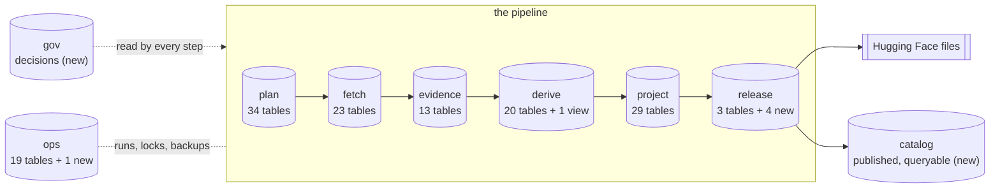
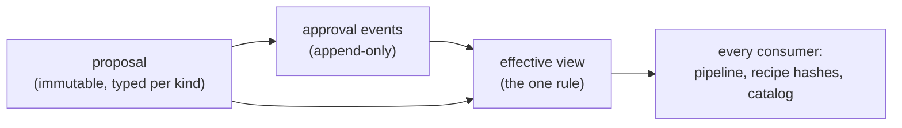

# 2. The target schema

Read [1. Requirements](1-requirements.md) first; next is
[3. Database code](3-database.md). This page says exactly which tables
Postgres holds at the end and where each one comes from. How the code uses
them is on page 3; storage and backups are on [4. Hosting](4-hosting.md).

## In one picture

Postgres groups tables into **namespaces** (Postgres calls them "schemas";
this plan says namespace so the word does not clash with "schema 37", a
migration number). Data flows left to right; every step reads the
decisions in `gov`.

| Namespace  | Holds                                                                   | Written by                            | Today's size  |
| ---------- | ----------------------------------------------------------------------- | ------------------------------------- | ------------- |
| `fetch`    | hosts, budgets, watches, snapshots, issued requests                     | acquire, plan                         | small         |
| `plan`     | per-event bookkeeping: enumerations, gaps, progress, timing, retirement | plan (some by derive)                 | small         |
| `evidence` | parse units and generations, admission, observations, findings          | derive                                | about 3.8 GB  |
| `derive`   | derivation scopes, generations, payloads, dependency sets, work queue   | derive                                | about 20.5 GB |
| `project`  | the projection tables, source events, identity                          | derive                                | about 3 GB    |
| `release`  | partitions, manifests, artifacts; candidates and publications (new)     | release                               | small         |
| `ops`      | runs, loop state, controls, stored-object index, backups, alerts        | every loop                            | small         |
| `gov`      | proposals, approval events, effective views; holds, requeues (new)      | people and agents, via `swingset gov` | new, small    |
| `catalog`  | every published release, row versions, id redirects (new)               | release, after publishing             | new           |

Sizes are from the phase 4 rehearsal copy
(`journal/evidence/runtime/architecture-phase4-rehearsal-2026-10/receipt.json`).
The whole database is about 41 GB; one table, `derivation_dependency_sets`,
is about 16 GB of it.

## The rules for the move

1. **Every table moves as it is,** with the same columns and the same kinds
   of values (text, whole numbers, decimals). Only its namespace is new.
   Better types, splits and renames come later, one at a time, with tests.
2. **`rowid` and `AUTOINCREMENT` become identity columns,** filled from the
   old numbers at import. Code that reads a new row's number uses
   `RETURNING`.
3. **The 809 triggers are recreated** in Postgres's trigger language with
   the same effect ([3. Database code](3-database.md#triggers)).
4. **New tables come after the switch:** `gov`, `catalog`, and the new
   `release` and `ops` tables that replace marker files are each their own
   change ([9. After the switch](9-after-switch.md)).

## Today's 141 tables, by namespace

Counts come from an empty schema-37 database built with the real migration
runner. "Decision" marks a table that holds a person's or agent's decision
and moves into `gov` after the switch.

### `fetch` (23 tables)

| Table                                                                                      | Holds                                                    |
| ------------------------------------------------------------------------------------------ | -------------------------------------------------------- |
| `hosts`, `host_budget`, `host_request_spacing`, `host_request_spacing_baselines`           | per-host gap, pause, robots state, daily budget, spacing |
| `watches`                                                                                  | every watched URL: schedule, cache headers, state        |
| `snapshots`                                                                                | one fetch: request, response, body hash, parse status    |
| `archive_queries`, `archive_captures`                                                      | Wayback queries and captures                             |
| `cursors`                                                                                  | named fetch cursors (registry sweep, enumerations)       |
| `acquisition_plan`                                                                         | the plan loop's ranked pages to fetch                    |
| `scheduler_requests`                                                                       | each issued request: host, day, category                 |
| `scheduler_watch_state`, `scheduler_parent_links`                                          | per-watch attempt counts, parent-to-child links          |
| `scheduler_event_policies`, `scheduler_event_requests`, `scheduler_event_turns`            | event turns per host                                     |
| `scheduler_capacity_policies`, `scheduler_capacity_requests`, `scheduler_capacity_service` | capacity shares per host                                 |
| `history_origin_intents`, `history_origin_requests`                                        | backfill pages to fetch from the origin, and requests    |
| `history_origin_operator_refs`                                                             | operator-supplied evidence for an event (decision)       |
| `history_dispatch_fence`                                                                   | a counter that triggers on 62 tables bump                |

### `plan` (34 tables)

Per-event bookkeeping the plan loop keeps. Three of these families are
switched off in `config/sources.toml` but their rows and some triggers
remain.

| Family                  | Tables                                                                                                                                                                          |
| ----------------------- | ------------------------------------------------------------------------------------------------------------------------------------------------------------------------------- |
| enumerations            | `source_event_enumerations`, `source_event_enumeration_members`, `source_event_member_watches`, `source_event_inventory`, `event_enumeration_inputs`                            |
| retirement              | `source_event_retirement_proofs`, `source_event_retirement_receipts`, `event_retirement_observations`, `event_retirement_receipts`                                              |
| accounting and gaps     | `event_accounting_receipts`, `event_accounting_support_observations`, `event_gap_observations`, `event_gap_revisions`                                                           |
| pressure (switched off) | `event_pressure_state`, `event_pressure_subjects`, `event_pressure_watches`, `event_pressure_parents`, `event_pressure_hosts`, `event_pressure_latches`, `event_pressure_dirty` |
| progress (switched off) | `event_progress_policies`, `event_progress_observations`, `event_progress_receipts`, `event_progress_scans`, `event_progress_cursor`, `event_stage_operations`                  |
| blockers (switched off) | `event_blocker_policies`, `event_blocker_observations`, `event_blocker_latest`, `event_blocker_refreshes`, `event_blocker_cursor`                                               |
| timing                  | `event_timing`, `event_timing_history`, `event_timing_cursor`                                                                                                                   |

### `evidence` (13 tables)

| Table                                                                                  | Holds                                                          |
| -------------------------------------------------------------------------------------- | -------------------------------------------------------------- |
| `source_units`, `source_generations`, `source_generation_packs`, `source_equivalences` | parse units, each parse result, packed bodies, equal re-parses |
| `admission_decisions`                                                                  | accept or reject a parse result under a policy                 |
| `admission_policies`, `admission_reviews`                                              | contract mode per page kind, reviewed reports (decisions)      |
| `observations`                                                                         | parsed facts from a snapshot                                   |
| `findings`, `finding_support`, `finding_support_references`                            | review-queue and data-quality findings, what reopens them      |
| `requirement_scan`                                                                     | the data-quality scan cursor                                   |
| `registry_verifications`                                                               | checks of WSDC registry claims                                 |

### `derive` (20 tables and 1 view)

| Table                                                                      | Holds                                                                   |
| -------------------------------------------------------------------------- | ----------------------------------------------------------------------- |
| `derivation_scopes`, `derivation_generations`, `derivation_building`       | each unit's pointer, each output generation, builds                     |
| `derivation_equivalences`, `derivation_recipes`                            | equal re-runs; recipes by hash                                          |
| `derivation_dependency_sets`                                               | what each result depends on (about 16 GB)                               |
| `derivation_payloads`, `derivation_row_refs`, `derivation_rows` (view)     | output rows, stored once by hash                                        |
| `derivation_evicted`, `label_body_packs`                                   | outputs and labels moved into objects                                   |
| `derivation_input_versions`, `derivation_reads`                            | change tokens (bumped by triggers on 17 tables), link reads             |
| `derivation_payload_removal_authority`, `derivation_payload_removal_grant` | the delete gate for payloads                                            |
| `work_queue`, `work_attempts`, `work_generations`, `pending_work`          | the work queue, attempts, retries (requeue author is in `retry_reason`) |
| `accepted_inputs`                                                          | the input digests each consumer accepted                                |
| `scheduler_offline_service`                                                | fairness counters for derive batches                                    |

### `project` (29 tables)

| Table                                                                                                                                                      | Holds                                                           |
| ---------------------------------------------------------------------------------------------------------------------------------------------------------- | --------------------------------------------------------------- |
| `events`, `contests`, `rounds`, `entries`, `heats`, `judges`, `callback_marks`, `callbacks`, `final_marks`, `placements`, `dancers`, `registry_placements` | the twelve projection tables, as published                      |
| `coverage`, `series`                                                                                                                                       | coverage counts (published); series (not published)             |
| `canonical_scope_rows`                                                                                                                                     | which rows each unit owns                                       |
| `source_events`, `source_event_map`, `source_event_scope_rows`, `source_event_proposals`                                                                   | events as each source lists them, and their mapping             |
| `link_candidates`, `identity_links`, `identity_link_history`, `identity_link_resolutions`                                                                  | WSDC-id candidates and chosen links (published)                 |
| `identity_source_refs`, `identity_reference_bindings`                                                                                                      | stable references to source participants                        |
| `identity_reference_migrations`, `identity_decisions`, `identity_journal_acceptances`, `history_acceptance`                                                | decisions: reference moves, identity overrides, year acceptance |

### `release` (3 tables)

| Table                | Holds                                           |
| -------------------- | ----------------------------------------------- |
| `release_partitions` | latest state per partition: built or withheld   |
| `release_manifests`  | manifests by digest, with candidate and verdict |
| `release_artifacts`  | partition files by digest                       |

### `ops` (19 tables)

| Table                                                                                          | Holds                                                                      |
| ---------------------------------------------------------------------------------------------- | -------------------------------------------------------------------------- |
| `runs`, `loop_state`, `guard_reasons`                                                          | one row per run, each loop's last tick, active guards                      |
| `meta`, `revisions`                                                                            | mixed key/value pairs; named change counters                               |
| `control_state`, `control_events`, `operator_pauses`                                           | pause and resume, with actor (decisions)                                   |
| `execution_admissions`, `execution_dependencies`                                               | in-flight publications and fetches                                         |
| `objects`, `blob_classes`                                                                      | the stored-object index and its classes                                    |
| `storage_applies`, `storage_eviction_authority`, `storage_eviction_grant`, `retention_applies` | notes and delete gates for storage and `gc`                                |
| `backup_sets`, `backup_objects`, `backup_uploads`                                              | backup sets and the keys each transport holds (`backup_uploads` is unused) |

## New tables

### `gov`: decisions as rows

Nothing in `gov` is ever edited. A decision has three parts, each with one
owner:

1. **A proposal** is an immutable row in a table typed for its kind, such
   as `gov.series_alias_proposals`. It holds the decision's own columns,
   plus: `proposal_id`; `action` (set or retire; identity decisions never
   retire); `supersedes` (the proposal it replaces, if any); the requested
   `effective_from`; `proposed_by` and `proposed_at`; `evidence` (a
   decision record, review or receipt); `note` (never published); the
   database role that wrote it (set by a trigger); and `created_by`
   (`import` or `gov`). A proposal carries no approval fields.
2. **An approval event** is an append-only row in one table,
   `gov.approval_events`: `event_id`, `proposal_id`, `kind` (approve,
   reject or withdraw), `actor`, the actor's database role, `at`,
   `self_approval` (true or false) and `evidence`.
3. **The effective view** for each kind, such as `gov.series_aliases`, is
   the only thing any consumer reads. One rule, written once, decides it:
   - a proposal is **approved** when it has an approve event from a role
     other than its proposer's (or the owner's own approval, flagged,
     except for suppressions and any loosening of a scraping or safety rule), and no later
     reject or withdraw event;
   - it is **active** from the later of its approval and its
     `effective_from`;
   - an active proposal that `supersedes` another ends the other's
     activity at that moment; a retire proposal removes its key;
   - the view lists, per key, the one active proposal.

   A trigger refuses an approval whose superseded proposal is no longer
   the active one, so two proposals can never both replace the same row.
   Recipe hashes and the catalog read the view, never the proposal tables.

| Effective view (proposals table behind it) | Replaces                                                                                | Key columns (other columns)                                                                                                                                             |
| ------------------------------------------ | --------------------------------------------------------------------------------------- | ----------------------------------------------------------------------------------------------------------------------------------------------------------------------- |
| `gov.series_aliases`                       | `overrides/series_aliases.csv` (644 rows)                                               | printed_name, from_month (series_id, source, to_month)                                                                                                                  |
| `gov.event_aliases`                        | `overrides/event_aliases.csv` (2)                                                       | source, source_ref (event_id)                                                                                                                                           |
| `gov.nicknames`                            | `overrides/nicknames.csv` (119)                                                         | nickname (canonical)                                                                                                                                                    |
| `gov.source_urls`                          | `overrides/source_urls.csv` (56)                                                        | source, url (event_id, kind, parser)                                                                                                                                    |
| `gov.suppressions`                         | `overrides/suppressions.csv` (0)                                                        | wsdc_id or name_norm (reason, date); never published                                                                                                                    |
| `gov.finding_reviews`                      | `overrides/finding_reviews.csv` (86)                                                    | kind, subject_id (decision, reviewer)                                                                                                                                   |
| `gov.release_decreases`                    | `overrides/release_decreases.csv` (1)                                                   | measure, baseline_value, candidate_value (reason)                                                                                                                       |
| `gov.identity_overrides`                   | `overrides/identity_overrides.csv` (0)                                                  | decision_id (source, event, contest, round, participant, wsdc_id, decision); never retired                                                                              |
| `gov.sources`                              | `[sources.*]` and `history_start` in `sources.toml`                                     | source (enabled, index URLs)                                                                                                                                            |
| `gov.host_policy`                          | `[hosts.*]` in `hosts.toml`                                                             | host (min gap, daily request, sweep and byte budgets, index, live, cooling and round intervals, challenge pause)                                                        |
| `gov.fetch_rules`                          | `REQUEST_FLOOR_SECONDS` in `config.py`, `USER_AGENT` in `fetch/client.py`               | one row: request floor, requests in flight per host, robots.txt and `Crawl-delay` obeyed, conditional requests, User-Agent                                              |
| `gov.settings`                             | `[scheduling]`, `[retention]` and `[stages]` policy in `sources.toml`; the Nix `dryRun` | key (value): publishing on or off, build cadence, release lag, the database size cap, checkpoint keeping, switched-off stage families, hold review period and alert age |

**Operator actions** take effect at once and need no approval, so they are
append-only event tables with their own views, not proposals:

| Table                                | Replaces                                          | Columns                                                                                               |
| ------------------------------------ | ------------------------------------------------- | ----------------------------------------------------------------------------------------------------- |
| `gov.hold_events` (view `gov.holds`) | the `operator-hold` file, `holds/hold_*.json`     | hold_id, event (place or release), kind, who, why, review_by, at; items name generations or artifacts |
| `gov.requeues`                       | the author inside `work_generations.retry_reason` | requeue_id, requested_by, selector, reason, units affected, at                                        |

- **Hashes:** each kind's input hash covers only the view's columns that
  change results (never author, note or evidence), in a fixed column
  order. Moving from files to tables changes those hashes once; the
  old-to-new map is a **re-key**, so nothing re-runs.
- **History is imported honestly** from the 84 captured input bundles: each
  row a bundle introduced becomes a proposal plus an approve event by
  `import`, both at the bundle's acceptance time; a row a later bundle
  changed or dropped becomes a superseding or retire proposal. Git commits
  are evidence only: every override commit shows the owner as author, even
  when an agent wrote the change.
- **One source of truth for identity:** `gov.identity_overrides` replaces
  the CSV; `project.identity_decisions` stays its accepted mirror, as today.
- **Later moves into `gov`,** each with a planned hash migration:
  `admission_policies` and `admission_reviews`, `operator_pauses` and
  `control_events`, `history_acceptance`.
- **Resource tuning stays in files:** memory limits and batch and pack
  sizes, which change no output and no politeness.

### Scraping and safety rules as rows

Every rule that limits how Swingset treats other sites, or how carefully
it changes and publishes data, is a row in `gov.sources`,
`gov.host_policy`, `gov.fetch_rules` or `gov.settings`, read through its
effective view like any other decision. Today's values are the first rows.

- **Changed without a deploy.** The loops read the effective view at the
  start of each tick, and each run's summary records the version of the
  rules it used, so every receipt can name them.
- **Loosening needs a second approver.** A change that makes Swingset less
  careful (a shorter gap, a bigger budget, more requests in flight,
  ignoring `Crawl-delay`, publishing on, a bigger size cap, a longer hold
  review period) needs an approval from a role other than the proposer's,
  with a decision record as evidence; the owner's self-approval flag does
  not count. Tightening can be self-approved.
- **Policy inputs keep their hashes.** `history_start` and the inventory
  year are recipe inputs today; moving them into `gov` changes their hash
  once, and that change is a re-key, so nothing re-runs.
- **The repo rules still apply.** `docs/reference/fetching.md` and AGENTS.md
  name the starting values and the approval rule; the rows hold the live
  values.

### `release` and `ops`: marker files become rows

| Today                                             | Becomes                                                |
| ------------------------------------------------- | ------------------------------------------------------ |
| `candidates/<id>/BUILT`, `PUBLISHING`, `REJECTED` | `release.candidates`, with a state column              |
| `candidates/<id>/_meta/verdict.json`              | `release.verdicts`                                     |
| `candidates/<id>/PUBLISHED`                       | `release.publications`                                 |
| the `baseline` symlink                            | one `release.baseline` row                             |
| `ALERTS.log`                                      | `ops.alerts` (alerts are sent before they are written) |
| page bodies, extracts, input bundles, candidates  | rows in `ops.objects` (today they have none)           |

Not rows: the out-of-band hold flag and `RESTORE_PENDING` stay outside
Postgres, so they work while it is down. Lock files become advisory locks.

### `catalog`: published releases, queryable

The release builder stays the only writer of Hugging Face files. After
each publication, the catalog loads the published parquet files and checks
their hashes.

| Table                      | Holds                                                                                                            |
| -------------------------- | ---------------------------------------------------------------------------------------------------------------- |
| `catalog.releases`         | each release: publication number (only goes up, even for a revert), commit, candidate, manifest, code hash, time |
| `catalog.release_files`    | each published file: path, sha256, bytes, rows                                                                   |
| `catalog.<table>_versions` | one per published table: its columns, plus a version id and the first and last publication it was true for       |
| `catalog.id_redirects`     | old id to new id, for events, contests, rounds, entries and judges; one-to-many allowed; chains collapsed        |
| views                      | current rows, filtered on `gov.suppressions`                                                                     |

- **Suppression wins.** A new suppression removes the person from every
  version and redirect, the one written exception to "rows are never
  edited". A test checks that no suppressed id appears anywhere.
- **Version layout waits for a measurement** of how many rows
  change between releases before the `_versions` layout is fixed; columns
  like `run_id` change every time.
- **Search:** indexes on public keys, WSDC ids, dates and series, and trigram
  indexes on names.

### What the dataset may publish about decisions

Only an allowlist: series and event aliases, source URLs, nicknames and
approved release decreases, without author, note or evidence columns.
Suppressions and identity decisions are never published.

## Known misfits, left for later

These keep their place during the move (rule 1) and are cleaned up after
the switch, one at a time:

- `meta` mixes migration, fetch, derive and identity keys, and the
  publication fence covers it.
- `history_dispatch_fence`, `derivation_input_versions` and `revisions` are
  bumped by triggers across namespaces; role grants must allow it.
- `release_manifests` already holds a candidate and a verdict, which
  overlap the new `release` tables.
- `coverage`, `identity_links` and `link_candidates` are published but are
  not in `model/schema.py`'s list of twelve; `series` is stored but not
  published.
- `backup_uploads` is unused; the two `*_grant` tables are empty by design;
  `pending_work` runs beside `work_queue`.
