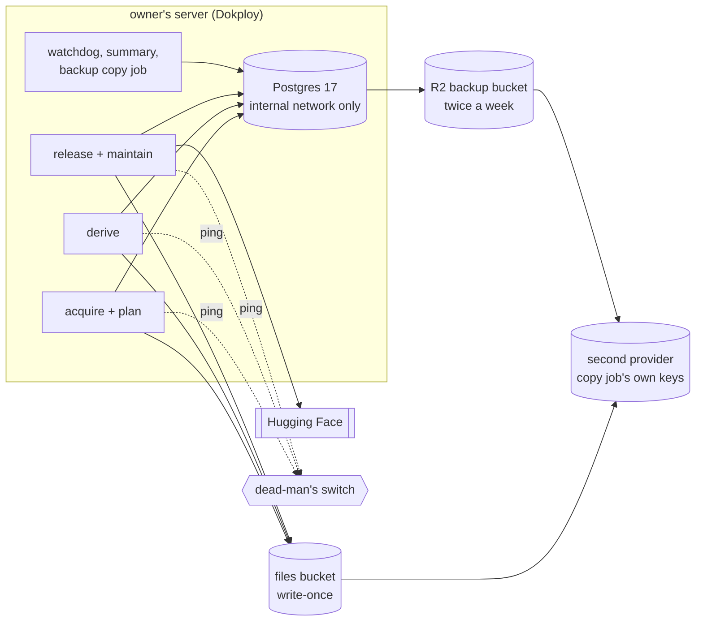

# 4. Where it runs: storage, backups and Dokploy

Read [3. Database code](3-database.md) first; next is [5. Stage 0](5-stage-0.md). This page describes the end state
on the owner's server: which files go to object storage, how backups and
restores work, and how the services run on Dokploy.

**The server is Rhuidean,** and its infrastructure is managed from the
[`skeswa/rhuidean`](https://github.com/skeswa/rhuidean) repo: Dokploy on one
AMD64 host with 24 cores, 62 GiB of memory and a 916 GB disk; a shared
Postgres 17, Redis and RustFS object store in an Infra project; one Dokploy
project per app; database dumps daily to an R2 bucket (Swingset opts out
of that schedule; see [Backups and recovery](#backups-and-recovery)). Swingset joins as
an app with that repo's tooling (`mise run app:new`, the database
onboarding script, `mise run infra:backups`). Anything that changes the
shared infrastructure is a decision in that repo, not this one. This
repo keeps Swingset's image, compose file and runbooks.

**What exists at the switch, and what comes after.** At the switch, files
stay on a volume on the server; the irreplaceable tables and the files are
backed up to Rhuidean's R2 backup bucket twice a week. Moving files into object storage and the second provider
come after the switch ([9. After the switch](9-after-switch.md)).

| Part                                    | At the switch | After the switch  |
| --------------------------------------- | ------------- | ----------------- |
| Postgres 17; backups twice a week to R2 | yes           |                   |
| files on the server's volume            | yes           | moved to a bucket |
| a second provider for backups and files |               | yes               |
| services, alerts, dead-man's switch     | yes           |                   |

## Files in object storage

| Today                                        | In the bucket              |
| -------------------------------------------- | -------------------------- |
| `blobs/` raw page bodies                     | `bodies/<sha256>`          |
| `extracts/`                                  | `extracts/<sha256>`        |
| `objects/<class>/` packed bodies and outputs | `objects/<class>/<sha256>` |
| `partitions/` parquet cache                  | `partitions/<digest>/`     |
| `candidates/` release builds                 | `candidates/<id>/`         |
| `inputs/` captured input bundles             | `inputs/<digest>/`         |
| backups                                      | a separate bucket          |

- **Write once.** Uploads ask the service to refuse an existing name
  (`If-None-Match: *`). Whether each provider supports this is **not yet
  verified**.
- **The row comes after the upload.** Postgres records an object only once
  the upload is confirmed. Local files stay until the bucket copy is
  checked.
- **A local cache** with a size limit keeps parsing fast. The bucket is the
  truth; every read checks the sha256.
- **Every top-level state file gets a rule:** bucket, database row, keep
  local, or discard. An unknown name fails the move. Today's names are in
  `backup/checkpoint.py`, `backup/restore_set.py` and `state/rwlock.py`.
- **A second copy** lives with a second provider, made by a separate job
  with its own keys. The worker cannot delete it. Object versions alone do
  not protect data: a key that can delete versions can remove them.
  Cloudflare R2 has no versioning or bucket replication (checked
  2026-10-19).
- **Deleting objects:** never delete an object any restorable database
  state still names, meaning any kept backup. Never delete the last verified backup or one in
  progress.

## Which Postgres

Decided by the owner on 2026-10-19: Rhuidean's shared Postgres 17, with a
`swingset` database and its roles, following Rhuidean's model (Rhuidean
D-0004). A dedicated Swingset Postgres and continuous change-log archiving
were considered and not chosen.

- **Settings for the whole server are Rhuidean's** (`shared_buffers`,
  `max_connections`, logging, full-page writes). Swingset sets only what
  can be set per database or per role: time zone, statement and lock
  timeouts, `work_mem`, and its own connection limit. The database is
  created in the C locale.
- **Roles:** Rhuidean gives each app one role that owns its database.
  Swingset's design needs a few more: worker, control, one per decider,
  and later a reader ([3. Database code](3-database.md#roles)). Adding them
  is a change to Rhuidean's onboarding, recorded there.
- **Heavy work stays off the shared server.** Verify runs and the dry run's
  re-derivation use a scratch Postgres 17 container, loaded from a dump
  taken for that run and not kept, so their writes and change log never
  touch other apps.

## Backups and recovery

Decided by the owner on 2026-10-19: back up only what cannot be rebuilt,
twice a week. Most of the 41 GB is caches that re-derivation rebuilds from
the evidence, and every published release already lives on Hugging Face.

| Data                                                                                                                                   | Size (estimate) | Backed up?   | If lost                    |
| -------------------------------------------------------------------------------------------------------------------------------------- | --------------- | ------------ | -------------------------- |
| **irreplaceable tables:** what was fetched and when, fetch state and budgets, every decision, identity journals and link history, runs | 1 to 3 GB       | twice a week | lost since the last backup |
| **files:** raw page bodies, packed objects, input bundles                                                                              | about 2 GB      | twice a week | lost since the last backup |
| **rebuildable tables:** derivations, dependency sets, parse results, projections, the work queue                                       | about 37 GB     | no           | rebuilt by re-derivation   |
| **published releases**                                                                                                                 | on Hugging Face | already      | the catalog reloads them   |

- **Every table carries a label,** irreplaceable or rebuildable, in one list
  in the code. A test fails on any table without one, so a new table
  cannot silently miss the backup. Stage 1 writes the labels and measures
  the backup's real size ([6. Stage 1](6-stage-1.md)).
- **The backup job** is Swingset's own, twice a week: `pg_dump` of the
  irreplaceable tables, and a mirror of the content-addressed files (only
  new files upload), both to Rhuidean's R2 backup bucket under a
  `swingset/` prefix, with a key that reaches only that prefix (a change in
  Rhuidean). No full dump is taken, and Dokploy's daily schedule does not
  cover the `swingset` database.
- **What a failure costs:** up to about 3½ days of fetches and decisions,
  and about a day to rebuild (estimate: import plus a full re-derivation of
  10 to 14 hours on today's VM; the dry run measures it on the server).
  Published data stays available on Hugging Face throughout.
- **Server settings** are Rhuidean's (see above); fsync, full-page writes,
  synchronous commit and autovacuum stay on. Only verify scratch
  containers turn them off.
- **Rebuild, in this order:**
  1. Start a fresh, empty database with the out-of-band hold and the
     restore-pending marker set; create schema 37's tables from the
     migrations.
  2. Check the backup's bytes, then restore the irreplaceable tables and the
     files. Sequences may come back higher than the largest id; never lower
     them.
  3. Compare with the actual Hugging Face head. Local pointers may be
     repaired; the Hub is never written. An unexpected head blocks.
  4. Re-derive everything with publishing off; then a verify run.
  5. Clear the marker, then clear the out-of-band hold last. Never touch
     the operator hold.

  A failed rebuild starts again in a fresh database.

- **Check every backup:** restore it into a scratch database; run schema,
  integrity and foreign-key checks; match each irreplaceable table's row
  count; check every file with its hash. A full rebuild drill, the slow
  part, runs once after the switch and again whenever the labels change.
- **The Mac copy and its 45 GB of checkpoints** stay as the fallback until
  the first full rebuild drill on the server passes, then retire with an
  independent check.

## Services on Dokploy

| Service              | Runs                                                                             | Stop grace |
| -------------------- | -------------------------------------------------------------------------------- | ---------- |
| acquire and plan     | the two loops that fetch and plan                                                | 45 s       |
| derive               | the derive loop                                                                  | 120 s      |
| release and maintain | builds, publishes, collects                                                      | 45 s       |
| jobs                 | backup copy, watchdog (every 30 minutes), daily summary (08:00), scratch cleanup | 45 s       |
| Postgres             | Rhuidean's Infra server, or a dedicated one (see above)                          | —          |

- **Separate services,** each with its own memory limit, so one
  out-of-memory kill does not stop every loop. Today's per-loop limits add
  up to about 17 GB; a backup used 8.5 GB counting cached pages.
- **Each service runs a small scheduler.** It keeps today's calendars and
  budgets, stops a tick that runs over (asks first, then forces it), and
  runs a missed tick once. A tick skipped by a hold is used up, not queued,
  so no burst follows a hold. A clock jump backwards never reruns a tick.
  Dokploy's own cron is not used: it has no overlap lock or timeout, and
  v0.30.8 had open bugs where jobs never ran.
- **One replica each, stop before start.** On stop, SIGTERM lets the bounded
  write finish or roll back; then the grace period above, then a kill.
  Docker's 10-second default is too short.
- **The watchdog is ported,** not dropped: today it reads SQLite directly
  and reads systemd unit states, so it moves to Postgres and container
  states.
- **An out-of-band hold:** a flag in each service's environment (or a file
  on its volume) checked before the scheduler connects to Postgres.
  Restores and imports always start with it set. `gov.holds` is the normal
  hold.

### Network and volumes

- Swingset never uses Dokploy's own internal database. Postgres joins only
  an internal network, as Rhuidean's databases do (no published ports); workers join it plus one for outbound
  traffic. No host port, no web route. The owner reaches it through an SSH
  tunnel to a port bound to localhost only.
- **Named external volumes,** so a redeploy cannot recreate them. Never run
  `compose down -v`, a global prune, or a fresh-volume deploy. Delete only
  by an exact owned label or id, after the receipts exist.
- **Passwords use SCRAM,** never `trust`. The Hugging Face token is limited
  to the one dataset. Dokploy's own login uses two-factor login and an
  address allowlist, and Dokploy is kept updated, because it holds every
  secret. The health endpoint has no public domain.
- **Connections:** each service holds a few at most, well under the limit,
  with no pooler.
- **Time:** all code uses Python's clock or `clock_timestamp()`, never
  `now()`, and every container runs in UTC.

### Deploys and disk

- **A deploy** is a new image under a hold, then migrations, then the hold
  lifts. Migrations add before they remove, so the previous image still
  runs if the deploy is rolled back.
- **The disk budget** on the shared disk covers Postgres and its change
  log, the local cache, build spill, the drill's scratch database (about
  62 GB today), verify scratch databases, and the other services already
  there. The dry run writes it down.

### Images

- **Dependencies are installed when the image is built.** Today every unit
  runs `uv sync` at start; on the server, the outbound allowlist would make
  that fail.
- **The dependency image** (the image without Swingset's own code) has its
  own digest, which is the runtime identity the verify run records
  ([5. Stage 0](5-stage-0.md#design)).
- **The running image is the proved image.** After each deploy, compare the
  running container's digest with the verify receipt's. Pin the Postgres
  base image by digest; no floating tags.
- **Hardening, as today's units:** non-root, umask 0077, read-only root
  filesystem, no new privileges, dropped capabilities, no Docker socket,
  secrets mounted read-only. Temporary and spill files go on a disk-backed
  volume, not memory.

### Health and alerts

- **Probes never change state.** None runs a loop, a dry run, a restore or a
  publish; none fetches or accepts inputs. Liveness is a cheap heartbeat;
  readiness checks the database, the schema version and restore state.
  Held is normal, not an alarm.
- **Alerts leave the server.** An outside dead-man's switch is pinged every
  tick. Alerts are sent before they are written to Postgres.
- **New alerts for Postgres:** unreachable or schema mismatch (a mismatch
  at once, and a hold never silences it), connections near the limit, the
  oldest open or idle transaction, blocked sessions, temp-file
  growth, a failed or late backup, container restarts, Postgres memory. A worker
  cannot read another container's memory, so an outside checker does this,
  not the Docker socket.
- **Logs:** json-file, 10 MB, 5 files per container. Replacing a container
  can lose its logs, so durable records stay in Postgres and the evidence
  folder.

### Dokploy facts to check, not assume

Rhuidean's platform reference already records: built-in server
monitoring is on; native databases have no published ports; scheduled
dumps of native databases to R2 work. Each of these is recorded in the dry
run as verified or unavailable:

- threshold alerts, and notifications for failed jobs or memory kills;
- how long the twice-weekly backup takes, and its size;
- whether its login has two-factor login, an address allowlist and current
  updates.

Rhuidean drives Dokploy through its CLI and `curl` (Rhuidean D-0009,
D-0020). Its rules carry over: never send `freshVolumes`; a queued
deploy has not succeeded; a call that timed out was not cancelled, so read
the state before retrying; pick resources by exact id, never "first match".
