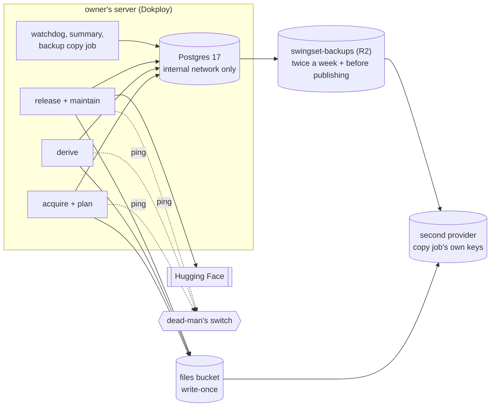

# 4. Where it runs: storage, backups and Dokploy

Read [3. Database code](3-database.md) first; next is [5. Stage 0](5-stage-0.md). This page describes the end state
on the owner's server: which files go to object storage, how backups and
restores work, and how the services run on Dokploy.

**The server is Rhuidean,** and its infrastructure is managed from the
[`skeswa/rhuidean`](https://github.com/skeswa/rhuidean) repo: Dokploy on one
AMD64 host with 24 cores, 62 GiB of memory and a 916 GB disk; a shared
Postgres 17, Redis and RustFS object store in an Infra project; one Dokploy
project per app; database dumps daily to an R2 bucket (Swingset opts out
of that schedule; see [Backups and recovery](#backups-and-recovery)). Swingset joins as
an app with that repo's tooling (`mise run app:new` and the database
onboarding script). Prerequisites in Rhuidean come first, each recorded
there: Swingset's extra roles, a persistent backup exclusion that
`mise run infra:backups` honours on every run, and two R2 buckets of
Swingset's own with bucket-scoped tokens, enforced worker egress rules,
and a loopback-only database relay for the owner's SSH tunnel
([7. Stage 2](7-stage-2.md#before-it-starts)). Anything that
changes the shared infrastructure is a decision in that repo, not this one. This
repo keeps Swingset's image, compose file and runbooks.

**What exists at the switch, and what comes after.** At the switch, files
stay on a volume on the server; the history rows and the backed-up files are
backed up to Swingset's own R2 bucket, `swingset-backups`, twice a week and before every publication. Moving files into object storage and the second provider
come after the switch ([9. After the switch](9-after-switch.md)).

| Part                                    | At the switch | After the switch  |
| --------------------------------------- | ------------- | ----------------- |
| Postgres 17; backups twice a week to R2 | yes           |                   |
| files on the server's volume            | yes           | moved to a bucket |
| a second provider for backups and files |               | yes               |
| services, alerts, dead-man's switch     | yes           |                   |



## Files in object storage

| Today                                        | In the bucket              |
| -------------------------------------------- | -------------------------- |
| `blobs/` raw page bodies                     | `bodies/<sha256>`          |
| `extracts/`                                  | `extracts/<sha256>`        |
| `objects/<class>/` packed bodies and outputs | `objects/<class>/<sha256>` |
| `partitions/` parquet cache                  | `partitions/<digest>/`     |
| `candidates/` release builds                 | `candidates/<id>/`         |
| `inputs/` captured input bundles             | `inputs/<digest>/`         |
| backups                                      | a separate bucket          |

- **Write once.** Uploads ask the service to refuse an existing name
  (`If-None-Match: *`). Whether each provider supports this is **not yet
  verified**.
- **The row comes after the upload.** Postgres records an object only once
  the upload is confirmed. Local files stay until the bucket copy is
  checked.
- **A local cache** with a size limit keeps parsing fast. The bucket is the
  truth; every read checks the sha256.
- **Every top-level state file gets a rule:** bucket, database row, keep
  local, or discard. An unknown name fails the move. Today's names are in
  `backup/checkpoint.py`, `backup/restore_set.py` and `state/rwlock.py`.
- **A second copy** lives with a second provider, made by a separate job
  with its own keys. The worker cannot delete it. Object versions alone do
  not protect data: a key that can delete versions can remove them.
  Cloudflare R2 has no versioning or bucket replication (checked
  2026-10-19).
- **Deleting objects:** never delete an object any restorable database
  state still names, meaning any kept backup. Never delete the last verified backup or one in
  progress.

## Which Postgres

Decided by the owner on 2026-10-19: Rhuidean's shared Postgres 17, with a
`swingset` database and its roles, following Rhuidean's model (Rhuidean
D-0004). A dedicated Swingset Postgres and continuous change-log archiving
were considered and not chosen.

- **Settings for the whole server are Rhuidean's** (`shared_buffers`,
  `max_connections`, logging, full-page writes). Swingset sets only what
  can be set per database or per role: time zone, statement and lock
  timeouts, `work_mem`, and its own connection limit. The database is
  created in the C locale.
- **Roles:** Rhuidean gives each app one role that owns its database.
  Swingset's design needs a few more: worker, control, one per decider,
  and later a reader ([3. Database code](3-database.md#roles)). Adding them
  is a change to Rhuidean's onboarding, recorded there.
- **Heavy work stays off the shared server.** Verify runs and every
  rebuild's re-derivation use a scratch Postgres 17 container, loaded from
  a dump taken for that run and not kept, so their writes and change log
  never touch other apps' databases.
- **Scratch matches the shared server** in image digest and settings,
  except the durability settings it turns off, and gets CPU and memory
  limits, because it still shares the host's CPU, memory and disk.
- **Everything else runs on the shared server, in the dry run too:** the
  import and its audit, the re-key, the backup job, the services with
  their real roles, network and holds, and the deploy lifecycle
  ([7. Stage 2](7-stage-2.md)). A Postgres restart is tested on scratch,
  since restarting the shared server stops other apps.

## Backups and recovery

Decided by the owner on 2026-10-19: back up only what cannot be rebuilt,
twice a week. Most of the 41 GB is caches that re-derivation rebuilds from
the evidence, and every published release already lives on Hugging Face.

Every table, or every set of rows a written rule picks out of a table,
belongs to exactly one of three classes. The class says whether it is
backed up and how a rebuild is checked against the original:

| Class           | What it holds                                                                                                                                                                                                       | Backed up?                                 | After a rebuild                                                                                                               |
| --------------- | ------------------------------------------------------------------------------------------------------------------------------------------------------------------------------------------------------------------- | ------------------------------------------ | ----------------------------------------------------------------------------------------------------------------------------- |
| **history**     | what was fetched and when, fetch state and budgets, every decision, identity journals and link history, runs, publications; any row something kept reads that re-derivation cannot make again (1 to 3 GB, estimate) | twice a week, and before every publication | preserved exactly: every row, every column, ids included                                                                      |
| **rebuilt**     | the current results: parse results, derivations, dependency sets, projections (most of the 37 GB)                                                                                                                   | no                                         | for every current unit, an equivalent output and dependency set, by unit key and content digest; ids and past rows may differ |
| **bookkeeping** | past execution: superseded generations nothing kept names, equivalences, failed attempts, queue counters, work tokens                                                                                               | no                                         | reset by a written rule per table (empty, zero, or recomputed), and checked against that rule                                 |

| Files                                                                                                                                                                                                  | Size (estimate) | Backed up?                                                                                                                                              |
| ------------------------------------------------------------------------------------------------------------------------------------------------------------------------------------------------------ | --------------- | ------------------------------------------------------------------------------------------------------------------------------------------------------- |
| raw page bodies, packed objects, input bundles                                                                                                                                                         | about 2 GB      | twice a week, and before every publication                                                                                                              |
| **publication metadata:** the baseline's name and its `PUBLISHED` receipt; each pending candidate's `BUILT`, `PUBLISHING`, `PUBLISHED` and `_meta/manifest.json`; retained release manifests; `holds/` | small           | twice a week, and before every publication                                                                                                              |
| candidate and partition Parquet                                                                                                                                                                        | several GB      | no: after reconciliation, the resulting baseline downloads from the Hub, checked against its manifest; a pending candidate that never landed is rebuilt |

Published releases already live on Hugging Face, and the catalog reloads
them.

- **The classes live in one list in the code.** A test fails on any table
  without a class, so a new table cannot silently miss the backup. Stage 1
  writes the list and measures the backup's real size
  ([6. Stage 1](6-stage-1.md)).
- **History is decided by what reads it, not by the table's name.** Rows
  of retired kinds are an example: `project/history` and `project/map`
  generations stay because retention and old release closures read them,
  but nothing schedules those kinds again
  (`state/derivation_dependencies.py`), so a rebuild can never make them.
  They are history. A table that mixes history and rebuilt rows is split
  by a written row rule.
- **History is closed under references, transitively.** A row that a
  history row references, by foreign key or by an id stored in a column
  or in JSON, is history too, and so are the rows it references. For
  example `admission_decisions.generation_id` references
  `source_generations` (migration 8), so every `source_generations` row an
  admission decision names is backed up, though a rebuild could re-derive
  its unit. Nothing is remapped: history keeps every column and id, so
  every foreign key holds when the backup is restored and checked, before
  any rebuild. The rebuild then adds its own new rows beside the restored
  ones. A test walks the foreign keys and the listed stored ids out of
  every history rule and fails on a reference that leaves history. The
  closure can make history larger than the 1 to 3 GB estimate; stage 1
  measures it, and a larger size changes the estimate, not the rule.
- **The publication files are named in the backup contract** because,
  until they become rows after the switch, recovery reads them as files
  (`verify_restored_public` in `backup/checkpoint.py`). Every top-level
  state file has a rule ([Files in object storage](#files-in-object-storage)),
  and a test fails on a state file no rule names.

The dry run's drill proves the classes, the reference list and the
publication files on full-size data.

- **The backup job** is Swingset's own, twice a week: the history rows,
  and a mirror of the backed-up files (only new files upload), to
  Swingset's own R2 bucket, `swingset-backups`. No full dump is taken, and
  Dokploy's daily schedule does not cover the `swingset` database.
- **Rows are exported with `COPY`, not `pg_dump`.** `pg_dump` picks whole
  tables and has no row filter, but history includes selected rows of
  mixed tables. So the job opens one `REPEATABLE READ READ ONLY`
  transaction and runs `COPY (SELECT … WHERE <the history rule> ORDER BY
<key>) TO STDOUT` for each history table, all in that one snapshot. If
  it needs several connections, they share the snapshot through
  `pg_export_snapshot()` and `SET TRANSACTION SNAPSHOT`. Each table
  becomes one zstd file, with its row count and its hash in the
  importer's audit encoding; sequence values are recorded too. A
  restore is the stage 1 importer with this reader: tables from the
  migrations, then `COPY` in, then triggers, indexes and foreign keys, a
  validation of every constraint, and the audit hashes compared with the
  backup's ([6. Stage 1](6-stage-1.md#steps), step 4).
- **Buckets and tokens.** R2 tokens can be limited to buckets, not to
  prefixes; only short-lived temporary credentials take prefixes. So
  Swingset gets two buckets of its own, each with long-lived
  bucket-scoped tokens and no temporary credentials:

  | Bucket             | Writer: token, where it lives                                                 | Readers                                                                    |
  | ------------------ | ----------------------------------------------------------------------------- | -------------------------------------------------------------------------- |
  | `swingset-backups` | the backup job and release service: Object Read & Write, in Dokploy's secrets | restores and checks: Object Read only, in Dokploy and the owner's keychain |
  | `swingset-dev`     | the dev export job: Object Read & Write, in Dokploy's secrets                 | the Mac: Object Read only, in its keychain; objects expire after 30 days   |

  Rhuidean creates the buckets and tokens and records them in its
  inventory; the account-level token that creates them stays with the
  owner and never reaches the server. Tokens are rotated yearly and
  whenever a holder may have leaked one: the new token is installed, a
  backup and its check pass with it, then the old one is revoked.
  Treat Object Read & Write as delete-capable until a denial test proves
  otherwise. The independent second copy is deferred, so its protection
  cannot be claimed at the switch. Mac-copy retirement depends on the
  checked protection described below ([9. After the switch](9-after-switch.md)).

- **One database and file snapshot.** The job runs beside the loops under
  a **shared** state lock, never an exclusive one. The port tightens
  today's `backup/segments.py` ordering:
  1. under lock B, reconcile or refuse any interrupted metadata
     transition; then establish the repeatable-read database snapshot with
     its first read, capture its closure roots, and copy mutable
     publication metadata and `holds/` into scratch;
  2. release B, then `COPY` the history rows and enumerate their immutable
     files from that same snapshot;
  3. upload the rows and files, write the manifest last, then record the
     set. A killed run leaves no recorded set and is cleaned up by the next.

  Every reservation, acknowledgement, baseline and hold-file transition
  also takes B, then C for its database writes, and completes its file
  transition before releasing B. No network call or long export holds B.
  If a transition crashes between its database and file writes, the next
  backup reconciles it under B or refuses the set; it never blesses the
  mismatch. Tests race each transition with snapshot capture, and kill
  it between its row and file writes. A file newer than the snapshot must
  not silently add a reference to a row the backup lacks.

  Content-addressed files never change, so copying them after the
  snapshot is safe. Two backups never run at once: each takes a backup
  lock with a try, and a busy one is skipped, not queued.

- **The manifest pins the recovery tools:** schema version and migration
  checksums, the history/reference rules' version, application and
  dependency image digests, Postgres major version, and required config
  and input-bundle digests. Keep those images and config artifacts while
  any retained backup needs them, and check they can be retrieved. Secret
  values stay outside the manifest; the runbook names how the owner
  recovers credentials independently of the lost server. Restore with
  that backup's schema and image, then use a tested forward migration
  before activating newer code. An older-backup/across-migration test is
  part of stage 1; registry cleanup may not remove a kept backup's tools.

- **What a failure costs:** up to about 3½ days of fetches and decisions,
  never a publication's evidence (see below). Recovery takes the dry run's
  measured drill time; the estimate is about a day (a restore plus a full
  re-derivation of 10 to 14 hours on today's VM). Published data stays
  available on Hugging Face throughout.
- **Server settings** are Rhuidean's (see above); fsync, full-page writes,
  synchronous commit and autovacuum stay on. Only verify scratch
  containers turn them off.
- **Rebuild, in this order:**
  1. Start a fresh, empty database and a fresh, empty state volume, with
     the out-of-band hold and the restore-pending marker set; nothing can
     reach the old database or the old volume. Retrieve the pinned
     recovery image and create the backup's schema from its migrations.
     The target's environment identity is new, as specified on
     [page 10](10-local-development.md#dev-and-production-stay-apart).
  2. Check the backup's bytes, then restore the history rows and the
     files, and check every foreign key. Sequences may come back higher
     than the largest id; never lower them.
  3. Compare with the actual Hugging Face head, as in
     [Publishing and backups](#publishing-and-backups), and settle which
     release is the baseline. Local pointers may be repaired; the Hub is
     never written.
  4. Only then download the resulting baseline's Parquet from the Hub, at
     its commit, and check every file its manifest names, with its hash.
     If the pending candidate's push landed, that is the candidate's
     Parquet, not the old baseline's. A baseline with a missing file
     blocks.
  5. Set the bookkeeping tables by their rules. Re-derive everything on a
     scratch database with publishing off; load the result into a fresh
     database on the shared server and audit it; then a verify run. A
     pending candidate whose push did not land is abandoned; the next
     build makes a new one.
  6. If newer code will run, apply and check its forward migrations under
     the hold. Clear the marker, then clear only this recovery's
     out-of-band hold last. Never touch an operator or deployment hold.

  A failed rebuild starts again in a fresh database.

- **Check every backup:** restore it into a scratch database; run schema,
  integrity and foreign-key checks; match each history table's row
  count; check every file with its hash, including the publication
  metadata. This proves the bytes, not that
  the rest can be rebuilt from them.
- **The full rebuild drill** proves that: the dry run runs it before the
  switch, from the backup a publication took, and compares the rebuilt
  release and tables with the import's
  ([7. Stage 2](7-stage-2.md#steps), steps 6 to 9). It runs again whenever
  the classes, the reference list or the backed-up files change.
- **The Mac copy and its 45 GB of checkpoints** stay until gate 3 has
  passed and a current, complete server backup has a checked copy whose
  deletion and overwrite the server's credentials cannot authorize.
  The independent copy job's administrative keys stay off the worker.
  Verify that protection with disposable objects before relying on it.
  Then retire the Mac copies with an independent check. After the first
  server request they are retained evidence, never a worker rollback.

### Publishing and backups

Publishing runs automatically, and the scheduled backups run only twice a
week, so the Hub being ahead of the last backup is an expected disaster
case, not a rare one. Public Parquet cannot replace the private evidence a
release was built from
([backup and restore](../../guides/backup-and-restore.md#backup-restore-and-a-remote-ahead-report)).
So:

- **Every publication takes its own backup first.** The release tick owns
  the whole sequence, in its own process; it never waits on a separate
  job:

  ```mermaid
  sequenceDiagram
    participant R as release tick
    participant PG as Postgres
    participant R2 as swingset-backups (R2)
    participant HF as Hugging Face
    Note over R: holds release loop lock,<br/>state shared, heavy exclusive
    R->>PG: commit reservation and metadata (B then C, short)
    R->>R: take the backup lock (try)
    R->>PG: establish snapshot (lock B)
    R->>R: capture publication files, release B
    R->>PG: COPY history rows in that snapshot
    R->>R2: upload, manifest last, check
    R->>PG: record the backup (lock C, short)
    R->>HF: push
    R->>PG: record publication and metadata (B then C, short)
  ```

  The backup needs only the state lock in shared mode, which the tick
  already holds, so there is no handoff and no deadlock. The snapshot
  starts after the reservation commits, so the backup holds it, the
  candidate's metadata and every history row and file the candidate was
  built from.

  | If                                                 | Then                                                                                             |
  | -------------------------------------------------- | ------------------------------------------------------------------------------------------------ |
  | the backup lock is busy (the scheduled job runs)   | the tick skips its push; the reservation stays, and the next tick tries again                    |
  | the backup or its check fails                      | no push; the reservation stays; an alert                                                         |
  | the tick is stopped or killed during the backup    | no backup is recorded and nothing is pushed; the next tick cleans up and starts the backup again |
  | the process dies after the backup, before the push | recovery finds the Hub at the reservation's expected parent: the push did not land               |
  | the push lands but its acknowledgement is lost     | settled as uncertain, then reconciled from the Hub, as today                                     |

- **At recovery, the Hub head is one of three cases:**

  | The Hub head is                                                                                 | Recovery                                                                                                                                                                           |
  | ----------------------------------------------------------------------------------------------- | ---------------------------------------------------------------------------------------------------------------------------------------------------------------------------------- |
  | the restored baseline, which is also the reservation's expected parent when a push did not land | go on                                                                                                                                                                              |
  | the restored reservation's candidate (manifest hash matches)                                    | record the publication, as today's lost-acknowledgement recovery does, and go on                                                                                                   |
  | anything else                                                                                   | block. The owner records a lost-evidence decision naming the public commits without private evidence; the Hub is never rewritten and evidence is never rebuilt from public Parquet |

  The third case happens only when a publication's own backup is lost
  too, or something other than the release builder wrote to the Hub, so
  it is the only one that needs a decision.

- **The dry run rehearses it:** a backup, a publication to the rehearsal
  dataset with its own backup, lost state, recovery that reconciles the
  publication and builds the next release against it, and a recovery from
  the older backup that must block ([7. Stage 2](7-stage-2.md#steps),
  steps 6 to 9).

## Services on Dokploy

| Service              | Runs                                                                             | Stop grace |
| -------------------- | -------------------------------------------------------------------------------- | ---------- |
| acquire and plan     | the two loops that fetch and plan                                                | 45 s       |
| derive               | the derive loop                                                                  | 120 s      |
| release and maintain | builds, publishes, collects                                                      | 45 s       |
| jobs                 | backup copy, watchdog (every 30 minutes), daily summary (08:00), scratch cleanup | 45 s       |
| Postgres             | Rhuidean's shared Infra server (see above)                                       | —          |

- **Separate services,** each with its own memory limit, so one
  out-of-memory kill does not stop every loop. Today's per-loop limits add
  up to about 17 GB; a backup used 8.5 GB counting cached pages.
- **Each service runs a small scheduler.** It keeps today's calendars and
  budgets, stops a tick that runs over (asks first, then forces it), runs
  a missed tick once, and can run one tick now by hand. A tick skipped by a hold is used up, not queued,
  so no burst follows a hold. A clock jump backwards never reruns a tick.
  Dokploy's own cron is not used: it has no overlap lock or timeout, and
  v0.30.8 had open bugs where jobs never ran.
- **One replica each, stop before start.** On stop, SIGTERM lets the bounded
  write finish or roll back; then the grace period above, then a kill.
  Docker's 10-second default is too short.
- **The watchdog is ported,** not dropped: today it reads SQLite directly
  and reads systemd unit states, so it moves to Postgres and container
  states.
- **An out-of-band hold:** a flag in each service's environment (or a file
  on its volume) checked before the scheduler connects to Postgres.
  Restores and imports always start with it set. At the switch, preserve
  the operator-hold file and database controls; `gov.holds` replaces them
  only in its after-switch step. Multiple holds compose: any active hold
  blocks the affected work, and each operation can release only its own.

- **Deployed as a Dokploy Compose service** (type `docker-compose`), the
  way Rhuidean's `mise run app:new` creates apps, not as a Swarm stack,
  although the host runs in Swarm mode. Compose honours what this page
  needs: `stop_grace_period`, memory limits, `read_only`, dropped
  capabilities, external named volumes, and stop before start. Services
  join `dokploy-network`, declared external, to reach the shared Postgres.

### Network and volumes

- Swingset never uses Dokploy's own internal database. Shared Postgres has
  no published port. `dokploy-network` is a shared overlay, not a security
  boundary or an outbound allowlist. Rhuidean provisions a separate
  database relay bound only to the host's `127.0.0.1`; SSH forwards to
  that recorded port, and Postgres still authenticates each decider with
  SCRAM. Test the Mac tunnel and refusal from a non-loopback address,
  including after container recreation. No public database port or route.
- **Egress is enforced outside the application.** Rhuidean owns a
  destination-allowlist proxy and firewall rules on every worker network
  attachment. Worker traffic may reach only the database, the designated
  DNS resolver and that proxy; deny direct Internet traffic over IPv4 and
  IPv6, including through the shared overlay. The proxy allows the exact
  bucket, Hub upload/download, alert and dead-man endpoints needed for
  the rehearsal. Redirect destinations are checked too. The rule set and
  enforcement points are recorded there before stage 2; joining an
  external Compose network alone does not meet this requirement. Negative
  tests from every actual service container, repeated after recreation,
  must show blocked disallowed DNS names and direct IP routes against
  owned test endpoints, without contacting a collection site.
- **Named external volumes,** so a redeploy cannot recreate them. Never run
  `compose down -v`, a global prune, or a fresh-volume deploy. Delete only
  by an exact owned label or id, after the receipts exist.
- **Passwords use SCRAM,** never `trust`. The Hugging Face token is limited
  to the one dataset. Dokploy's own login uses two-factor login and an
  address allowlist, and Dokploy is kept updated, because it holds every
  secret. The health endpoint has no public domain.
- **Connections:** each service holds a few at most, well under the limit,
  with no pooler.
- **Time:** all code uses Python's clock or `clock_timestamp()`, never
  `now()`, and every container runs in UTC.

### Deploys and disk

- **A deploy** places its own named, persistent out-of-band hold, with an
  owner, reason and review time, visible to every affected service. It
  records existing holds, stops schedulers, drains admitted work, settles
  uncertain publications and confirms old writers are gone before taking
  the state-exclusive lock for migrations. Only then may the new image
  start. Check migration checksums, every running image digest and
  readiness before releasing this deploy's hold. Existing operator and
  restore holds stay set. A failed or uncertain deploy keeps its hold and
  alerts; a retry reads the operation's state first. Rehearse success and
  failure with an operator hold already present.
- **A deploy with a migration is forward only.** An image opens only the
  schema version and migration checksums it was built with
  ([3. Database code](3-database.md#timeouts-and-lost-connections)), so
  after a migration the previous image refuses to open the database, even
  when every change was additive. A deploy without a migration can roll
  back to the previous digest. After a migration, a bad deploy is fixed
  forward: a new image with the code reverted and the schema kept.
  `mise run deploy` refuses a digest whose schema version is older than
  the database's. Migrations still add before they remove, so a fix
  forward is small.
- **The disk budget** on the shared disk covers Postgres and its change
  log, the local cache, build spill, the drill's scratch database (about
  62 GB today), verify scratch databases, and the other services already
  there. The dry run writes it down.

### Images

- **CI builds the image** for `linux/amd64` and pushes it, by digest, to
  a private registry the server pulls from
  ([10. Local development](10-local-development.md#shipping-a-change)).
- **Dependencies are installed when the image is built.** Today every unit
  runs `uv sync` at start; on the server, the outbound allowlist would make
  that fail.
- **The dependency image** (the image without Swingset's own code) has its
  own digest, which is the runtime identity the verify run records
  ([5. Stage 0](5-stage-0.md#design)).
- **The running image is the proved image.** After each deploy, compare the
  running container's digest with the verify receipt's. Pin the Postgres
  base image by digest; no floating tags.
- **Hardening, as today's units:** non-root, umask 0077, read-only root
  filesystem, no new privileges, dropped capabilities, no Docker socket,
  secrets mounted read-only. Temporary and spill files go on a disk-backed
  volume, not memory.

### Health and alerts

- **Probes never change state.** None runs a loop, a dry run, a restore or a
  publish; none fetches or accepts inputs. Liveness is a cheap heartbeat;
  readiness checks the database, the schema version and restore state.
  Held is healthy for these probes. It does not suppress overdue-hold or
  stalled-work alerts.
- **Alerts leave the server.** An outside dead-man's switch is pinged every
  tick. This proves scheduler liveness, not progress. Preserve the
  operation guide's failure, pause, hold-age and 60-minute no-progress
  signals; after a resume check actual requests and pages, not just
  completed ticks. No unattended watch goes two hours without reporting.
  Alerts are sent before they are written to Postgres.
- **New alerts for Postgres:** unreachable or schema mismatch (a mismatch
  at once, and a hold never silences it), connections near the limit, the
  oldest open or idle transaction, blocked sessions, temp-file
  growth, a failed or late backup, container restarts, Postgres memory. A worker
  cannot read another container's memory, so an outside checker does this,
  not the Docker socket.
- **Logs:** json-file, 10 MB, 5 files per container. Replacing a container
  can lose its logs, so durable records stay in Postgres and the evidence
  folder.

### Dokploy facts to check, not assume

Rhuidean's platform reference already records: built-in server
monitoring is on; native databases have no published ports; scheduled
dumps of native databases to R2 work. Each of these is recorded in the dry
run as verified or unavailable:

- threshold alerts, and notifications for failed jobs or memory kills;
- how long the twice-weekly backup takes, and its size;
- that `mise run infra:backups` leaves every `swingset*` database without a
  dump schedule;
- whether its login has two-factor login, an address allowlist and current
  updates.

Rhuidean drives Dokploy through its CLI and `curl` (Rhuidean D-0009,
D-0020). Its rules carry over: never send `freshVolumes`; a queued
deploy has not succeeded; a call that timed out was not cancelled, so read
the state before retrying; pick resources by exact id, never "first match".
