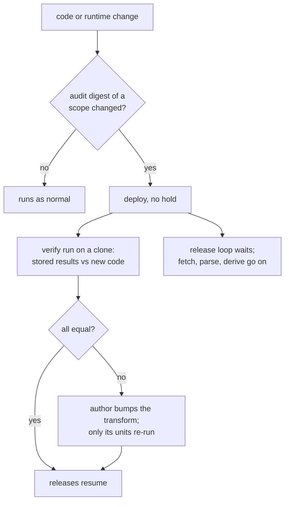

# 5. Stage 0: declared versions and a verify run

Read [4. Hosting](4-hosting.md) first; next is [6. Stage 1](6-stage-1.md).

Today a code or environment change makes every derived result look out of
date, and the worker re-runs tens of thousands of units to find out that
almost all of them produce the same bytes. Stage 0 changes the rule: a
result is out of date only when the **transform** that made it carries a
new **declared version**, or when one of its inputs changed. After a code
change, a **verify run** on a copy of the data checks that the stored
results still match what the new code gives, and releases wait until it
is clean. A difference means the author bumps that transform's version, and
only its units re-run.

Status: design, 2026-10-19; the owner chose this lighter shape ("B") after
a review of the cost of the fuller proof system. Not started. Decision:
[D-0264](../../../journal/decisions/0264-declared-transform-versions-and-differential-proofs-decide-re-derivation.md).
Words in **bold** are in the [glossary](glossary.md).

**Production SQLite never runs this code.** Stage 0 is built on the port's
bookmark with stage 1 and switched on at the switch, on the server. Until
then production's rules stay as they are today.

## Why

- **Most re-runs change nothing.** 99.98% of replaced derivation
  generations and 95.65% of replaced parse generations were byte-identical
  to what they replaced
  ([investigation](../../../journal/investigations/2026/derivation-invalidation-2026-09-23.md)).
- **They happen often.** In the three weeks to 2026-10-19 the project and
  link code scopes changed in 9 of 27 accepted bundle transitions, so about
  36,500 units re-ran nine times, about 7.5 hours each, for changes that
  touched no projector.
- **The scopes cannot get much narrower.** Every project and link scope
  holds 178 files, because the storage, projection and link modules import
  each other (D-0207, D-0261).
- **The move itself** would otherwise re-derive everything at the switch,
  10 to 14 hours without releases. With stage 0 the switch needs one verify
  run and a re-key instead. The dry run still re-derives everything once, on
  the server, on purpose: that re-run is the proof that the port is right
  ([7. Stage 2](7-stage-2.md)).

## Design

### What a unit's recipe key holds

A unit's identity (`desired()` in `state/derivations.py`, `stage()` in
`admission/generations.py`) is a hash over its scope, its **recipe** and its
dependencies. The recipe is a map from accepted input names to digests
(`state/recipes.py`). Stage 0 changes the value of two kinds of recipe
input and nothing else:

| Recipe input                                              | Today                                                             | After stage 0                                                        |
| --------------------------------------------------------- | ----------------------------------------------------------------- | -------------------------------------------------------------------- |
| `recipe/code/<stage>/<kind>`                              | digest of every file in the scope's import closure                | digest of the scope's declared version (below)                       |
| `recipe/env`                                              | digest of the interpreter, its ABI, every wheel's RECORD, project | leaves the recipe; recorded as an audit input instead                |
| `policy/*`, `overrides/*.csv`, `link/weights.toml`        | content digests                                                   | unchanged: a policy or override edit still invalidates its consumers |
| dependencies (snapshots, selected generations, read sets) | as today                                                          | unchanged                                                            |

The input names do not change, so `recipe_names()`, `affected_work()`, the
certificates and the stored recipes keep their shape. Only the accepted
digest for each `recipe/code/*` name changes, once, at the stage 0 deploy.

**A scope's declared version** is the sorted map of `module: VERSION` over
the scope's deep entry modules in `recipe_scope.entries()`, read from the
captured bytes by AST, the way `admission/kinds.py` tables are read today:

| Scope                 | Entry modules and their version constants                                                                                                                                       |
| --------------------- | ------------------------------------------------------------------------------------------------------------------------------------------------------------------------------- |
| `extract/<kind>`      | the adapter's `EXTRACT_VERSION` for that page class                                                                                                                             |
| `parse/<kind>`        | the adapter's `PARSER_VERSION`; the contract module's `VERSIONS[kind]`; a new `PARSE_CORE_VERSION` in `admission/contracts.py` for the shared core, report, staging and writers |
| `project/<unit_kind>` | `PROJECTOR_VERSION` in `project/process.py`; a new `VERSION` in `project/materialization.py`; a new `VERSION` in the kind's projector module                                    |
| `link`                | `LINKER_VERSION` in `link/service.py`; a new `VERSION` in `link/persistence.py`                                                                                                 |
| `build`               | stays bytes-based (below)                                                                                                                                                       |

The version is declared on the transform, not on every file it imports. A
change to a shared module (`state/`, `model/`, `config.py`,
`identity_policy.py`, a migration) changes the audit digest of every scope
that reaches it, so the verify run covers each of them and says which
transforms, if any, need a bump.

**The audit digests** are the digests the recipe holds today: each scope's
closure digest and the exact runtime identity (on the worker, the
interpreter, its ABI and compiler and every wheel's RECORD; on the server,
the digest of the dependency image). They move to a second accepted
consumer (`audit`, beside `pipeline`), so they are stored and compared at
every acceptance but enter no recipe. A change in an audit digest starts a
verify run and holds releases until it is clean. It never makes a result
out of date by itself.

### The verify run

`swingset verify-derivations` exists today as a weekly 1% sample: it runs a
unit's real write on production's database inside a transaction, compares
the output with the stored generation's label, and rolls back
(`state/verify.py`). Stage 0 extends it:

- **Scope:** every current unit of every transform whose audit digest
  changed, or the whole graph. Parse units use the cutoff's own equality
  (result, report, contract version); extracts compare their digest.
- **Dependencies too:** each unit's dependency-set digest is compared with
  the stored one, not only its output. New code that reads one more input
  and gives the same output is a difference.
- **On a copy, in parallel:** units shard across processes, each on its own
  reflink clone of a checkpoint (SQLite) or its own scratch database
  (Postgres), never on the live database.
- **Side effects are not compared.** Findings, watch clocks and admission
  side effects are not replayed when a result is identical (D-0205), so a
  change to effects alone needs the author's bump, as it does today.
- **A receipt** names the audit digests, the checkpoint, units compared,
  equal and differing (listed), time and peak memory.

Measured: the whole graph took about 35 minutes at two processes on the
worker (estimate from measured per-kind times), and all 35,647 parses 72
seconds. A unit whose stored result already differed before the change is
today's `[read-set-miss]` alarm; the fix is a bump.

### Releases wait for a clean verify

After any deploy whose audit digest changed, the release loop builds
nothing until a verify receipt for that exact audit digest shows no
difference, or every differing transform has been bumped. Fetching,
parsing and deriving go on. So stale results and results from new code
never mix in a release. The cost is a release delay of about one verify
run; production is never held.

The CI fixture test runs the same comparison on the fixtures and the
33-page cohort, so most unbumped output changes fail before review.

### Re-keying at the switch

Changing the accepted values of `recipe/code/*` changes every unit's
fingerprint once. The **re-key** (`swingset rekey`) avoids re-running the
graph for that: for every current unit it computes the fingerprint under
the new recipe values, which needs the dependency walk but no transform,
and records an equivalence from the new fingerprint to the unit's pointer
(`derivation_equivalences`, `source_equivalences`, migration 33): about
36,500 derivation rows and 35,600 source rows. Nothing re-runs.

A re-key is honest only if the code gives the stored results. So at the
switch, the server runs a verify of its own code over the imported final
checkpoint first, and re-keys only after it is clean or every differing
transform is bumped. The dry run rehearses both and times them. The same
command serves later "same bytes, new digest" switches, such as moving the
overrides into `gov`.

### What still re-runs

- **Build** keeps its closure digest in the recipe. It runs daily anyway,
  and the release gate already compares its output with the baseline.
- **A real bump** re-runs that transform's units, with cutoff keeping each
  identical result. A registry parser bump is about 31,600 parses and
  29,200 dancer projections.
- **Policy and override edits** re-run their consumers as today, including
  `policy/inventory_year` every January.

## Rules

1. A derived result is out of date when a declared version it was made
   under changed, or an input it reads changed. Never because code bytes or
   the runtime changed.
2. Code and runtime digests are recorded at every acceptance and never enter
   a recipe.
3. After a change to an audit digest, releases wait for a clean verify of
   every affected transform, or a bump of each that differs.
4. The verify run compares output and dependencies, on a copy, never on
   production.
5. A re-key happens only after a clean verify of the code being keyed, and
   only adds equivalence rows.
6. Every verify run and every re-key leaves one receipt.

## Measurements, taken 2026-10-19

All six ran on a clone or read-only; production paused for 4 seconds.
Details: [the measurements](../../../journal/investigations/2026/stage-0-measurements-2026-10-19.md).

| #   | Measured                                    | Result                                                                                                                                                                            |
| --- | ------------------------------------------- | --------------------------------------------------------------------------------------------------------------------------------------------------------------------------------- |
| 1   | where a derive tick's time goes             | 53% of CPU in dependency fingerprints (`desired()`, about four calls per unit); commits 1.5%. Batching commits would not help.                                                    |
| 2   | a rolled-back run of 1,491 units on a clone | 1,485 of 1,486 current units gave their stored output; the one difference is a calendar the inventory rewrites. 35 minutes per side at 2 processes for the whole graph (estimate) |
| 3   | re-parse every stored page                  | all 35,647 accepted parse units matched, in 72 seconds                                                                                                                            |
| 4   | old code from stored bundles                | runs as-is under today's venv; the 10-15 code gave stored output for all 207 sampled units though every parse scope digest had changed                                            |
| 5   | Mac Linux containers, ARM64 and AMD64       | identical parse output on 303 pages; environment identity never matched; emulated AMD64 lacks AVX, so the server needs its own proof                                              |
| 6   | Postgres log from rolled-back proof writes  | 2.2 to 3.2 GB per whole-graph proof; proofs run on a scratch cluster with archiving and full-page writes off                                                                      |

## Steps and gates

1. **Declared versions and the audit consumer:** the new `VERSION`
   constants, the AST reader, the `audit` consumer with the exact runtime
   identity, and an alert when an audit digest changes. The `recipe/env`
   and code scope rows in the state reference's invalidation table change
   accordingly.
2. **The verify run:** whole graph or changed scopes, sharded on clones or
   scratch databases, with the dependency-set comparison and a receipt.
3. **The release guard:** the release loop waits for a clean receipt after
   an audit-digest change.
4. **The re-key command,** one transaction per batch, with a receipt of rows
   written per kind.

**Gate 0:** core tests and the full suite pass on Postgres. On the sampled
import ([6. Stage 1](6-stage-1.md)), a verify of the ported code is clean,
and a re-key leaves every unit current with nothing queued. The full-size
rehearsal is in the dry run. `test_recipe_scoping.py` still proves every
package file is in a scope or excluded.

## Deferred, unless a measurement says otherwise

Earlier reviews designed a fuller proof system. Each piece answered a real
gap, and each is left out on purpose because it costs more than the gap is
worth for this move. Revisit one only when its trigger happens.

| Left out                                                                                        | Gap it closed                                                | Revisit when                                                    |
| ----------------------------------------------------------------------------------------------- | ------------------------------------------------------------ | --------------------------------------------------------------- |
| comparing side effects (an evaluation record with semantic effects)                             | an effects-only change without a bump                        | such a change reaches production unnoticed                      |
| old code against new code in separate runtimes, with a records protocol and a bootstrap adapter | a new runtime that changes output the same way on both sides | a runtime change ships outside the dry run's full re-derivation |
| a gating proof under a production hold                                                          | effects that depend on state since the proof's copy          | effects comparison is adopted                                   |
| an activation check in every loop                                                               | new code running before its proof                            | a refused deploy is ever seen running domain work               |
| per-unit repair rows                                                                            | repairing one stale unit without a bump                      | read-set misses become frequent enough that bumps cost too much |

## Risks

- **A forgotten bump that changes only side effects** deploys unnoticed, as
  it would today.
- **A forgotten bump that changes output** is caught by the verify run
  before any release uses it; the author then bumps.
- **The verify run covers stored inputs only.** A change that alters output
  only for a page shape no stored snapshot has passes, which is correct but
  leaves the version silent about it.
- **Transforms that read beyond their declared inputs** stay what they are
  today, a read-set miss; the whole-graph verify finds them in bulk instead
  of 1% a week.

Next: [6. Stage 1](6-stage-1.md).
