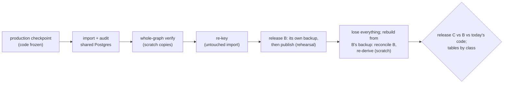

# 7. Stage 2: dry run on the server

Read [6. Stage 1](6-stage-1.md) first; next is [8. Stage 3](8-stage-3.md).

Status: started 2026-11-05 on `postgres-migration`, following the tested
stages 0/1 revision `5f5e52447963`. Gate 2 is open. Infrastructure onboarding,
persistent backup exclusions and enforced network isolation are prepared;
the native import passes all 141 tables and 23,433,486 typed rows. Native-40 input acceptance passes in 58.920 seconds under the unchanged
60-second limit. Whole-graph verification remains open; the fresh bounded run starts at 2026-11-11 13:02 UTC. The final source passes all 3,148
core cases in 179.054 seconds, Ruff and mypy; its 4,728-case full suite passes
in 55 minutes 47 seconds on unchanged inputs. Final-runtime isolated
network, worker recreation/restart and loopback relay/tunnel checks passed
against owned endpoints; that initial receipt proves HTTP relay behavior.
SQL authentication is recorded separately below; the credentialed application topology remains open
([proof](../../../journal/evidence/runtime/postgres-stage2-2026-11-05/network-final.json)).
Frozen-code reference R passed and is SHA-verified on the server. The two private R2 buckets
and dev expiry are verified. Both scoped S3 keys pass write, read-back and
guarded deletion checks; the Hub token now grants only the private rehearsal
repository. Healthchecks.io provider alarms reach the owner and the proxy route
is verified; guarded application delivery remains open. All 45 immutable checkpoint transport files
are verified on the server. Production continues on
its current SQLite image; no cutover or source-site request from the new host
is authorized by this stage.

The first strict unpack rejected 153 legacy code scopes without verified
retained bundles. Frozen04 includes only the current input bundle; historical
v1 archives still exist on the worker. The unchanged reader collected all
192 required pairs from the SHA-checked frozen database. All thirteen retained
archives passed full byte and native semantic verification, covering every
required pair. The fresh strict unpack passes in 61.26 minutes with these
separate witnesses: full SQLite integrity, foreign keys and the original
database-bound file closure all pass
([unpack](../../../journal/evidence/runtime/postgres-stage2-2026-11-05/unpack-passed.json),
[archive proof](../../../journal/evidence/runtime/postgres-stage2-2026-11-05/code-archives.json)). Do not rewrite the frozen
checkpoint or waive its guard
([receipt](../../../journal/evidence/runtime/postgres-stage2-2026-11-05/unpack-code-closure-current.json)).

The five required storage and Hub credential fields are populated in the
private server template. No credential value was emitted, hashed or copied
to the Mac. The runtime token has one active resource grant, matching the
rehearsal repository's immutable ID; a second, empty user entry grants nothing
([scope](../../../journal/evidence/runtime/postgres-stage2-2026-11-05/credential-scope.json)).
Both bucket keys pass their own 36-byte probe and receive HTTP 403 for
HeadBucket against the other Swingset bucket and both Rhuidean buckets.
The two probe objects are absent afterwards; all seven existing apps are unchanged
([storage](../../../journal/evidence/runtime/postgres-stage2-2026-11-05/r2-capabilities.json)).

The single Hub duplicate request created a private snapshot, so its strict
default-branch history guard correctly refused success. It was never retried.
Separately reviewed branch creation anchors all 77 original source commits at
`mirror-live` and checkpoint A at `rehearsal`, preserving their commit IDs.
The source and the new repository's default branch remain unchanged. Baseline
file downloads were checked separately
([duplicate](../../../journal/evidence/runtime/postgres-stage2-2026-11-05/mirror-duplicate.json),
[anchors](../../../journal/evidence/runtime/postgres-stage2-2026-11-05/mirror-anchors.json)).
The first download check fetched ten files, then an older Parquet object
received HTTP 403 from the private repository's CDN. The live repository
serves the same original content hash. History metadata alone is insufficient;
The repaired mirror now has provider acknowledgments for all 967 original
large-file objects (8.78 GB). All 77 historical file trees match, and all
39 baseline files download with their expected hashes. No commit or ref changed;
the live head and seven existing apps are unchanged
([content proof](../../../journal/evidence/runtime/postgres-stage2-2026-11-05/mirror-content.json)).

The import runtime contains the exact source that passed 4,599 tests;
the server verifies its installed modules and manifest-to-CONFIG mapping
([image](../../../journal/evidence/runtime/postgres-stage2-2026-11-05/image-lazy-import.json)).
Three scoped database URLs were delivered directly from Dokploy into private
server staging files. They select the planned private relay at
`172.30.240.3:5432`. Only the held import utility has received the three
internal scoped files; ordinary workers remain unstarted
([credentials](../../../journal/evidence/runtime/postgres-stage2-2026-11-05/database-credentials.json)).
The actual Dokploy Compose service now runs four credential-free support
services: relay, proxy, resolver and owned mock. All three scoped logins pass
read-only authentication through the relay; only migrate can assume the owner
role. The host publishes only `127.0.0.1:15435`, outside ingress is denied,
and an SSH tunnel receives a SCRAM challenge without copying a credential to
the Mac. Owned proxy and resolver checks pass. Pipeline workers have not started;
their guarded credentialed topology and recreation checks remain open
([gateway proof](../../../journal/evidence/runtime/postgres-stage2-2026-11-05/gateway-sql.json)).

Private Postgres for verification is also deployed at `172.30.240.6:5432`,
with no published port, the shared server's exact image, C/UTF8 and 8 GiB/six
CPU limits. The 22 captured shared settings match except the planned scratch
`fsync` and `full_page_writes` changes; error statements and parameter values
also have explicit log protections. Separate worker/control logins authenticate
and cannot assume the owner or each other's capability. Their private cluster
has no application database yet. Three private-cluster application files are
mode 0400 for UID 10001. The seven existing apps and four gateways are unchanged
([private server](../../../journal/evidence/runtime/postgres-stage2-2026-11-05/private-postgres.json)).

The held import workspace contains 201,576 verified files (5.87 GB), owned by
UID 10001. The first utility stopped before initialization: that user could
not read the original UID-1000 source directory. A fresh read-only adoption
check confirms all 142 prepared tables remain empty and the catalog is unchanged.
A separate source volume now contains the full checkpoint, with ownership
for the actual utility user. That user independently reads and hashes all
38,890,938,368 SQLite bytes and verifies schema 37 and baseline A; the original
checkpoint and its permissions are unchanged
([workspace](../../../journal/evidence/runtime/postgres-stage2-2026-11-05/import-filesystem.json),
[refusal](../../../journal/evidence/runtime/postgres-stage2-2026-11-05/import-permission-refusal.json),
[readable source](../../../journal/evidence/runtime/postgres-stage2-2026-11-05/import-readable-source.json)).
The separately reviewed second attempt started 2026-11-06 21:25 UTC, with the
hold set, only three internal scoped credentials, a 7,200-second deadline and
a 200 GB disk floor. Source preflight returned after about 115 minutes, but
the first destination transaction found its connection closed. It exited one
before initialization. A fresh 2026-11-09 read-only check confirms all 142
tables remain empty, the catalog is unchanged, and no native import receipt
exists. The relay's 4,200-second idle timeout explains the stale session;
this is inferred from code and the idle interval, without a retained relay
timeout log
([refusal](../../../journal/evidence/runtime/postgres-stage2-2026-11-05/import-idle-refusal.json)).
The CLI now validates before opening its destination, then keeps that one
session through load and audit. It does not reconnect or reuse validation.
Separate preflight progress reports phase and table; they authorize nothing.
The reused monitor is now
the tested `swingset import-job` command. No scheduler or external I/O is enabled
([second preflight](../../../journal/evidence/runtime/postgres-stage2-2026-11-05/import-second-preflight.json)).

The second attempt spent 6,877 seconds before any load; the old 7,200-second
ceiling left only 323 seconds for COPY and the mandatory audit. A fresh attempt
may use a fixed 21,600-second total ceiling after the independent check of its
exact image, policy, mounts and empty target. This is measured safety headroom,
not a completion estimate. Keep 8 GiB, six CPUs, 256 processes, the 200 GB floor,
all source checks, final audit, existing relay and transaction limits, and
no automatic retry or reset. An operator attends, reports at least every two
hours, reacts to stalls or failures and reviews the existing hold. A failed
attempt retains all partial state. The core's separate 180-second limit stays
unchanged.

The third reviewed attempt started 2026-11-09 19:24 UTC with the tested
lazy-connection runtime and fixed 21,600-second ceiling. The replacement
namespace operator verified its new incarnation and private firewall. It loaded all 141 tables and 23,433,486 rows, then stopped at its fixed
ceiling during the independent audit. All state is retained; audit and stored identity remain open
([preflight](../../../journal/evidence/runtime/postgres-stage2-2026-11-05/import-third-preflight.json)).

The owner closed the tested preparation as revision `6db1ca53` on November 10.
A fresh independent read-only inspection confirms the retained finalized
schema, all 141 counts and stored dry-run UUID. The reviewed resume started
at 05:15 UTC with the exact 4,611-test runtime and a new private receipt volume.
It repeats full source validation, checks every loaded table, then repeats the
independent audit; it cannot reload tables or reseed the UUID. The six-hour
ceiling, resource limits and hold remain. Its final audit, separate file and capacity checks now pass
([preflight](../../../journal/evidence/runtime/postgres-stage2-2026-11-10/import-resume-preflight.json)).

Full frozen-source validation passed at 07:06 UTC in 6,643 seconds. Its 141-table
matrix and separate file proof match the retained receipt exactly. The native resume then exits zero at 09:40 UTC in 15,869.686 seconds.
Its final audit matches all 141 tables and 23,433,486 rows, with no OOM kill.
Independent terminal identity, working-file and capacity checks pass. Gate 2 stays open
([checkpoint](../../../journal/investigations/2026/stage-2-server-rehearsal-2026-11-05.md#working-file-postcheck-passed)).

The private copy passes all 141 typed-table audits, then its coordinator
fails in the statistics wait. Its owned helpers are stopped; the complete
108,390-unit base and ownership record are retained. Do not replay that
executor or adopt its base implicitly
([boundary](../../../journal/evidence/runtime/postgres-stage2-2026-11-10/private-copy-boundary.json)).
An independent read-only data seal now confirms its checkpoint, complete
unit set, historical context and identity. The reader is stopped and the
base remains intact. This proves data only; it does not replace the new
candidate's input/version proof
([preseal](../../../journal/evidence/runtime/postgres-stage2-2026-11-10/retained-base-preseal.json)).
The graph uses the corrected operator release wrapper and maintained
`verification-job` supervisor. That candidate's core passes 3,066 cases in 173.15
seconds; focused checks pass 57 cases. All 4,638 full-suite cases now pass
in 3,508.20 seconds with an unchanged 935-input binding
([validation](../../../journal/evidence/runtime/postgres-stage2-2026-11-10/developer-verifier-supervisor.json)). Require
an immutable image proof and an independent retained-base, namespace and
graph lifecycle review before starting it. The graph may clean its three
new copies, but cannot remove the retained base
([candidate](../../../journal/investigations/2026/stage-2-server-rehearsal-2026-11-05.md#operator-release-dispatch-and-final-graph-candidate)).

Its first start fails on a root-owned mode-0600 override before any graph
copy or ownership claim is created; keep that attempt stopped
([failure](../../../journal/evidence/runtime/postgres-stage2-2026-11-10/graph-startup-permission-failure.json)).
The Dockerfile-only public-input permission fix passes complete input capture
as UID 10001 with root read-only, no capabilities, no network and no credentials.
All 934 other inputs and package source identity remain unchanged. Require
a new immutable image/policy and independent execution review for a separate
private attempt. That full run is later interrupted for the guard fix below;
the historical 4,638 passes are application-code evidence, not the new binding
([packaging proof](../../../journal/evidence/runtime/postgres-stage2-2026-11-10/runtime-public-input-permissions.json)).

Current developer-gate trigger: all 3,066 cases, Ruff and mypy pass, but the
new core takes 205.58 seconds against the fixed 180-second budget. Case
membership and caps match the 173-second run; measured weights and assignments
differ. Inspect existing timing reports and weight provenance before a
controlled fix or retiming. Do not automatically repeat the run or change
selection, assertions, four clients, sixteen workers or resource limits.
Existing-report analysis now attributes the dominant increase to about 29 seconds
of cold image preparation after the Dockerfile changed. The actual failure
stands. Permit one matched warm-cache comparison only after the current full
passes, resources are idle and its source binding is unchanged. Use the failed
run's exact input weights through the normal check command, preserve and restore
the prior cache under the core lock, and reject competing jobs or an unexpected
build. Do not hold the lock across the normal command or repeat the comparison
([measurement](../../../journal/evidence/runtime/postgres-stage2-2026-11-10/core-cold-preparation-analysis.json)).

The reviewed replacement graph starts once, then its supervisor stops it on a
command timeout at 15:21 UTC. Preserve its terminal state, copy registry and any
partial outputs; inspect the failure before a separate operation. No graph pass
or retained-base cleanup follows from this attempt
([boundary](../../../journal/investigations/2026/stage-2-server-rehearsal-2026-11-05.md#replacement-graph-stops-on-a-supervisor-timeout)).

The subsequent guard fix passes 108 focused and 3,074 core cases, Ruff and mypy,
but the normal core takes 231.14 seconds. Its startup is warm; existing reports
show shared-case work up 31.17 percent and cannot identify the underlying cause.
The eight regressions add only 0.018 aggregate seconds. Keep the timing gate
open; no weight change or blind timing retry follows. The C970 matched probe
is canceled without execution because the source changed. The required new
full run now passes 4,646 cases in 3,756.83 seconds on unchanged binding
`4c7b6dbe`, source `94c8cb77`
([measurement](../../../journal/evidence/runtime/postgres-stage2-2026-11-10/core-guard-shared-work-analysis.json)).

A separately reviewed fresh graph starts at 16:47 UTC under the fixed guard.
Its new registry and three new volumes exclude the failed copy's ownership
records. C696 and failed copy 69 remain untouched; only this job's new copies
may be cleaned. Final inspection must find exactly the defaults, C696 and
retained69, and bind their identities. Attendance uses current-job COPY/index
progress and activity, not aggregate counters that include retained databases
([start](../../../journal/evidence/runtime/postgres-stage2-2026-11-10/fresh-graph-start.json)).

That attempt exits naturally at 17:11 UTC: candidate input acceptance exceeds
the unchanged 60-second atomic-write budget, after the frozen copy finishes.
No graph receipt or shard pass is produced; approved cleanup removes its new
copies. Preserve C696 and retained69. This measured failure triggers work on
input acceptance's per-row queue and scope registration writes. Measure those
writes before changing them, then batch them while preserving callback order,
complete invalidation, rollback and the same write budget. Do not bypass normal
input acceptance in verification or re-key. The proposed matched core probe
for source `94c8cb77` is canceled without execution because this necessary
source change invalidates its binding.
The independent [failure boundary](../../../journal/evidence/runtime/postgres-stage2-2026-11-10/graph-input-accept-deadline.json)
confirms natural exit 1, no OOM, absent receipt, empty new registry and no
remaining new databases. This attempt supplies no graph acceptance proof.

The batching fix preserves repeated invalidations and their generation/fence
increments, callback visibility and rollback. It passes 88 focused and all
3,075 core cases, Ruff and mypy, but takes 209.04 seconds against 180. Its
source `94a24e6c`, complete binding `bc222965`, later passes all 4,648 full-suite
cases at 19:25 UTC. Its separate full-size graph attempt still exceeds sixty
seconds during input acceptance. The 80 GiB free-space floor and 110 GiB
full-suite admission remain unchanged
([validation](../../../journal/evidence/runtime/postgres-stage2-2026-11-10/developer-batched-full-passed.json)).

The owner chooses Healthchecks.io on 2026-11-10, replacing the earlier provider
exclusion; Slack remains excluded. The dedicated project's two controlled
provider alarms reach the owner. Private ping URLs are staged server-only;
guarded application delivery remains open. The project management key stays
outside application services. Separate owner-alert and watchdog checks prevent
normal heartbeats from erasing an explicit alarm
([D-0283](../../../journal/decisions/0283-use-separate-healthchecks-alert-and-liveness-checks.md)).

Developer-gate trigger: the corrected 2,729-case core passes functionally but
takes 200.48 seconds, above its unchanged 180-second limit
([measurement](../../../journal/evidence/runtime/postgres-stage2-2026-11-05/developer-wal.json)).
Use its measured phase and file costs to resolve that regression before landing.
Keep deadlines, memory caps and assertions; any selection change must follow
the existing core-versus-extended rule and retain the full-suite check.
An earlier `mise run check` passed: all 2,978 selected cases in 171.62 seconds,
plus Ruff and mypy across 362 source files. Source, selection, assertions and
caps are unchanged from the earlier 214.56-second run; the executor uses
refreshed measured scheduling weights
([receipt](../../../journal/evidence/runtime/postgres-stage2-2026-11-05/developer-passed.json)).
After adding the maintained mirror bootstrap command, a check passed
all 3,001 selected cases, Ruff and mypy, but takes 285.25 seconds. The unchanged
180-second gate reopened. Host swap pressure did not establish a cause
([measurement](../../../journal/evidence/runtime/postgres-stage2-2026-11-05/developer-mirror.json)).
The complete suite for that source passed all 4,573 cases in 29.34 minutes
([full run](../../../journal/evidence/runtime/postgres-stage2-2026-11-05/full-mirror.json)).
The earlier check, after adding the maintained import supervisor, passed all
3,018 selected cases in 171.71 seconds, plus Ruff and mypy across 364 source
files. The source binding is unchanged during the run; the unchanged
180-second gate passed. The final full run must include these additions
([current check](../../../journal/evidence/runtime/postgres-stage2-2026-11-05/developer-import-job.json)).
After the connection-lifetime and progress changes, all 3,027 core cases pass
in 207.00 seconds; mypy passes. A misplaced fixture lint annotation was fixed
afterwards and Ruff passes. The unchanged 180-second timing gate is open
([measurement](../../../journal/evidence/runtime/postgres-stage2-2026-11-05/developer-lazy-import.json)).
One controlled check after the image build finished passes the same 3,027
cases, Ruff and mypy in 192.23 seconds. Timing remains open; no selection,
assertion, resource or deadline changed
([check](../../../journal/evidence/runtime/postgres-stage2-2026-11-05/developer-controlled.json)).
The full suite for that source passes all 4,599 cases in 22.39 minutes,
with the complete source binding unchanged
([full run](../../../journal/evidence/runtime/postgres-stage2-2026-11-05/full-lazy-import.json)).

The source-volume experiment did not recover the budget and changed copied
file permissions, so it was reverted. Under the existing selection rule, the
older exhaustive read-set case moves to extended: it launches five entire
fixture files again. Its assertions remain unchanged. Core keeps the recorder
and wrapper checks, those files' existing selected cases, and a real armed
project/link pipeline smoke case. Record the new timing and run the complete
suite before landing.

Further setup reductions preserve actual restores and corruption assertions:
share immutable source archives, copy them privately per test, and retire the
source database. Transport core keeps direct contract checks and a native
standalone restore for each backend; its five multi-day integrations remain
unchanged in full. One link-fuzz seed stays in core and two additional seeds
remain in full. Measure the complete core after these changes
([focused checks](../../../journal/evidence/runtime/postgres-stage2-2026-11-05/fixture-setup.json)).
The complete suite passes all 4,550 cases with all 929 source and test inputs
unchanged
([full run](../../../journal/evidence/runtime/postgres-stage2-2026-11-05/full-durable.json)).
The earlier core contained 2,989.72 aggregate phase seconds across sixteen
workers, too much for balancing alone at those fixed measured costs.
A focused profile passes all eighteen publication safety cases and identifies
real publication backups and restore checks as the largest cost. It does not
justify skipping those checks or caching their results
([profile](../../../journal/evidence/runtime/postgres-stage2-2026-11-05/developer-profile.json)).
The passing run's aggregate phase work also fell, to 2,480.71 seconds. The
measurements do not isolate the cause or guarantee every future run's timing.

**Goal:** prove the port, the switch and the recovery on full-size data
and the server's own CPU, without touching other sites or the published
dataset. Production keeps running on the Mac.

**Three proofs, one full re-derivation:**

| Proof       | Runs on                                              | Shows                                                                                                                                                                             |
| ----------- | ---------------------------------------------------- | --------------------------------------------------------------------------------------------------------------------------------------------------------------------------------- |
| switch      | an untouched import of the checkpoint                | the ported code gives every stored result (a whole-graph verify run), and the re-key carries the graph over from SQLite's old recipe keys                                         |
| publication | the import, against a rehearsal dataset              | a release takes its own backup, then publishes, with the real locks                                                                                                               |
| recovery    | a fresh database and volume holding only that backup | the Hub being one release ahead is reconciled; everything else re-derives (the one full re-derivation) into a release identical to today's, built against the reconciled baseline |

The verify run is the per-unit proof of the port: it re-runs every current
unit with the ported code on the server's CPU and compares each output and
dependency set with what SQLite stored. Expected: about 0.02% differences,
each inspected (estimate from the re-derivation history). The rebuild is
the end-to-end proof: it re-derives the whole graph from the backup alone.

## Before it starts

- Gate 1 has passed.
- **Rhuidean's prerequisites** are in that repo and recorded there:
  1. Swingset's extra roles in the database onboarding
     ([3. Database code](3-database.md#roles));
  2. **a persistent backup exclusion** for every `swingset*` database.
     Today `mise run infra:backups` finds every database and creates or
     re-enables a daily full dump for each (`dokploy/infra/backups.sh`), so
     a later run would undo a one-off exclusion. The exclusion lives in
     Rhuidean's config, every run honours it, and a run with discovery is
     checked to leave no `swingset*` schedule;
  3. two R2 buckets, `swingset-backups` and `swingset-dev`, with
     bucket-scoped tokens, and the 30-day expiry on `swingset-dev`
     ([4. Hosting](4-hosting.md#backups-and-recovery)). R2 tokens cannot be
     limited to a prefix, so Swingset does not share Rhuidean's bucket;
  4. the enforced proxy/firewall egress rules and the loopback-only
     database relay, with the tests on
     [page 4](4-hosting.md#network-and-volumes). Record actual endpoint
     and port choices; an unimplemented allowlist is a blocker.
- The immutable environment guard and the tunnel tooling exist before
  any rehearsal database is created ([page 10](10-local-development.md#dev-and-production-stay-apart)).

## Steps

1. **Provision** with Rhuidean's tooling: a Swingset project
   (`mise run app:new`), which deploys a Dokploy Compose service
   (`docker-compose`, not a Swarm stack;
   [4. Hosting](4-hosting.md#services-on-dokploy)); a `swingset_dryrun`
   database on the shared Postgres 17, in the C locale, with the real
   roles, marked `environment` = `dryrun` (as is `swingset_drill` later); the services, secrets and alert channels. Add Swingset to
   Rhuidean's inventory. Record each Dokploy fact on
   [that page's checklist](4-hosting.md#dokploy-facts-to-check-not-assume)
   as verified or unavailable.
2. **Make fetching and publishing to the live dataset impossible,** not
   just switched off:
   - the only Hugging Face token writes to a separate rehearsal dataset,
     a full history mirror of the live dataset, so commit ids match. Its explicit
     rehearsal branch starts at the checkpoint baseline. A newer live default
     head is not force-reset; no operation writes the live repository;
   - the enforced egress policy allows only the bucket, Hugging Face, the
     alert channel and the dead-man's switch. Test denial of disallowed
     names and direct IP routes from every service using owned endpoints;
   - the out-of-band hold is set during the import.
3. **Freeze production's code.** From this checkpoint until the switch,
   production takes no deploys, so what the dry run proves is what the
   switch replaces.
4. **Transfer and import** a production checkpoint (39 GB, plus about
   2.5 GB of small files and input bundles) with the stage 1 importer into
   `swingset_dryrun` on the shared server, the way the switch will, and
   audit it. Keep the Mac awake for the transfer (see
   [8. Stage 3](8-stage-3.md#steps), step 2). Record the transfer, import
   and audit times, and how the other apps' health checks fared.
5. **Verify, then re-key, on this untouched import,** as the switch will:
   - a verify run of the whole graph, on scratch databases loaded from a
     dump of the import. Inspect every difference; a transform whose output
     really changed (for example a rounding difference on the new CPU
     type) gets a version bump in the port before the switch;
   - then the re-key on `swingset_dryrun` itself, through the worker role.
     Every eligible clean unit must be current afterwards. Bumped
     transforms and their affected consumers stay queued, never re-keyed
     to old outputs. Drain that work before building B and record it
     separately from the recovery drill's full re-derivation.

   Record both times.

6. **Back up, then publish once to the rehearsal dataset.** The rehearsal
   dataset preserves the live history, and its configured rehearsal branch
   carries the checkpoint's baseline commit, A; check the complete ancestry
   and baseline-file downloads first. A successful duplicate API call alone
   does not establish this; existing unrelated repositories are not adopted. Choose a
   checkpoint with changes since A, so the gate accepts a new release.
   - Run the scheduled backup job once (backup 1), and its check, foreign
     keys included. Record its size and time.
   - Build release B from `swingset_dryrun` and publish it to the
     rehearsal dataset through the normal path: reservation, its own
     backup (backup 2), push ([4. Hosting](4-hosting.md#publishing-and-backups)).
     The Hub is now one release ahead of backup 1.
7. **The rebuild drill** (the one full re-derivation), from backup 2,
   following [the rebuild order](4-hosting.md#backups-and-recovery)
   exactly:
   - restore only that backup into a fresh scratch database **and a fresh,
     empty state volume**. The drill's services mount no volume the import
     used and cannot reach `swingset_dryrun`, so no surviving file (the
     baseline, `BUILT`, `PUBLISHING`, a manifest, a receipt, Parquet) can
     make recovery pass when the backup lacks it. Before reconciliation,
     compare every restored history row and column against backup 2's
     frozen audit hashes, with only the destination environment identity
     excluded by its explicit rule;
   - for an explicitly staged restore, retain `RESTORE_PENDING` after the
     exact initial audit. Register its fresh UUID in the private rehearsal
     policy before any public I/O. Resume through the maintained command,
     which checks the public head before any cache hydration;
   - the Hub check finds B, the reservation backup 2 holds, and promotes
     it. Only then is B's Parquet downloaded and checked against B's
     manifest, so the baseline is B, complete, and not A;
   - set the bookkeeping tables by their rules, then re-derive everything
     with publishing impossible;
   - load the result into a fresh `swingset_drill` database on the shared
     server, as a real recovery would, and audit it.

   Recovery may span bounded resumable turns. Bootstrap completion and verified
   source chunks are recorded with the data, not only in a file. A budget or
   stop keeps the restore barrier and never resets completed replay. Unit
   deadlines and the final verification and history audit stay unchanged
   ([D-0277](../../../journal/decisions/0277-resume-recovery-from-database-bound-progress.md)).

   Record each part's time: their sum is the real recovery time.

   Reference-build storage trigger: the live SQLite database is over 20 GB,
   and another full checkpoint copy would cross the Mac's 80 GiB free-space
   floor. The measured frozen stream is 38,890,938,368 bytes; all 128 KiB
   chunks differ from the live file because checkpoint creation repacks it.
   Do not substitute the live database or reconstruct it with a full-size
   reflink rewrite. First test compression in a tiny owned filesystem inside
   a private mount namespace. Any full reference workspace needs a separate
   reviewed physical-growth bound, exact frozen SHA and both Mac and VM
   free-space guards. The maintained reference job uses a sparse loop device
   whose capacity equals that physical budget; it does not depend on Btrfs
   quotas. Verify its actual device size, synchronous discard and compression
   before restoring. Serialize its allocation with full-suite scratch.

8. **Compare:**
   - **releases:** build release C from `swingset_drill`, within its
     service's memory limit. Its release gate runs against baseline B, so
     a baseline with missing files fails here. Build release R with
     today's code on the worker VM from the same checkpoint. B, C and R
     must be byte-identical in every published table, except a named list
     of columns such as run ids;
   - **every table, by its class** ([4. Hosting](4-hosting.md#backups-and-recovery)),
     `swingset_drill` against `swingset_dryrun`:

     | Class       | Must hold                                                                                                                        |
     | ----------- | -------------------------------------------------------------------------------------------------------------------------------- |
     | history     | the initial restore matched backup 2 exactly; subsequent changes match the recovery transition list below                        |
     | rebuilt     | the same set of current units, each with an equivalent output and dependency set, by unit key and content digest; ids may differ |
     | bookkeeping | the table matches its reset rule; it is not compared with the import                                                             |

     The recovery transition list names table, key and allowed columns:
     settle the restored reservation, acknowledge B and advance the local
     baseline, settle interrupted runs/admissions, and append new
     recovery, rebuild and verification run records. New generated rows
     referenced by those records are listed too. Backup 2 cannot contain
     its own later registration; reconstruct that record from its checked
     manifest. Include the class list's exact mutable anchor fields, such as
     a scope's selected generation and signature or a source unit's accepted
     pointer, when the normal rebuild advances them. Preserve every other
     restored history value and every original key. The initial audit still
     compares all fields exactly before workers run. Test each allowed
     transition; blanket exclusions for operational tables
     are forbidden.

     A missing history row at the initial check means the backup left it
     out. A current unit that differs means the backup lacked an input or
     the rebuild is wrong. Past rows in rebuilt and bookkeeping tables (superseded
     generations, equivalences, failed attempts) are not expected to
     come back.

   An unexplained difference blocks the switch. A deliberate output change
   needs a named version bump and an independent check; missing history,
   broken references or incomplete verification cannot be waived.

9. **An unknown head blocks.** Run rebuild steps 1 to 4 from backup 1,
   into another fresh database and empty volume. Backup 1 knows only A,
   and the Hub is at B, so this is the lost-backup case: it must block and
   ask for a lost-evidence decision, and write nothing.
10. **Test the lifecycle and the failures,** on the shared server with the
    real Compose file and roles, unless noted:
    - a deploy under a hold, with a migration, then the hold lifted; then
      a rollback to the previous digest, which must be refused, and a fix
      forward;
    - recreate every container on the same volumes;
    - kill a service mid-tick; drop its database connection
      (`pg_terminate_backend`);
    - a hold and resume with both the switch-time operator hold and the
      out-of-band flag; successful and failed deploys with an existing
      operator hold must preserve it;
    - lose the backup's connection partway; crash between rebuild steps;
    - a Postgres restart, on a scratch container with the shared server's
      image and settings, because restarting the shared server stops other
      apps;
    - an alert reaching the owner, and the dead-man's switch firing.

    Each must show no lost commit, no repeated request to the mock source
    and no hold cleared silently. Repeat egress-denial and tunnel tests
    after container recreation.

11. **Egress rehearsal:** use an owned mock source to prove the allowed
    route, redirects, conditional requests, timeouts and Retry-After
    accounting through the real fetch gate. No collection site is
    contacted and no production host is paused. Actual source access
    from the new address remains unproved until the controlled first
    request in [stage 3](8-stage-3.md#steps). This keeps all real request
    accounting in the final production database.

**Scratch databases match the shared server.** They use its Postgres image
digest and its settings (the difference is recorded), except the durability
settings that verify and rebuild scratch turn off. Each gets CPU and memory
limits, so other apps keep their share of the host; the other apps' health
checks are watched during every heavy step.

## Gate 2

- the import's audit passes, and the other apps stayed healthy;
- the whole-graph verify run is clean, or every difference is explained and
  bumped; the re-key on the untouched import passes; times recorded;
- both backups' checks pass; their size and time are recorded;
- B published with its own backup first;
- the rebuild drill from backup 2, from an empty database and volume,
  reconciles B, downloads its Parquet after that, and finishes; releases
  B, C and R and the per-class comparisons are clean; the recovery time is
  recorded;
- recovery from backup 1 blocks on the unknown head;
- the tests in step 10 pass;
- the egress-denial tests and owned-source rehearsal pass, and the
  provisioned SSH tunnel works;
- peak memory per service and for Postgres is recorded, with no
  out-of-memory kill.

| Step                                              | Review                          |
| ------------------------------------------------- | ------------------------------- |
| rehearsal publication, paid resources or deletion | independent check plus receipts |
| other rehearsal work                              | tests and receipts              |

**Rollback:** stop the rehearsal services. Remove only exact owned
services and dry-run databases after an independent check; keep the
receipts and required recovery artifacts. Production never changed.

Next: [8. Stage 3](8-stage-3.md).

### Core concurrency measurement

The controller-routing fix passes all 4,600 full-suite cases and all 3,028 core
cases, Ruff and mypy. Core takes 203.50 seconds. Its 2,974.09 aggregate case
seconds already exceed 180 seconds across sixteen workers before setup and
cleanup overhead, so scheduling alone cannot close this run
([measurement](../../../journal/evidence/runtime/postgres-stage2-2026-11-05/developer-copy-controller.json)).
One twelve-worker probe used four clients with three workers each. It took
209.32 seconds with 2,313.07 aggregate case seconds, so it did not recover the
budget. The existing four-manifest validator also refused the changed layout;
the probe is not a passing gate. All executor and test edits were restored
byte for byte to the 4,600-case full-run binding. Keep four clients, four workers,
the same selection, assertions, serial prologue, resource caps and 180-second
gate. No further automatic timing retry is planned
([probe](../../../journal/evidence/runtime/postgres-stage2-2026-11-05/core-worker-probe.json)).

The controller fix's runtime is cached separately for private verification.
All 364 installed Python modules match the exact source that passed 4,600
full-suite tests, including the controller regression. The now-stopped import
retained its prior pinned runtime; no worker has switched images
([image](../../../journal/evidence/runtime/postgres-stage2-2026-11-05/image-private-verifier.json)).

The verifier also needs its configured writable `TMPDIR` for graph scratch.
That fix passes all 4,600 full-suite cases with an unchanged complete input
binding. Its core before the catalog probe passes correctness, Ruff and mypy in 207.85 seconds;
the 180-second timing gate remains open. A new cached runtime matches all
545 installed package files. The now-stopped import retained its prior runtime;
private verification at that point still awaited the native audit and identity
([validation and image proof](../../../journal/investigations/2026/stage-2-server-rehearsal-2026-11-05.md#writable-verifier-scratch-and-current-import)).

### Controlled warm catalog probe

The latest unchanged core takes 207.85 seconds against the 180-second budget.
The same disposable test server served the earlier 171.67-second run. Its
shared dependency catalog has 4,338 live rows, a 2,359,296-byte heap, and
105,414,656 bytes in two indexes. No client connection is active. This is a
measured possible source of DDL overhead; it does not establish causation.

The trigger for one controlled probe is a failed core timing gate together
with those inflated catalog indexes. Rebuild only
`pg_catalog.pg_shdepend_depender_index` and
`pg_catalog.pg_shdepend_reference_index` on the exact labeled disposable test
service, after an independent check and a fresh no-owner/no-client guard.
Preserve every database, role, schema, template, other service and resource
limit. Reuse the 207.85-second run's exact measured weights and run one
supported check. Keep its result even if it misses the budget; do not retry.
No test selection, assertion or deadline changes.

Scratch preflight and before/after measurements live in
`/tmp/swingset-stage2-core-catalog-probe-20261109/`. The unchanged full-run
source binding is `79e5eb35fd90326a6e1fad6a551a5f8ee2b30ad2cd0add9a8c9024f34b97d70e`.

The controlled probe completed November 9 after an independent check. Both
indexes shrink to 172,032 bytes combined; all 4,338 heap rows, databases,
roles and container identity are preserved. The matched 3,028-case core takes
192.20 seconds, versus 207.85 before. Correctness, Ruff and mypy pass, but
the 180-second timing gate remains open. The one probe does not isolate
other host effects, and no further timing retry is planned
([receipt](../../../journal/evidence/runtime/postgres-stage2-2026-11-05/core-catalog-probe.json)).

### Bounded read-only transfer measurement

The imported database's measured directory is 38.50 GB, above the 20 GB
state-size trigger. During its final audit, observed SQL return traffic rises
from 64.7 to 75.8 GB over about ten minutes; a later sample shows about
18 percent client CPU and 14 percent Postgres CPU. This does not establish
the cause of the transfer rate.

Run one bounded diagnostic on the existing SQL path, using the internal worker
login and synthetic bytea only. Read 8 MiB at each of three query sizes:
64 KiB, 1 MiB and 4 MiB, with a thirty-second total bound. Record all results
without repeating the probe. It changes no application row, producer, route,
resource cap or deadline. Keep the native import unchanged; any later code
change needs its own measured justification and validation.

The single probe passes at 00:48 UTC on November 10. SQL reports
38,501,373,619 database bytes. Synthetic reads measure 6.58 MB/s at 64 KiB,
22.43 MB/s at 1 MiB and 26.09 MB/s at 4 MiB. This measures query-size
overhead on the actual relay path, not the real audit's speedup or a proven
network cause. No application row or running producer changed.

If the fixed import ceiling expires without a complete audit, test 1 MiB
chunks for a separately reviewed next attempt. Preserve streaming bounds,
typed digests, every source and final audit, resource caps and deadlines.
Do not change the active producer or repeat this probe
([measurement](../../../journal/investigations/2026/stage-2-server-rehearsal-2026-11-05.md#synthetic-bytea-probe-at-0048-utc)).

The attempt stopped November 10 at 01:26 UTC after the six-hour ceiling
and its 120-second stop grace. Exit 137 was the deadline kill; all observed
OOM-kill counters remain zero. Its native receipt retains all 141 completed
loads but no final audit. No reset or automatic retry occurred
([stop receipt](../../../journal/evidence/runtime/postgres-stage2-2026-11-05/import-budget-stop.json)).
The 1 MiB transfer fix and maintained `inspect-import` command pass all
33 focused import/utility cases and all 4,611 full-suite cases. Core correctness
passes all 3,039 cases in 187.54 seconds; that runtime misses the 180-second gate.
The matching immutable runtime is cached and all installed inputs match the
completed validation. The large Unicode regression loads at 64 KiB, resumes at
1 MiB and audits at 4 MiB without changing typed digests.

The first scratch adoption helper refused on an incorrect role name. Its
replacement is the tested read-only command, with a NULL-safe guard for hidden
cross-role sessions. Independent read-only adoption now passes for the exact retained UUID, schema
and all 141 row counts. These checks precede the separately reviewed resume
and its successful audit recorded above
([current validation](../../../journal/investigations/2026/stage-2-server-rehearsal-2026-11-05.md#full-validation-passed-at-0310-utc)).

The earlier 3,039-case report contains 2,757.076 seconds across the parallel cases.
Ideal division across sixteen workers, mean client collection and the
serial prologue total 180.858 seconds before other overhead, holding
observed case costs fixed. This supports investigating work costs; it
does not prove a cause or authorize another timing retry. The unchanged
180-second gate remains open for that earlier runtime
([existing-run analysis](../../../journal/evidence/runtime/postgres-stage2-2026-11-10/core-existing-timings.json)).

### Profile the full-size acceptance deadline

The second graph attempt exits 1 at 18:57 UTC on November 10 after the unchanged
sixty-second acceptance budget. Batched enqueueing preserves correctness, but
per-input timings still reach 39.538 seconds for scoringdance.round before the
later dancer input. Current full validation passes all 4,648 cases; core timing
remains above 180 seconds.

The measured imported state remains above the 20 GB optimization trigger.
One diagnostic will freeze a new owned copy, profile the normal acceptance
order inside a rollback-only sixty-second transaction, run ANALYZE only on that
copy after the DDL/ACL transaction, and repeat the rollback-only acceptance once.
Measure SQL completion and result materialization separately. Preserve all
invalidations, triggers, history fences, resource caps and production state.
The trials share cache and aborted-tuple effects, so elapsed time alone cannot
establish causality. A concrete independent review precedes execution and owns
cleanup only of that job's new database; no retained copy may be adopted or
removed. No further graph retry is selected until the diagnostic is assessed
([investigation](../../../journal/investigations/2026/stage-2-server-rehearsal-2026-11-05.md#batched-acceptance-still-exceeds-sixty-seconds)).

The existing 3,075-case batched core report has warm startup, but 3,068.929
aggregate phase seconds across parallel cases. Shared case work is 24.02
percent above the earlier 173-second passing run. At those fixed observed
costs, ideal division across sixteen workers already needs 191.81 seconds.
This does not identify CPU, I/O or database waits, and supports no assignment
change or retry. During the next required check of a settled candidate, collect
read-only cgroup CPU, throttling, I/O and pressure counters for Postgres and
its four clients. Keep selection, assertions, caps, scheduling inputs and the
180-second budget unchanged. Do not run an extra timing experiment or pin the
cache for this observation
([analysis](../../../journal/evidence/runtime/postgres-stage2-2026-11-10/core-batched-existing-work-analysis.json)).

### Isolate the mutation counter cost

The reviewed full-size diagnostic finishes at 20:25 UTC. Both normal acceptance
trials exceed sixty seconds and roll back with equal selected-table fingerprints.
Explicit ANALYZE takes 49.50 seconds but does not resolve the deadline. Before
it, watch updates consume 18.97 seconds and enqueueing 37.52 seconds; after it,
they consume 33.76 and 24.72 seconds. The last watch update is interrupted, so
these are observed prefixes, not completed-work comparisons. Source and caches
remain confounds. Its new database is removed and the retained catalog is exact
([result](../../../journal/evidence/runtime/postgres-stage2-2026-11-10/acceptance-profile-result.json)).

This measured failure and the existing over-20-GB state trigger a narrow local
synthetic counter measurement before selecting a fix. In one newly owned bare
test database, compare the same singleton revision counter under row triggers,
row triggers with 1,024-row UPDATE statements, and a statement trigger that adds
the exact changed-row count. Use 1,024, 4,096 and 8,192 generated rows, keep a
sixty-second SQL bound and a 180-second total bound, verify exact final counter
and row values, then roll back each case. Reset only those generated probe
tables between cases. No application schema or trigger changes, retained data,
reference state, resource-cap changes or new core timing run are included.
Independent review precedes this one measurement and its owned cleanup. The
synthetic result cannot establish actual application causality or the semantic
equivalence of a proposed trigger change. No further graph retry is selected.

The synthetic measurement completes all nine cases in 1.40 seconds, with exact
counter values and rollback, owned cleanup and no remaining process group.
At 8,192 rows the row trigger takes 186.346 ms; splitting that update into
1,024-row statements takes 186.447 ms; the statement-count model takes 6.796 ms.
This is a local model, not a server latency explanation. It selects no trigger
or schema change
([result](../../../journal/evidence/runtime/postgres-stage2-2026-11-10/synthetic-counter-result.json)).

The next full-size diagnostic uses the maintained `profile-input-acceptance`
command instead of replaying a frozen helper. Freeze a fresh owned dev copy,
keep schema 38 and every application trigger unchanged, enumerate the normal
whole-graph prefix, and profile one rollback-only normal acceptance. Enable
`track_functions=pl` only on its scratch-admin session, then change session and
current user to the actual unprivileged worker before the trial. Restore the
scratch identity only after rollback to flush this backend's statistics. Do
not change role grants, cluster settings, applied migration checksums, data
semantics or the sixty-second limit. Record function self time separately from
nested total time and collect read-only cgroup CPU/I/O/pressure observations.
The explicit isolated dev source and fresh ownership registry remain mandatory.
A new immutable image, focused/core validation and independent execution review
precede this private operation. The final complete suite remains required for
the settled migration change; no graph retry or acceptance pass is selected.

### Measured history-fence follow-up

The maintained diagnostic completes its one owned copy, enumerates all
108,390 units with digest `d58f3f45…`, and rolls back normal worker acceptance
after 60.015 seconds. Its four dominant history-timing functions consume
47.528 seconds of self time: watch updates 25.486, work-generation updates
11.035, pending-work inserts 9.195 and pending-work updates 1.812. Cleanup
removes only its owned database. Source and protected boundaries pass the
independent terminal audit
([measurement](../../../journal/evidence/runtime/postgres-stage2-2026-11-10/input-profile-result.json)).

The same operation exposes a separate guard lifecycle bug: a stopped actor's
PID 0 is treated as a new incarnation and reauthorized. The guard exits 1;
the supervisor correctly refuses a completion pass. Fix confirmed stopped or
removed actors while keeping live and ambiguous authorization failures fatal.
Do not restart the failed guard or profiler. A new guard needs source tests,
an immutable image and a separately reviewed transition.

The measurement now selects a narrow native migration 39: replace only those
four row-level history-counter triggers with counted transition-table
statement triggers ([D-0284](../../../journal/decisions/0284-count-bulk-history-fence-changes-per-statement.md)).
Preserve exact row-count deltas, no-op/zero-row behavior, callback visibility,
generation values, publication row fences, rollback and the sixty-second
write bound. Keep applied 37/38 SQL unchanged. The retained native-38 source
uses an explicit, read-only, prefix-checksummed checkpoint path; ordinary
worker opens stay strict
([D-0285](../../../journal/decisions/0285-read-verified-native38-checkpoints-without-migrating-them.md)).

Before server use, prove native-38-to-39 upgrade preservation, worker grants,
mixed insert/update conflicts, zero and unchanged-row updates, observer fence
visibility and rollback. Repeat core and the final full suite on settled
source, keeping the 180-second budget and every existing resource cap.
Then build and byte-check a new image, review its guard transition and run a
fresh owned diagnostic. No graph retry or authoritative re-key precedes those
checks. A later successful acceptance still requires the whole graph proof.

### Batch the measured nested generation updates

The native-39 diagnostic enumerates all 108,390 units and preserves rollback
and the protected boundary, with a healthy guard and complete owned cleanup.
Acceptance still expires after 60.023 seconds. The work-generation history
function runs 30,629 times and consumes 41.526 seconds of self time;
`work_enqueued` runs 27,268 times and its 44.208-second total includes nested
functions. Do not add those totals. The counted history triggers now run
once per SQL statement, but these pending-work row callbacks still issue
one generation statement per row
([measurement](../../../journal/evidence/runtime/postgres-stage2-2026-11-10/native39-input-profile-result.json)).

This measurement and the imported state above 20 GB select a narrow native
migration 40: batch `work_enqueued` and `work_invalidated` over their changed
pending rows. The pending-work primary key makes each changed unit unique.
Keep exactly one generation increment per inserted or updated pending row,
new-generation defaults, missing-generation update behavior, retry fields,
per-row history deltas, publication row fences, grants and rollback. Retain
applied 37/38/39 SQL unchanged. Continue to admit only the verified native-38
checkpoint through an explicit read-only path; ordinary opens stay strict.

Prove 38-to-39, 39-to-40 and direct 38-to-40 behavior against the earlier row
callbacks, including mixed conflicts, empty statements, unchanged rows,
missing or pre-existing generation records, observer visibility, committed
values and publication refusal. Audit exact function bodies, trigger event,
timing and transition aliases. Finish the currently bound native-39 full run
before editing its source; draft the follow-up only in scratch meanwhile.
Then run focused/core/final full validation of settled native-40 source,
keeping 180-second core and sixty-second write limits and every resource cap.
A new image, byte proof, separately reviewed healthy-guard image transition
and fresh owned diagnostic precede any whole-graph retry. No authoritative
migration, re-key or publication is selected before the private proofs pass.

### Locate the remaining developer-gate cost

Native 40 passes all 3,141 core cases, Ruff and mypy, but the existing normal
run takes 204.02 seconds against 180. Its recorded parallel phases total
2,979.13 seconds; even ideal division across sixteen workers exceeds the
budget before startup. Selection, caps and normal scheduling were not
manually changed
([measurement](../../../journal/evidence/runtime/postgres-stage2-2026-11-10/developer-native40-core.json)).

This unmet developer limit selects one call profile of the existing
`test_archived_scoringdance_event_runs_end_to_end`, whose core call takes
24.04 seconds. Use an external one-use pytest hook through the normal native
selector command, preserving assertions, source, SQL settings and all limits.
The call uses an owned HTTP mock and private test database. Its native-host
profile differs from the Linux core clients: use function counts and cost
locations to select further investigation, not a causal core-speedup claim.
No complete-core timing retry, cache adjustment, assignment change or source
optimization is selected before this profile is assessed.

The selected call profile passes with unchanged source: 89,897 connection
execute calls account for 14.79 cumulative seconds of a 22.53-second call;
psycopg wait accounts for 10.74 seconds of self time. Derivation storage
and projection writes are the largest direct callers. This points to
database round trips and does not prove a specific optimization. Preserve
the bound native-40 source during the reviewed whole-graph run. Core timing
remains failed; no further default-core timing retry or source change is
selected from this native-host profile alone
([profile](../../../journal/evidence/runtime/postgres-stage2-2026-11-10/developer-core-call-profile.json)).

### Bound physical cloning separately from empty creation

The native-40 graph accepts current inputs and persists its complete
108,390/D58 expected set at 03:29:17.255 UTC. Postgres cancels a statement
at 03:29:27.540; the actor exits before any shard clone completes. Together
with `_create` code order, this strongly indicates the first owned physical
template clone hit the ten-second statement timeout. The private database
is about 39 GB, above the existing 20 GB measurement trigger
([failure](../../../journal/evidence/runtime/postgres-stage2-2026-11-10/native40-whole-graph-failed.json)).

Keep ten seconds for empty `template0` creation. Allow up to 600 seconds
for physical cloning only of this owner's quiescent scratch template, with
a separate ten-second lock timeout. Keep the sixty-second application write
limit, all resource caps, ownership fencing, cleanup and 24-hour graph ceiling.
Prove real timeout/cancellation behavior and owned clone contents with scaled
test limits before focused/core/final full validation and a reviewed new image.
No failed actor is restarted.

Before another graph attempt, explain the candidate checkpoint change from
source `00c831…` to `5039effb…`. Input acceptance may register known NULL
scopes and clear watch extraction versions. Preserve the original source
identity and exact candidate checkpoint binding; do not drop equality or
exclude whole operational tables to make the inspector pass.

### Prove the accepted checkpoint without weakening source identity

The independent trace identifies exact extraction-version clearing and
NULL-scope registration as possible canonical checkpoint changes during
code-input acceptance. Preserve the ordinary identity algorithm. Compute
raw source and predicted candidate hashes in a read-only snapshot, keeping
all other fields and table hashes exact. Compare actual acceptance against
the prediction before cloning. A migration receipt and its final inspector
must check both source/preseal equality and predicted/actual candidate
equality. Unsupported input changes cannot supply this proof.

Regression cases cover declared extractor changes, extractor-code changes,
legacy runtime invalidation, its combination with a manual-crosscheck
extractor change, and project-to-link scope registration. Unrelated watch
fields, changed policy files, stale identity journals and receipt tampering
must refuse or change the proof. Before another whole graph, use one fresh
SQL-only read-only worker diagnostic on C696 to reconstruct the failed fdb
image’s exact capture and measure whether the projections explain the full
`5039effb…` hash. Load the tested projection outside `/app`, so installed
fdb source bytes and captured inputs remain unchanged.

The first clone/projection normal check executes all 3,147 core cases
successfully but fails the 180-second gate at 192.79 seconds and finds an
import-order lint error. Correct that lint error, then run the required
normal check on the new exact binding. Preserve the first timing failure;
this validation is required by the lint/source change and is not a timing
waiver or a change to caps, selection or scheduling.

### Check the remaining recipe-lookup round trips

The corrected binding passes all 3,147 core cases but takes 182.89 seconds
against the unchanged 180-second gate. The earlier selected call profile
records 4,976 SQL calls from recipe lookup, 0.727 cumulative seconds. Scoped
project/link/build lookups currently fetch pipeline inputs and then query
whether an audit/code scope exists.

Prototype one combined SQL snapshot in scratch. Compare the existing
function’s answers and missing-scope errors on a fresh owned synthetic
Postgres table, including empty pipeline, audit-only, case-insensitive scope
presence, complete and missing recipes, and unaffected parse/extract paths.
Record statement counts, not a claimed core speedup. Keep source fixed during
the bound full suite. No optimization is promoted or extra core timing retry
is selected until this equivalence measurement is assessed.

The scratch probe reaches its unsupported `extract` selector after the
four scoped stages’ 32 comparisons, which implies their answers/errors and
2-to-1 statement checks passed. It has no completed summary and is retained
as an incomplete probe; do not claim all 48 cases passed. Its owned database
and registry are cleaned. Promote the scoped lookup with regression coverage
in `test_recipes.py`, retaining unsupported-stage errors and parse behavior.
Use one SQL snapshot with global audit/code presence and only selected
pipeline names; preserve audit-only and unselected-code missing-scope refusal.

The previous bound full suite is deliberately interrupted at 04:49:50 before
source edits: 1,156 pass, no failures/errors, exit130, unchanged binding and
no process-group members. It is not a completed full proof. A fresh normal
core check and full suite must bind the changed source; no time/resource
limit or test selection is relaxed.

The scoped one-statement implementation passes all 36 recipe/retention-input
cases after correcting parameterized SQL percent escaping. The regressions
observe one statement while preserving the global missing-scope guard.
Run the normal core check on this binding before selecting the final full
validation. Preserve earlier timing failures; the 180-second limit is unchanged.

### Reduce streamed output-write round trips

The final recipe-query binding passes every core case and lint/type check but
still takes 181.90 seconds. Its four clients take 173.6–175.8 seconds, so a
single long case does not explain the gate. Preserve this timing failure.
The retained call profile names output `_store` as the largest connection
caller: 8,120 calls and 1.750 cumulative seconds in the selected end-to-end
case ([measurement](../../../journal/evidence/runtime/postgres-stage2-2026-11-10/developer-core-call-profile.json)).

Combine only the interned payload insert and its row-reference insert into
one SQL statement per streamed row. Keep row-by-row consumption, canonical
bytes, ordering, duplicate-payload handling, transaction rollback, generation
labels and all publication fences. Do not buffer outputs or alter legacy
uninterned storage. Extend the existing streaming regression to measure one
write statement per produced row, then run payload, read-set and publication
fence coverage before the required normal core check. No timeout, resource,
selection or placement rule changes. A full suite must bind the final source.

### Batch scope ownership claims

The streamed-write follow-up passes all 3,147 core cases, Ruff and mypy but
still takes 181.14 seconds. Preserve that timing failure. The existing
selected profile measures `replace_scope` at 5,782 connection calls and
0.976 cumulative seconds; it issues one ownership claim per projected row.
Projection rows are already materialized and deduplicated by table/key.

Keep canonical upserts and table order unchanged. After each table's upserts,
insert ownership claims in bounded groups of 1,024 with `ON CONFLICT DO
NOTHING`. Keep per-row trigger effects, exact ownership, unchanged-row
behavior, rollback, shared ownership and deletion. Add a regression across
the group boundary and confirm trigger/ownership counts before another
normal core check. No migration, timeout, resource or test-selection change.

The combined clone/projection/round-trip source now passes the unchanged
normal core gate: 3,148 cases in 174.80 seconds, plus Ruff and mypy. The
current full suite binds source `d6bee16f…`; source and tests remain fixed.
The separate SQL-only projection diagnostic has already explained the full
fdb source/candidate hash difference, so no replay is selected. The candidate
AMD64 image passes all 560 installed public-file hashes and remains inactive.
Its prepared image transition and graph launcher both require an actual
passing current full receipt before execution, followed by their independent
preflight. The later migration audit helper is only statically accepted.

During full validation, free disk falls below 100 GB and reaches about
82.7 GiB, with the 80 GiB stop floor still enforced. This triggers a narrow
review of obsolete generated runtime archives for possible headroom. Keep
the current runtime archive and every reference R/frozen-source artifact.
No user-cache or active test-root cleanup is selected.

The current full run completes at 06:26:41 UTC: all 4,725 cases pass in
58 minutes, fixed complete source binding, exit zero and the free-space
floor preserved. No obsolete runtime archive is deleted. The next selected
action is the prepared image-only transition's fresh independent preflight;
then the normal whole graph on three new owned scratch databases.

The completed current full suite left generated root `/private/tmp/pytest-of-skeswa/pytest-3361` while Mac free space remained just above the 80 GiB floor. Independent review finds 31,667,224,576 allocated bytes eligible for exact unlink-only cleanup after fresh checks under both validation locks. External full-suite results, siblings, reference R, runtime images, databases and server work remain outside this cleanup. The measured low disk margin is the trigger; no extra validation run is selected.

### Measure the large physical clone strategy

The 40,033,506,995-byte owned template exceeds the 20 GB state-size trigger. Its default first physical clone is still active at 561 seconds and PostgreSQL cancels it at the unchanged 600-second ceiling. The actor exits one with SQLSTATE 57014; independent terminal checks confirm owned cleanup, unchanged protected services and retained bases ([measurement](../../../journal/evidence/runtime/postgres-stage2-2026-11-10/physical-clone-600s-failed.json)). No unit result is produced.

Select a narrow strategy change for owned physical templates: PostgreSQL 17 `FILE_COPY` instead of the default `WAL_LOG`, which logs each copied block. Keep empty template creation on its default strategy, exact ownership refusal, the 600-second statement limit, ten-second lock limit, resource caps and two-shard verification unchanged. FILE_COPY forces cluster checkpoints before and after creation; apply it only to this private scratch-copy path. Check clone data/identity, refusal and cleanup with the existing Postgres copy cases; then bind the normal core/full checks, installed image and a fresh independently reviewed graph. No automatic replay or change to application write deadlines.

### Bound the measured FILE_COPY clone

The FILE_COPY candidate passes all 16 copy cases, 3,148 core cases within
180 seconds and all 4,725 full-suite cases. Its fresh graph still fails:
PostgreSQL cancels its first physical clone at 10:05:34 UTC on November 11,
after 600 seconds. The actor exits one naturally with no OOM and no unit
results. Independent terminal review confirms exact owned cleanup and no
change to retained state, the shared import or protected services.

The 40,033,130,163-byte template exceeds the 20 GB measurement trigger.
Private PostgreSQL cgroup device 8:0 writes 31,892,938,752 bytes and reads
29,642,420,224 bytes over 481.882 seconds of active copying: about 66.18 MB/s
written and 61.51 MB/s read. At that write rate, template bytes alone take
about 605 seconds, before checkpoint and other overhead. This is observed
I/O, not a completed copy time or proof of a host bottleneck. The raw
observations and independent failure review remain in the scratch packet
`/tmp/swingset-stage2-file-copy-whole-graph-20261111`; retained evidence is
at this change's 200 KiB limit.

Select a fixed 1,200-second physical clone limit under D-0290. Keep FILE_COPY,
empty creation and lock limits, application deadlines, resources, exact
ownership fences, two shards and the whole-job ceiling. Run the existing
real cancellation/content/refusal/cleanup cases, normal core and full suite,
then verify installed image bytes and independently review a new graph.
The failed graph and its receipt remain terminal; do not replay it or adopt
its partial databases. All subsequent gates remain open.

The first 1,200-second candidate check passes all 3,148 core cases, Ruff and
mypy but misses timing at 181.576 seconds. The previous source took 178.466
seconds; both client sets are balanced, with identical membership, image and
caps. The source delta is one scalar replaced by the focused timeout test.
This does not prove variance or a regression. Preserve the failed result and
allow exactly one unchanged normal confirmation to resolve that uncertainty.
Keep the runner's naturally updated measured weights; do not reset, pin,
warm up, tune resources or change selection. Preserve both reports. If the
confirmation also fails, stop timing retries and measure before another fix.

### Size the disposable test lock table for concurrent imports

The one unchanged confirmation also fails: 194.192 seconds, seven failed
cases and one error. All four clients report SQLSTATE 53200. The primary
PostgreSQL log records nine shared-memory exhaustion errors at 10:23:59–10:24:03
UTC; cgroup OOM counters stay zero. Its settings are
`max_locks_per_transaction=64`, `max_connections=100` and no prepared
transactions. No further unchanged core retry is selected.

A separate real native import case passes in 1.53 seconds while read-only
sampling after successful DDL observes 1,503 backend locks, 1,486 outside the
fast path. Sixteen simultaneous transactions of that size would need 23,776
entries before other connections, above the nominal 6,400 shared allocation.
The diagnostic does not sample the failed run's peak lock occupancy or prove
a timing improvement. Its compact scratch measurement is
`/tmp/swingset-stage2-lock-table-measurement-20261111/measurement.json`, SHA
`a4744d2af8f635fae4d2d319eb95af23c17c3600fd80d737543b3367d08b4f4f`.

Select `max_locks_per_transaction=512` for the disposable test/CI primary
only. This sizes a finite internal lock table for sixteen workers while
keeping the 2 GiB container cap, six CPUs, data tmpfs, all test membership,
parallelism and 180-second gate. Leave the physical lifecycle profile,
persistent development database and server rehearsal settings unchanged.
Record D-0291 and update the local profile reference. Before its maintained
configuration reconciliation replaces the exact owned disposable primary,
require an independent ownership/idle/inventory check. Preserve both failed
core reports and their ordinary measured weights. Then run affected service
and native import tests, normal core and the required full suite on fixed
new inputs. No failed graph is replayed and no runtime image is promoted
before its gates pass.

### Profile the remaining core latency

The combined source passes all 3,148 core cases, Ruff and mypy, with no
shared-lock failure, but still takes 199.652 seconds. All four clients take
187.8–193.2 seconds. This preserves the correctness fix and leaves timing
failed; no unchanged retry follows. The scratch report is
`/tmp/swingset-stage2-clone-1200-locks-check-20261111/validated.json`, source
`385838ce…`, job `07b584826a464cf981ba9418`.

Measure one current scoring.dance end-to-end case with Python's standard
cProfile and the normal pytest service/ownership plugin. Its current core
phase total is 26.007 seconds, up from 19.192 in the earlier passing report;
its old profile cannot establish this source's bottleneck. Preserve all
caps, fixtures and selection rules. Capture SQL callers and cumulative work,
not a claimed core timing improvement. Select no further optimization until
that measurement supports a narrow implementation. Do not change core
placement, measured weights, timeouts, resource limits or the 180-second gate.

The current profile passes its one selected case in 20.43 seconds. It
records 77,651 connection execute calls and 12.987 cumulative seconds;
canonical `_upsert` is the largest caller with 8,616 calls and 1.481 seconds.
This is a diagnostic, not a core speed comparison. The scratch measurement
is `/tmp/swingset-stage2-current-core-profile-20261111/measurement.json`.

Select bounded old-row lookup for the already materialized, deduplicated
projection records: read current rows for at most 1,024 desired keys at a
time, then keep the existing Python semantic comparison, owner/seen-time
preservation and individual upserts in their original order. No pipeline,
SQL comparison rewrite or output buffering is introduced. Known canonical
row triggers do not modify another desired canonical row during these
upserts; review that assumption. Keep table order, per-row writes and
triggers, exact ownership claims, publication fences, rollback and NULL/NaN
behavior. Extend the existing 1,025-record projection regression to check
bounded reads and unchanged-row behavior, then run projection/read-set/fence
coverage and the normal core. No other optimization or extra unchanged
core retry is selected; full validation must bind the final source.

The same current profile also measures 7,064 individual certificate-token
lookups, 0.838 cumulative seconds. Before the next normal check, select one
additional narrow read consolidation in the same source: collect token
positions in the certificate basis, fetch their versions in bounded groups
of 1,024, then fill those positions without changing ordering, duplicates,
zero defaults or selected-generation group overrides. Keep the separate
calendar/dancer fast path. Certificate construction reads within its caller's
serialized transaction and performs no writes between token reads; preserve
that assumption and review it. Add a manual expected-digest/query-count
regression and exercise mutation/rollback tests. Compare the prior and new
function on representative owned fixture units in scratch. No new time,
resource, selection, cache or version exception follows from this change.

The type-only correction passes all 3,148 core cases, Ruff and mypy but takes
181.582 seconds. The prior source's identical executable instructions passed
core timing at 177.919 seconds and failed only typing. Preserve both results;
this does not prove variance or robustness. The sole bound-file difference
is the local annotation, and exact reversal restores the reviewed source.
Allow one unchanged normal confirmation under the same resources, selection
and natural measured-weight lifecycle, with no cache reset, warmup, pinning
or tuning. Keep every failed result. If it also fails, stop timing retries
and measure before any further fix; the 180-second gate stays unchanged.

The one unchanged confirmation passes all 3,148 cases, Ruff and mypy but
takes 183.269 seconds. Preserve that failure; no further unchanged timing
retry follows. Profile the current source's remaining writes in the same
scoring.dance case with standard cProfile and normal ownership fixtures.
Use the result to assess bounded multi-row canonical inserts that preserve
Python comparison and row values. Select no write consolidation before
that measurement and an audit of the native statement/row trigger effects.

The current profile passes its selected case in 19.49 seconds. It records
66,434 connection calls; individual canonical inserts remain the second
largest caller at 2,879 calls and 0.580 cumulative seconds. The compact
scratch measurement is
`/tmp/swingset-stage2-current-writes-profile-20261111/measurement.json`.
The row-trigger audit finds no static blocker: canonical insert/update
triggers are row-level; native 39/40 statement triggers attach to other
tables. AFTER row triggers run at statement end, so registered_at remains an
operational timestamp, not an exact replay comparison.

Select at most 1,024 already prepared changed canonical records per
multi-VALUES insert, preserving original Python comparison, NULL/NaN handling,
old owner/seen values, deduplication and table order. Keep all native row
triggers, publication fences, caller writer locks and sixty-second deadline.
Never issue an insert for unchanged rows. Compare mixed insert/update batches
across the 1,024 boundary against individual writes in a rolled-back
transaction, including canonical contents, ownership, exact history and
work-generation/input-version deltas. Retain the 5,128-delta pure-insert case,
publication refusal and rollback checks. Run affected coverage and then the
normal check/full suite on the final source. No unchanged core retry or
other optimization is selected.

The batched-write source passes all 3,148 core cases, Ruff and mypy but takes
182.246 seconds. Preserve the timing failure; do not repeat it unchanged.
The retained current-writes profile also measures the unchanged currentness
functions: 2,554 SQL calls from `_current`, 1,862 from `building_available`
and 1,442 from `building`. The function bodies still match that profile;
these are caller counts, not a timing comparison for the later write batch.

Select one metadata-read consolidation: return visible staging-table
presence with the existing scope-pointer query, then query its staged row
only when present. Reuse the exact existing pg_class/visibility predicate;
keep the public building helper's behavior and missing/old-schema guard.
Do not cache presence, parse an absent staging table, alter proofs or move
writes. Check current/unfinished scopes and a temporary view shadowing the
staging table, then run affected currentness/recovery tests and the normal
check. The full suite must bind the final source. No extra unchanged retry,
time, resource or selection exception is selected.

The pointer/presence source passes core correctness, Ruff and mypy but takes
183.167 seconds. No unchanged retry follows. The retained current profile
measures 4,166 selected-generation SQL calls and 0.515 cumulative seconds;
that helper's body is unchanged by the intervening work.

Select bounded selected-generation reads inside certificate construction,
with at most 1,024 distinct requested units per statement and the original
single-unit path for singleton groups. Preserve each certificate position,
including duplicates, missing NULL values and consistency-group selected or
effective overrides (including an explicit NULL). Keep the existing public
single lookup unchanged; add a bulk helper with identical per-unit rules.
Construction performs no writes and its caller supplies the stable input
transaction. Test the group override/mismatched-connection cases and 1,025
units across the boundary, and compare old/new certificate digests before
normal core/full validation. No cache, time, resource or test-selection
exception is introduced.

The selected-pointer application source passes core timing at 178.485 seconds
and typing but the normal check fails Ruff on an unbound loop variable in
its new extended test. Fix that test callback's local binding; direct Ruff,
mypy and the boundary/group test pass. The application source revision stays
identical. The required final-binding check passes correctness and static
checks but takes 180.300 seconds, so it fails timing. Preserve both results.
Allow one unchanged confirmation for this final binding, under the same
conditions and normal measured-weight lifecycle. No cache, warmup, resource,
selection or time change is allowed. If it also fails, stop timing retries
and measure before another fix. This is not a pass or a robustness claim.
