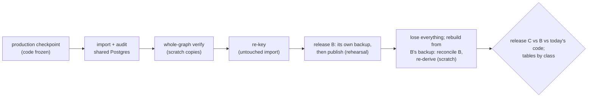

# 7. Stage 2: dry run on the server

Read [6. Stage 1](6-stage-1.md) first; next is [8. Stage 3](8-stage-3.md).

Status: started 2026-11-05 on `postgres-migration`, following the tested
stages 0/1 revision `5f5e52447963`. Gate 2 is open. Infrastructure onboarding,
persistent backup exclusions and enforced network isolation are prepared;
the full import must establish the stored rehearsal identity. Final-runtime isolated
network, worker recreation/restart and loopback relay/tunnel checks passed
against owned endpoints; that initial receipt proves HTTP relay behavior.
SQL authentication is recorded separately below; the credentialed application topology remains open
([proof](../../../journal/evidence/runtime/postgres-stage2-2026-11-05/network-final.json)).
Frozen-code reference R passed and is SHA-verified on the server. The two private R2 buckets
and dev expiry are verified. Both scoped S3 keys pass write, read-back and
guarded deletion checks; the Hub token now grants only the private rehearsal
repository. Alert delivery remains unresolved. All 45 immutable checkpoint transport files
are verified on the server. Production continues on
its current SQLite image; no cutover or source-site request from the new host
is authorized by this stage.

The first strict unpack rejected 153 legacy code scopes without verified
retained bundles. Frozen04 includes only the current input bundle; historical
v1 archives still exist on the worker. The unchanged reader collected all
192 required pairs from the SHA-checked frozen database. All thirteen retained
archives passed full byte and native semantic verification, covering every
required pair. The fresh strict unpack passes in 61.26 minutes with these
separate witnesses: full SQLite integrity, foreign keys and the original
database-bound file closure all pass
([unpack](../../../journal/evidence/runtime/postgres-stage2-2026-11-05/unpack-passed.json),
[archive proof](../../../journal/evidence/runtime/postgres-stage2-2026-11-05/code-archives.json)). Do not rewrite the frozen
checkpoint or waive its guard
([receipt](../../../journal/evidence/runtime/postgres-stage2-2026-11-05/unpack-code-closure-current.json)).

The five required storage and Hub credential fields are populated in the
private server template. No credential value was emitted, hashed or copied
to the Mac. The runtime token has one active resource grant, matching the
rehearsal repository's immutable ID; a second, empty user entry grants nothing
([scope](../../../journal/evidence/runtime/postgres-stage2-2026-11-05/credential-scope.json)).
Both bucket keys pass their own 36-byte probe and receive HTTP 403 for
HeadBucket against the other Swingset bucket and both Rhuidean buckets.
The two probe objects are absent afterwards; all seven existing apps are unchanged
([storage](../../../journal/evidence/runtime/postgres-stage2-2026-11-05/r2-capabilities.json)).

The single Hub duplicate request created a private snapshot, so its strict
default-branch history guard correctly refused success. It was never retried.
Separately reviewed branch creation anchors all 77 original source commits at
`mirror-live` and checkpoint A at `rehearsal`, preserving their commit IDs.
The source and the new repository's default branch remain unchanged. Baseline
file downloads were checked separately
([duplicate](../../../journal/evidence/runtime/postgres-stage2-2026-11-05/mirror-duplicate.json),
[anchors](../../../journal/evidence/runtime/postgres-stage2-2026-11-05/mirror-anchors.json)).
The first download check fetched ten files, then an older Parquet object
received HTTP 403 from the private repository's CDN. The live repository
serves the same original content hash. History metadata alone is insufficient;
The repaired mirror now has provider acknowledgments for all 967 original
large-file objects (8.78 GB). All 77 historical file trees match, and all
39 baseline files download with their expected hashes. No commit or ref changed;
the live head and seven existing apps are unchanged
([content proof](../../../journal/evidence/runtime/postgres-stage2-2026-11-05/mirror-content.json)).

The import runtime contains the exact source that passed 4,599 tests;
the server verifies its installed modules and manifest-to-CONFIG mapping
([image](../../../journal/evidence/runtime/postgres-stage2-2026-11-05/image-lazy-import.json)).
Three scoped database URLs were delivered directly from Dokploy into private
server staging files. They select the planned private relay at
`172.30.240.3:5432`. Only the held import utility has received the three
internal scoped files; ordinary workers remain unstarted
([credentials](../../../journal/evidence/runtime/postgres-stage2-2026-11-05/database-credentials.json)).
The actual Dokploy Compose service now runs four credential-free support
services: relay, proxy, resolver and owned mock. All three scoped logins pass
read-only authentication through the relay; only migrate can assume the owner
role. The host publishes only `127.0.0.1:15435`, outside ingress is denied,
and an SSH tunnel receives a SCRAM challenge without copying a credential to
the Mac. Owned proxy and resolver checks pass. Pipeline workers have not started;
their guarded credentialed topology and recreation checks remain open
([gateway proof](../../../journal/evidence/runtime/postgres-stage2-2026-11-05/gateway-sql.json)).

Private Postgres for verification is also deployed at `172.30.240.6:5432`,
with no published port, the shared server's exact image, C/UTF8 and 8 GiB/six
CPU limits. The 22 captured shared settings match except the planned scratch
`fsync` and `full_page_writes` changes; error statements and parameter values
also have explicit log protections. Separate worker/control logins authenticate
and cannot assume the owner or each other's capability. Their private cluster
has no application database yet. Three private-cluster application files are
mode 0400 for UID 10001. The seven existing apps and four gateways are unchanged
([private server](../../../journal/evidence/runtime/postgres-stage2-2026-11-05/private-postgres.json)).

The held import workspace contains 201,576 verified files (5.87 GB), owned by
UID 10001. The first utility stopped before initialization: that user could
not read the original UID-1000 source directory. A fresh read-only adoption
check confirms all 142 prepared tables remain empty and the catalog is unchanged.
A separate source volume now contains the full checkpoint, with ownership
for the actual utility user. That user independently reads and hashes all
38,890,938,368 SQLite bytes and verifies schema 37 and baseline A; the original
checkpoint and its permissions are unchanged
([workspace](../../../journal/evidence/runtime/postgres-stage2-2026-11-05/import-filesystem.json),
[refusal](../../../journal/evidence/runtime/postgres-stage2-2026-11-05/import-permission-refusal.json),
[readable source](../../../journal/evidence/runtime/postgres-stage2-2026-11-05/import-readable-source.json)).
The separately reviewed second attempt started 2026-11-06 21:25 UTC, with the
hold set, only three internal scoped credentials, a 7,200-second deadline and
a 200 GB disk floor. Source preflight returned after about 115 minutes, but
the first destination transaction found its connection closed. It exited one
before initialization. A fresh 2026-11-09 read-only check confirms all 142
tables remain empty, the catalog is unchanged, and no native import receipt
exists. The relay's 4,200-second idle timeout explains the stale session;
this is inferred from code and the idle interval, without a retained relay
timeout log
([refusal](../../../journal/evidence/runtime/postgres-stage2-2026-11-05/import-idle-refusal.json)).
The CLI now validates before opening its destination, then keeps that one
session through load and audit. It does not reconnect or reuse validation.
Separate preflight progress reports phase and table; they authorize nothing.
The reused monitor is now
the tested `swingset import-job` command. No scheduler or external I/O is enabled
([second preflight](../../../journal/evidence/runtime/postgres-stage2-2026-11-05/import-second-preflight.json)).

The second attempt spent 6,877 seconds before any load; the old 7,200-second
ceiling left only 323 seconds for COPY and the mandatory audit. A fresh attempt
may use a fixed 21,600-second total ceiling after the independent check of its
exact image, policy, mounts and empty target. This is measured safety headroom,
not a completion estimate. Keep 8 GiB, six CPUs, 256 processes, the 200 GB floor,
all source checks, final audit, existing relay and transaction limits, and
no automatic retry or reset. An operator attends, reports at least every two
hours, reacts to stalls or failures and reviews the existing hold. A failed
attempt retains all partial state. The core's separate 180-second limit stays
unchanged.

The third reviewed attempt started 2026-11-09 19:24 UTC with the tested
lazy-connection runtime and fixed 21,600-second ceiling. The replacement
namespace operator verified its new incarnation and private firewall. It loaded all 141 tables and 23,433,486 rows, then stopped at its fixed
ceiling during the independent audit. All state is retained; audit and stored identity remain open
([preflight](../../../journal/evidence/runtime/postgres-stage2-2026-11-05/import-third-preflight.json)).

The owner declined Slack and Healthchecks.io on 2026-11-06. Neither provider
is required. The storage and Hub credentials are ready; leave the notification
URL fields blank while their delivery method is unresolved.
Keep the owner-alert and outside liveness proofs open; blank fields do not
establish those proofs or disable the existing monitoring checks.

Developer-gate trigger: the corrected 2,729-case core passes functionally but
takes 200.48 seconds, above its unchanged 180-second limit
([measurement](../../../journal/evidence/runtime/postgres-stage2-2026-11-05/developer-wal.json)).
Use its measured phase and file costs to resolve that regression before landing.
Keep deadlines, memory caps and assertions; any selection change must follow
the existing core-versus-extended rule and retain the full-suite check.
An earlier `mise run check` passed: all 2,978 selected cases in 171.62 seconds,
plus Ruff and mypy across 362 source files. Source, selection, assertions and
caps are unchanged from the earlier 214.56-second run; the executor uses
refreshed measured scheduling weights
([receipt](../../../journal/evidence/runtime/postgres-stage2-2026-11-05/developer-passed.json)).
After adding the maintained mirror bootstrap command, a check passed
all 3,001 selected cases, Ruff and mypy, but takes 285.25 seconds. The unchanged
180-second gate reopened. Host swap pressure did not establish a cause
([measurement](../../../journal/evidence/runtime/postgres-stage2-2026-11-05/developer-mirror.json)).
The complete suite for that source passed all 4,573 cases in 29.34 minutes
([full run](../../../journal/evidence/runtime/postgres-stage2-2026-11-05/full-mirror.json)).
The earlier check, after adding the maintained import supervisor, passed all
3,018 selected cases in 171.71 seconds, plus Ruff and mypy across 364 source
files. The source binding is unchanged during the run; the unchanged
180-second gate passed. The final full run must include these additions
([current check](../../../journal/evidence/runtime/postgres-stage2-2026-11-05/developer-import-job.json)).
After the connection-lifetime and progress changes, all 3,027 core cases pass
in 207.00 seconds; mypy passes. A misplaced fixture lint annotation was fixed
afterwards and Ruff passes. The unchanged 180-second timing gate is open
([measurement](../../../journal/evidence/runtime/postgres-stage2-2026-11-05/developer-lazy-import.json)).
One controlled check after the image build finished passes the same 3,027
cases, Ruff and mypy in 192.23 seconds. Timing remains open; no selection,
assertion, resource or deadline changed
([check](../../../journal/evidence/runtime/postgres-stage2-2026-11-05/developer-controlled.json)).
The full suite for that source passes all 4,599 cases in 22.39 minutes,
with the complete source binding unchanged
([full run](../../../journal/evidence/runtime/postgres-stage2-2026-11-05/full-lazy-import.json)).

The source-volume experiment did not recover the budget and changed copied
file permissions, so it was reverted. Under the existing selection rule, the
older exhaustive read-set case moves to extended: it launches five entire
fixture files again. Its assertions remain unchanged. Core keeps the recorder
and wrapper checks, those files' existing selected cases, and a real armed
project/link pipeline smoke case. Record the new timing and run the complete
suite before landing.

Further setup reductions preserve actual restores and corruption assertions:
share immutable source archives, copy them privately per test, and retire the
source database. Transport core keeps direct contract checks and a native
standalone restore for each backend; its five multi-day integrations remain
unchanged in full. One link-fuzz seed stays in core and two additional seeds
remain in full. Measure the complete core after these changes
([focused checks](../../../journal/evidence/runtime/postgres-stage2-2026-11-05/fixture-setup.json)).
The complete suite passes all 4,550 cases with all 929 source and test inputs
unchanged
([full run](../../../journal/evidence/runtime/postgres-stage2-2026-11-05/full-durable.json)).
The earlier core contained 2,989.72 aggregate phase seconds across sixteen
workers, too much for balancing alone at those fixed measured costs.
A focused profile passes all eighteen publication safety cases and identifies
real publication backups and restore checks as the largest cost. It does not
justify skipping those checks or caching their results
([profile](../../../journal/evidence/runtime/postgres-stage2-2026-11-05/developer-profile.json)).
The passing run's aggregate phase work also fell, to 2,480.71 seconds. The
measurements do not isolate the cause or guarantee every future run's timing.

**Goal:** prove the port, the switch and the recovery on full-size data
and the server's own CPU, without touching other sites or the published
dataset. Production keeps running on the Mac.

**Three proofs, one full re-derivation:**

| Proof       | Runs on                                              | Shows                                                                                                                                                                             |
| ----------- | ---------------------------------------------------- | --------------------------------------------------------------------------------------------------------------------------------------------------------------------------------- |
| switch      | an untouched import of the checkpoint                | the ported code gives every stored result (a whole-graph verify run), and the re-key carries the graph over from SQLite's old recipe keys                                         |
| publication | the import, against a rehearsal dataset              | a release takes its own backup, then publishes, with the real locks                                                                                                               |
| recovery    | a fresh database and volume holding only that backup | the Hub being one release ahead is reconciled; everything else re-derives (the one full re-derivation) into a release identical to today's, built against the reconciled baseline |

The verify run is the per-unit proof of the port: it re-runs every current
unit with the ported code on the server's CPU and compares each output and
dependency set with what SQLite stored. Expected: about 0.02% differences,
each inspected (estimate from the re-derivation history). The rebuild is
the end-to-end proof: it re-derives the whole graph from the backup alone.

## Before it starts

- Gate 1 has passed.
- **Rhuidean's prerequisites** are in that repo and recorded there:
  1. Swingset's extra roles in the database onboarding
     ([3. Database code](3-database.md#roles));
  2. **a persistent backup exclusion** for every `swingset*` database.
     Today `mise run infra:backups` finds every database and creates or
     re-enables a daily full dump for each (`dokploy/infra/backups.sh`), so
     a later run would undo a one-off exclusion. The exclusion lives in
     Rhuidean's config, every run honours it, and a run with discovery is
     checked to leave no `swingset*` schedule;
  3. two R2 buckets, `swingset-backups` and `swingset-dev`, with
     bucket-scoped tokens, and the 30-day expiry on `swingset-dev`
     ([4. Hosting](4-hosting.md#backups-and-recovery)). R2 tokens cannot be
     limited to a prefix, so Swingset does not share Rhuidean's bucket;
  4. the enforced proxy/firewall egress rules and the loopback-only
     database relay, with the tests on
     [page 4](4-hosting.md#network-and-volumes). Record actual endpoint
     and port choices; an unimplemented allowlist is a blocker.
- The immutable environment guard and the tunnel tooling exist before
  any rehearsal database is created ([page 10](10-local-development.md#dev-and-production-stay-apart)).

## Steps

1. **Provision** with Rhuidean's tooling: a Swingset project
   (`mise run app:new`), which deploys a Dokploy Compose service
   (`docker-compose`, not a Swarm stack;
   [4. Hosting](4-hosting.md#services-on-dokploy)); a `swingset_dryrun`
   database on the shared Postgres 17, in the C locale, with the real
   roles, marked `environment` = `dryrun` (as is `swingset_drill` later); the services, secrets and alert channels. Add Swingset to
   Rhuidean's inventory. Record each Dokploy fact on
   [that page's checklist](4-hosting.md#dokploy-facts-to-check-not-assume)
   as verified or unavailable.
2. **Make fetching and publishing to the live dataset impossible,** not
   just switched off:
   - the only Hugging Face token writes to a separate rehearsal dataset,
     a full history mirror of the live dataset, so commit ids match. Its explicit
     rehearsal branch starts at the checkpoint baseline. A newer live default
     head is not force-reset; no operation writes the live repository;
   - the enforced egress policy allows only the bucket, Hugging Face, the
     alert channel and the dead-man's switch. Test denial of disallowed
     names and direct IP routes from every service using owned endpoints;
   - the out-of-band hold is set during the import.
3. **Freeze production's code.** From this checkpoint until the switch,
   production takes no deploys, so what the dry run proves is what the
   switch replaces.
4. **Transfer and import** a production checkpoint (39 GB, plus about
   2.5 GB of small files and input bundles) with the stage 1 importer into
   `swingset_dryrun` on the shared server, the way the switch will, and
   audit it. Keep the Mac awake for the transfer (see
   [8. Stage 3](8-stage-3.md#steps), step 2). Record the transfer, import
   and audit times, and how the other apps' health checks fared.
5. **Verify, then re-key, on this untouched import,** as the switch will:
   - a verify run of the whole graph, on scratch databases loaded from a
     dump of the import. Inspect every difference; a transform whose output
     really changed (for example a rounding difference on the new CPU
     type) gets a version bump in the port before the switch;
   - then the re-key on `swingset_dryrun` itself, through the worker role.
     Every eligible clean unit must be current afterwards. Bumped
     transforms and their affected consumers stay queued, never re-keyed
     to old outputs. Drain that work before building B and record it
     separately from the recovery drill's full re-derivation.

   Record both times.

6. **Back up, then publish once to the rehearsal dataset.** The rehearsal
   dataset preserves the live history, and its configured rehearsal branch
   carries the checkpoint's baseline commit, A; check the complete ancestry
   and baseline-file downloads first. A successful duplicate API call alone
   does not establish this; existing unrelated repositories are not adopted. Choose a
   checkpoint with changes since A, so the gate accepts a new release.
   - Run the scheduled backup job once (backup 1), and its check, foreign
     keys included. Record its size and time.
   - Build release B from `swingset_dryrun` and publish it to the
     rehearsal dataset through the normal path: reservation, its own
     backup (backup 2), push ([4. Hosting](4-hosting.md#publishing-and-backups)).
     The Hub is now one release ahead of backup 1.
7. **The rebuild drill** (the one full re-derivation), from backup 2,
   following [the rebuild order](4-hosting.md#backups-and-recovery)
   exactly:
   - restore only that backup into a fresh scratch database **and a fresh,
     empty state volume**. The drill's services mount no volume the import
     used and cannot reach `swingset_dryrun`, so no surviving file (the
     baseline, `BUILT`, `PUBLISHING`, a manifest, a receipt, Parquet) can
     make recovery pass when the backup lacks it. Before reconciliation,
     compare every restored history row and column against backup 2's
     frozen audit hashes, with only the destination environment identity
     excluded by its explicit rule;
   - for an explicitly staged restore, retain `RESTORE_PENDING` after the
     exact initial audit. Register its fresh UUID in the private rehearsal
     policy before any public I/O. Resume through the maintained command,
     which checks the public head before any cache hydration;
   - the Hub check finds B, the reservation backup 2 holds, and promotes
     it. Only then is B's Parquet downloaded and checked against B's
     manifest, so the baseline is B, complete, and not A;
   - set the bookkeeping tables by their rules, then re-derive everything
     with publishing impossible;
   - load the result into a fresh `swingset_drill` database on the shared
     server, as a real recovery would, and audit it.

   Recovery may span bounded resumable turns. Bootstrap completion and verified
   source chunks are recorded with the data, not only in a file. A budget or
   stop keeps the restore barrier and never resets completed replay. Unit
   deadlines and the final verification and history audit stay unchanged
   ([D-0277](../../../journal/decisions/0277-resume-recovery-from-database-bound-progress.md)).

   Record each part's time: their sum is the real recovery time.

   Reference-build storage trigger: the live SQLite database is over 20 GB,
   and another full checkpoint copy would cross the Mac's 80 GiB free-space
   floor. The measured frozen stream is 38,890,938,368 bytes; all 128 KiB
   chunks differ from the live file because checkpoint creation repacks it.
   Do not substitute the live database or reconstruct it with a full-size
   reflink rewrite. First test compression in a tiny owned filesystem inside
   a private mount namespace. Any full reference workspace needs a separate
   reviewed physical-growth bound, exact frozen SHA and both Mac and VM
   free-space guards. The maintained reference job uses a sparse loop device
   whose capacity equals that physical budget; it does not depend on Btrfs
   quotas. Verify its actual device size, synchronous discard and compression
   before restoring. Serialize its allocation with full-suite scratch.

8. **Compare:**
   - **releases:** build release C from `swingset_drill`, within its
     service's memory limit. Its release gate runs against baseline B, so
     a baseline with missing files fails here. Build release R with
     today's code on the worker VM from the same checkpoint. B, C and R
     must be byte-identical in every published table, except a named list
     of columns such as run ids;
   - **every table, by its class** ([4. Hosting](4-hosting.md#backups-and-recovery)),
     `swingset_drill` against `swingset_dryrun`:

     | Class       | Must hold                                                                                                                        |
     | ----------- | -------------------------------------------------------------------------------------------------------------------------------- |
     | history     | the initial restore matched backup 2 exactly; subsequent changes match the recovery transition list below                        |
     | rebuilt     | the same set of current units, each with an equivalent output and dependency set, by unit key and content digest; ids may differ |
     | bookkeeping | the table matches its reset rule; it is not compared with the import                                                             |

     The recovery transition list names table, key and allowed columns:
     settle the restored reservation, acknowledge B and advance the local
     baseline, settle interrupted runs/admissions, and append new
     recovery, rebuild and verification run records. New generated rows
     referenced by those records are listed too. Backup 2 cannot contain
     its own later registration; reconstruct that record from its checked
     manifest. Include the class list's exact mutable anchor fields, such as
     a scope's selected generation and signature or a source unit's accepted
     pointer, when the normal rebuild advances them. Preserve every other
     restored history value and every original key. The initial audit still
     compares all fields exactly before workers run. Test each allowed
     transition; blanket exclusions for operational tables
     are forbidden.

     A missing history row at the initial check means the backup left it
     out. A current unit that differs means the backup lacked an input or
     the rebuild is wrong. Past rows in rebuilt and bookkeeping tables (superseded
     generations, equivalences, failed attempts) are not expected to
     come back.

   An unexplained difference blocks the switch. A deliberate output change
   needs a named version bump and an independent check; missing history,
   broken references or incomplete verification cannot be waived.

9. **An unknown head blocks.** Run rebuild steps 1 to 4 from backup 1,
   into another fresh database and empty volume. Backup 1 knows only A,
   and the Hub is at B, so this is the lost-backup case: it must block and
   ask for a lost-evidence decision, and write nothing.
10. **Test the lifecycle and the failures,** on the shared server with the
    real Compose file and roles, unless noted:
    - a deploy under a hold, with a migration, then the hold lifted; then
      a rollback to the previous digest, which must be refused, and a fix
      forward;
    - recreate every container on the same volumes;
    - kill a service mid-tick; drop its database connection
      (`pg_terminate_backend`);
    - a hold and resume with both the switch-time operator hold and the
      out-of-band flag; successful and failed deploys with an existing
      operator hold must preserve it;
    - lose the backup's connection partway; crash between rebuild steps;
    - a Postgres restart, on a scratch container with the shared server's
      image and settings, because restarting the shared server stops other
      apps;
    - an alert reaching the owner, and the dead-man's switch firing.

    Each must show no lost commit, no repeated request to the mock source
    and no hold cleared silently. Repeat egress-denial and tunnel tests
    after container recreation.

11. **Egress rehearsal:** use an owned mock source to prove the allowed
    route, redirects, conditional requests, timeouts and Retry-After
    accounting through the real fetch gate. No collection site is
    contacted and no production host is paused. Actual source access
    from the new address remains unproved until the controlled first
    request in [stage 3](8-stage-3.md#steps). This keeps all real request
    accounting in the final production database.

**Scratch databases match the shared server.** They use its Postgres image
digest and its settings (the difference is recorded), except the durability
settings that verify and rebuild scratch turn off. Each gets CPU and memory
limits, so other apps keep their share of the host; the other apps' health
checks are watched during every heavy step.

## Gate 2

- the import's audit passes, and the other apps stayed healthy;
- the whole-graph verify run is clean, or every difference is explained and
  bumped; the re-key on the untouched import passes; times recorded;
- both backups' checks pass; their size and time are recorded;
- B published with its own backup first;
- the rebuild drill from backup 2, from an empty database and volume,
  reconciles B, downloads its Parquet after that, and finishes; releases
  B, C and R and the per-class comparisons are clean; the recovery time is
  recorded;
- recovery from backup 1 blocks on the unknown head;
- the tests in step 10 pass;
- the egress-denial tests and owned-source rehearsal pass, and the
  provisioned SSH tunnel works;
- peak memory per service and for Postgres is recorded, with no
  out-of-memory kill.

| Step                                              | Review                          |
| ------------------------------------------------- | ------------------------------- |
| rehearsal publication, paid resources or deletion | independent check plus receipts |
| other rehearsal work                              | tests and receipts              |

**Rollback:** stop the rehearsal services. Remove only exact owned
services and dry-run databases after an independent check; keep the
receipts and required recovery artifacts. Production never changed.

Next: [8. Stage 3](8-stage-3.md).

### Core concurrency measurement

The controller-routing fix passes all 4,600 full-suite cases and all 3,028 core
cases, Ruff and mypy. Core takes 203.50 seconds. Its 2,974.09 aggregate case
seconds already exceed 180 seconds across sixteen workers before setup and
cleanup overhead, so scheduling alone cannot close this run
([measurement](../../../journal/evidence/runtime/postgres-stage2-2026-11-05/developer-copy-controller.json)).
One twelve-worker probe used four clients with three workers each. It took
209.32 seconds with 2,313.07 aggregate case seconds, so it did not recover the
budget. The existing four-manifest validator also refused the changed layout;
the probe is not a passing gate. All executor and test edits were restored
byte for byte to the 4,600-case full-run binding. Keep four clients, four workers,
the same selection, assertions, serial prologue, resource caps and 180-second
gate. No further automatic timing retry is planned
([probe](../../../journal/evidence/runtime/postgres-stage2-2026-11-05/core-worker-probe.json)).

The controller fix's runtime is cached separately for private verification.
All 364 installed Python modules match the exact source that passed 4,600
full-suite tests, including the controller regression. The now-stopped import
retained its prior pinned runtime; no worker has switched images
([image](../../../journal/evidence/runtime/postgres-stage2-2026-11-05/image-private-verifier.json)).

The verifier also needs its configured writable `TMPDIR` for graph scratch.
That fix passes all 4,600 full-suite cases with an unchanged complete input
binding. Its core before the catalog probe passes correctness, Ruff and mypy in 207.85 seconds;
the 180-second timing gate remains open. A new cached runtime matches all
545 installed package files. The now-stopped import retained its prior runtime;
private verification still awaits the completed native audit and identity
([validation and image proof](../../../journal/investigations/2026/stage-2-server-rehearsal-2026-11-05.md#writable-verifier-scratch-and-current-import)).

### Controlled warm catalog probe

The latest unchanged core takes 207.85 seconds against the 180-second budget.
The same disposable test server served the earlier 171.67-second run. Its
shared dependency catalog has 4,338 live rows, a 2,359,296-byte heap, and
105,414,656 bytes in two indexes. No client connection is active. This is a
measured possible source of DDL overhead; it does not establish causation.

The trigger for one controlled probe is a failed core timing gate together
with those inflated catalog indexes. Rebuild only
`pg_catalog.pg_shdepend_depender_index` and
`pg_catalog.pg_shdepend_reference_index` on the exact labeled disposable test
service, after an independent check and a fresh no-owner/no-client guard.
Preserve every database, role, schema, template, other service and resource
limit. Reuse the 207.85-second run's exact measured weights and run one
supported check. Keep its result even if it misses the budget; do not retry.
No test selection, assertion or deadline changes.

Scratch preflight and before/after measurements live in
`/tmp/swingset-stage2-core-catalog-probe-20261109/`. The unchanged full-run
source binding is `79e5eb35fd90326a6e1fad6a551a5f8ee2b30ad2cd0add9a8c9024f34b97d70e`.

The controlled probe completed November 9 after an independent check. Both
indexes shrink to 172,032 bytes combined; all 4,338 heap rows, databases,
roles and container identity are preserved. The matched 3,028-case core takes
192.20 seconds, versus 207.85 before. Correctness, Ruff and mypy pass, but
the 180-second timing gate remains open. The one probe does not isolate
other host effects, and no further timing retry is planned
([receipt](../../../journal/evidence/runtime/postgres-stage2-2026-11-05/core-catalog-probe.json)).

### Bounded read-only transfer measurement

The imported database's measured directory is 38.50 GB, above the 20 GB
state-size trigger. During its final audit, observed SQL return traffic rises
from 64.7 to 75.8 GB over about ten minutes; a later sample shows about
18 percent client CPU and 14 percent Postgres CPU. This does not establish
the cause of the transfer rate.

Run one bounded diagnostic on the existing SQL path, using the internal worker
login and synthetic bytea only. Read 8 MiB at each of three query sizes:
64 KiB, 1 MiB and 4 MiB, with a thirty-second total bound. Record all results
without repeating the probe. It changes no application row, producer, route,
resource cap or deadline. Keep the native import unchanged; any later code
change needs its own measured justification and validation.

The single probe passes at 00:48 UTC on November 10. SQL reports
38,501,373,619 database bytes. Synthetic reads measure 6.58 MB/s at 64 KiB,
22.43 MB/s at 1 MiB and 26.09 MB/s at 4 MiB. This measures query-size
overhead on the actual relay path, not the real audit's speedup or a proven
network cause. No application row or running producer changed.

If the fixed import ceiling expires without a complete audit, test 1 MiB
chunks for a separately reviewed next attempt. Preserve streaming bounds,
typed digests, every source and final audit, resource caps and deadlines.
Do not change the active producer or repeat this probe
([measurement](../../../journal/investigations/2026/stage-2-server-rehearsal-2026-11-05.md#synthetic-bytea-probe-at-0048-utc)).

The attempt stopped November 10 at 01:26 UTC after the six-hour ceiling
and its 120-second stop grace. Exit 137 was the deadline kill; all observed
OOM-kill counters remain zero. Its native receipt retains all 141 completed
loads but no final audit. No reset or automatic retry occurred
([stop receipt](../../../journal/evidence/runtime/postgres-stage2-2026-11-05/import-budget-stop.json)).
The 1 MiB transfer fix and maintained `inspect-import` command pass all
33 focused import/utility cases and all 4,611 full-suite cases. Core correctness
passes all 3,039 cases in 187.54 seconds; its 180-second timing gate stays open.
The matching immutable runtime is cached and all installed inputs match the
completed validation. The large Unicode regression loads at 64 KiB, resumes at
1 MiB and audits at 4 MiB without changing typed digests.

The first scratch adoption helper refused on an incorrect role name. Its
replacement is the tested read-only command, with a NULL-safe guard for hidden
cross-role sessions. Independent read-only adoption now passes for the exact retained UUID, schema
and all 141 row counts. Final resume review and capacity for new receipts
remain required before another native attempt
([current validation](../../../journal/investigations/2026/stage-2-server-rehearsal-2026-11-05.md#full-validation-passed-at-0310-utc)).
