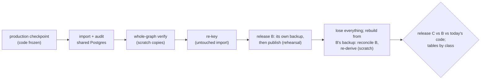

# 7. Stage 2: dry run on the server

Read [6. Stage 1](6-stage-1.md) first; next is [8. Stage 3](8-stage-3.md).

November 17 native41 normal graph ends naturally at 10:56:37 UTC, exit1,
on qualified source `be56773b…` / CONFIG `2eb802d9…`. It returns 107,674
unique results against 108,390 expected: 107,007 match, 653 mismatch and
14 fail. Thirteen link units exceed the unchanged 75-second write limit.
`project/inventory/all` loses its connection; shard1 stops and leaves exactly
716 units unattempted. No OOM or supervisor stop is observed. Independent
terminal review accepts the protected-source boundary and automatic owned
cleanup only, rejecting the graph, Gate2 and re-key. Raw receipt and review
stay in scratch under the evidence rules
([terminal outcome](../../../journal/investigations/2026/stage-2-server-rehearsal-2026-11-05.md#native41-normal-graph-terminal-2026-11-17)).

This normal failure selects one bounded current-producer inventory
attribution before any further optimization. Reuse the maintained
`unit-diagnostic` operator and host supervisor, updating their fixed producer
to immutable BE567 / CONFIG2eb / 570 installed files / Linker10. Pin the
actual graph clock `2026-11-17T05:20:58.846978+00:00`, source00c, accepted5039
and actual audit/version/input context. Mirror ordinary committed input
acceptance; the graph's unsupported predictive binding stays null. Do not
invent a projected binding or overlay business code in `/app`.

Select only `project/inventory/all` on one fresh owned copy. Keep native75,
all resource and statement limits, rollback-only verification, source
fingerprints and owned cleanup. Record bounded owner wall/CPU spans and the
original exception class/SQLSTATE and connection state at loss, without
messages, arguments, SQL, locals or secrets. Observation and restoration
must preserve primary failures. Promote the necessary tested diagnostics
into the existing maintained modules; do not retarget the executed scratch
helper or add a general controller. Concrete admission and sole review
precede execution. One isolated sample does not prove the historical loss
cause. The 13 link overruns and all 653 mismatches remain unaccepted; no
unchanged whole-graph retry, limit raise, Shared migration, re-key, backup,
publication or recovery is selected before the measured failures are fixed.

For the observed link-label differences, select a bounded read-only
counterfactual witness. Current output labels include
`identity_links.linker_version`; test whether changing only recorded 9 to 10
predicts each actual found label. First reproduce every original label,
preserve all other payload values and ordering, and retain exact unmatched
units. No database write or version-only explanation is authorized by the
aggregate counts. Dependency-only differences still require closed queue
exclusions; no bump or tolerance waiver follows without its witness.

Use the original native38 C696 copy through one repeatable-read, read-only
snapshot for that witness. The proposed SQLite reader remains stopped:
host permissions prevent proving that its source has no writer. No SQLite
source hash or reader execution occurred. Stream typed rows only through a
server-local pipe to the isolated reader; export only hashes, counts and
unit names. Both processes must exit zero after the committed footer and
EOF. Exact source identity, cold helper profile, independent review and
one execution intent precede the query. This route grants no host-wide
privilege and changes no graph acceptance rule.

The first actual native witness reproduces all 405 original labels and
explains 401 through that single version field. Four remain: July 2025
Midwest Westie Fest, February 2026 Rose City Swing, May 2026 SoSwing and
July 2026 Midwest Westie Fest. Keep every residual blocked; do not infer
its cause from the majority. The graph still has 13 link overruns, the
inventory failure, 716 unattempted units and 248 dependency-only differences
([witness](../../../journal/investigations/2026/stage-2-server-rehearsal-2026-11-05.md#native-link-version-witness-2026-11-17)).

Select a narrow hash-only path in the existing maintained forensic command
before another capture. Start with the 248 dependency differences: 191
distinct expected roots, plus the checkpoint's selected inventory group,
split into packets of at most 128 top-level roots. Read no nested scan or
assumed rolled-back found manifest. First prove each original root digest,
unit pointer and label. Then replace only the inventory selection and use
the existing canonical outer-list sort to test the complete found digest.
Keep every failed reconstruction blocked.

Raw rows, root bodies and names stay in server RAM. Preserve the existing
source, time, resource, byte and root limits. Promote repeated stream
validation into `metadata_capture.py` and its existing tests; do not run
the one-off reader again or add a launcher/framework. Implement and test
locally while the inventory sample runs; no forensic server operation or
source connection precedes that sample's terminal cleanup review. The
four numerical differences still need closed current pair sets and full
label reconstructions; old missing captures supply hypotheses only.

The current inventory sample completes its diagnostic and owned cleanup,
but the write fails at 75.038 seconds. Source fingerprints and rollback
match, the connection remains open/idle, and observer quality passes.
Capture takes 33.159 seconds, including a 32.429-second desired selection;
inventory preparation takes 23.818 seconds. Completion is interrupted
during its repeated desired selection, in the per-member generation-pointer
lookup. These nested spans are not additive and identify no exact timed
SQL statement. This does not reproduce the normal graph's connection loss
([measurement](../../../journal/investigations/2026/stage-2-server-rehearsal-2026-11-05.md#current-inventory-diagnostic-outcome-2026-11-17)).

That measured overrun selects bounded pointer reads through the existing
`selected_generations` module interface. Resolve each dependency cohort
in batches, preserving missing pointers, group overrides, duplicate input
members, canonical member ordering and exact digests. Keep both fresh
selection checks, all mutation/rollback protections, and the 75-second
limit. Add no cache, schema change or version bump. Query-count and
semantic-equivalence tests precede qualification and actual timing; the
13 link overruns and all other graph blockers remain open.

Before another whole graph, select one bounded attribution of the current
first failed link, `link/event/2020-01-budafest-open-wcs-championships`,
on qualified BE567. Its normal graph overrun is the trigger; the earlier
West-in-Lyon sample predates the native41 indexes and is not its proof.
Extend the existing maintained diagnostic to this explicit target while
preserving the inventory default, one owned copy, ordinary committed
acceptance, exact current context, native75, rollback and source checks.
Observe bounded evidence/resolve/commit and completion spans with the same
safe exception metadata; do not change scoring, matching or caller checks.
No arbitrary target, one-off script, new launcher or unbounded profile is
selected. Qualification and separate concrete review still precede a
single actual invocation. Local preparation may run in parallel with the
pointer fix; no new server action follows from this plan edit.

November 16 current normal graph fails. Source `862bbd75…` / CONFIG
`e68aa127…`, Linker 10 and 75-second writes end naturally at 23:34:02 UTC,
exit 1/PID0, no OOM or restart. The 108,390 unique expected identities all
return: 38,070 match, 107 mismatch without declared bumps and 70,213 fail.
Of the failures, 67 exceed the unchanged 75-second write bound; 70,146 are
ConnectionLost. Complete and clean remain false. Empty shard-level errors
do not erase unit failures. The source/current checkpoint `00c831a4…` /
`5039effb…`, D58 and actual audit/version/input context remain captured;
unsupported predicted binding remains null. Sole terminal review accepts
only source/protected preservation and automatic owned cleanup, rejecting
graph, Gate 2 and re-key acceptance
([terminal receipt](../../../journal/evidence/runtime/postgres-stage2-2026-11-16/normal75-graph-d1f0059d2cc2-terminal.json)).

Each shard keeps one Database. Once its final deadline leaves that session
closed, roughly 35,000 following units per shard return the same ConnectionLost.
That cascade is established; the initial session-closure cause is not yet
proved. The 67 actual overruns remain failed. The generic supervisor
ValueError/peer-or-disk stop label supplies no precise cause, and no supervisor
stop is attempted. The normal failure now triggers bounded current-runtime
attribution; no limit raise, optimization, unchanged replay, shared migration,
input acceptance or re-key is selected. All three owned databases/backends,
ledger, processes, cgroup and authorization are retired automatically. Source
C696/69, native38, protected14 and the original five-database catalog remain
preserved. No observed OOM establishes no stronger memory-pressure claim.

Two local correctness fixes now stop a shard on session loss, preserve its
completed prefix and mark remaining work unattempted. Expired writes on a
closed session report ConnectionLost with rollback unconfirmed, preserving
commit uncertainty and external interruptions. The existing verifier and
deadline test files pass all 32 and 35 cases. The complete core check passes
all 3,713 cases in 249.48 seconds under 300 seconds; Ruff and mypy pass on
source `b06416a2…`
([receipt](../../../journal/evidence/runtime/postgres-stage2-2026-11-16/closed-session-correctness-core.json)).
The extended suite also passes all 5,293 cases with four workers in 1,516
seconds, with zero failures, errors or skips and unchanged source binding
([full receipt](../../../journal/evidence/runtime/postgres-stage2-2026-11-17/closed-session-correctness-full.json)).
These fixes change neither the 75-second limit nor link computation. They are
not deployed and do not resolve the 67 measured overruns. A read-only copy of
all 956 qualified inputs preserves source `862bbd75…` for current-runtime
attribution while the working copy changes.

The failed normal graph selects one bounded attribution of
`link/event/2019-03-west-in-lyon`, a real 75-second overrun followed by
461 successful comparisons in its shard. Use the unchanged qualified862
producer and Linker 10, one fresh owned copy of protected C696, ordinary
input acceptance and one real verifier rollback. Preserve the 75-second
write limit; measure elapsed time, owner CPU and nested driver spans.
No shared writes, provider access, retries or session repair are selected.
The measurement must prove entry into the real native write boundary,
preserve primary failures through observer cleanup and reject incomplete
quality. Corrected diagnostic source and actual container pass sole review. Actor
`b2819cfa…` starts once at November 17 01:33:52 UTC, PID 2471234 / birth 1027567070. Its exact owned `2db67a13…_0`, OID 8109605, is freezing;
source C696 remains read-only. Independent startup review accepts the
incarnation, authorization, firewall, resource and protected-source boundary
([startup](../../../journal/evidence/runtime/postgres-stage2-2026-11-17/one-link-b2819cfa7563-startup.json)).
No copy-ready, accepted checkpoint, trial or cleanup result exists yet. This
selects measurement, not an optimization or another whole-graph replay.

The one-link diagnostic ends naturally at November 17 02:14:32 UTC.
Actual input acceptance5039, native-entry1, complete measurement quality,
rollback equality and healthy writer are proved; the unit still fails75.
Persistence spans40.088 seconds (2.176 ownerCPU), before any `_write_subject`
entry; its old-row deletion loop is therefore the next measured target.
Loading spans21.049 seconds and resolution11.593; timings overlap and include
observer cost. Full source00c post-binding and automatic owned cleanup pass
sole terminal review
([measurement](../../../journal/evidence/runtime/postgres-stage2-2026-11-17/one-link-b2819cfa7563-terminal.json)).
The 67 normal overruns and this failed native75 sample select a bounded
read-only catalog/EXPLAIN check of the two existing subject-ID deletes. Use
plain EXPLAIN without ANALYZE and read-only PostgreSQL sessions; preserve
every query, write order, history, transaction and75-second limit. Do not
choose an index or SQL rewrite until those actual plans identify a target.

The read-only source catalog and plain EXPLAIN confirm sequential scans
for both subject-only deletes, over about214,000 rows each. Existing keys
lead with subject_kind, not subject_id. Native39/40 leave these table/index
definitions unchanged. This measured target selects native migration41: add
one nonunique subject_id index to each table. Preserve the existing delete
predicates, subject order, row triggers/history and transactions; do not
batch or narrow the deletes. No index is installed on the server by this
read-only check, and no speedup is yet proved
([plans](../../../journal/evidence/runtime/postgres-stage2-2026-11-17/link-subject-delete-plans.json)).

Recovery C's failed provisioning partial has been reconciled without
regenerating credentials, roles or its database. All three scoped logins
authenticate; the remaining public-schema CREATE grant is revoked, and
initial empty tables are prepared in the same database, OID 16394.
The owned PG stops cleanly with no running volume mounters. Failed actors
and receipts remain. This is limited empty preparation on frozen source862:
fsync and full_page_writes are still disabled, so it proves no durability,
restore, rebuild or current native41 runtime. A durable configuration needs
separate admission before recovery
([preparation](../../../journal/evidence/runtime/postgres-stage2-2026-11-17/recovery-C-empty-preparation.json)).

The prepared C comment still binds the full native40 migration checksum.
Current native41 adoption must refuse it, despite identical empty table and
role definitions. Before current-source restore, flush the owned C data directory while its
PG is stopped, using the pinned PG image's `initdb --sync-only`. Require a
natural-zero result; normal initialization is forbidden. Then start a new
owned actor with durable settings, retaining the old actor stopped.
Changing settings alone does not flush earlier kernel buffers
([PostgreSQL 17 fsync](https://www.postgresql.org/docs/17/runtime-config-wal.html#GUC-FSYNC),
[sync-only](https://www.postgresql.org/docs/17/app-initdb.html)). Then separately
admit an explicit empty-marker rebind: prove the old comment, same database,
roles, grants, table phase, complete catalog and zero rows; change only the
prepared comment to the actual native41 checksum and verify normal adoption.
Do not relax the ordinary adoption check or edit old receipts. Any physical
or role difference refuses this route and requires a fresh-database plan.
No such operation has run.

Local native41 validation passes all 47 schema cases and3,716 core cases
in 198.79 seconds under 300, with Ruff/mypy/formatting clean. The guarded
read-only native38 path explicitly admits index-only41; unknown future
versions still refuse and ordinary workers still require the current schema.
Source BE567 and its 957-input binding16e74b75 remain unchanged. The full
suite passes all 5,296 cases in 1,272.28 seconds. The corrected AMD64 runtime
is byte-qualified and cached inactive, with baseline dependencies unchanged.
The image-only guard transition is independently accepted; new guardian
`0d9661f9…` authorizes CONFIG2eb and retains A30 stopped. The later normal
graph fails as recorded above; remaining failures are unresolved ([core](../../../journal/evidence/runtime/postgres-stage2-2026-11-17/native41-core-validation.json),
[full](../../../journal/evidence/runtime/postgres-stage2-2026-11-17/native41-full-validation.json),
[runtime](../../../journal/evidence/runtime/postgres-stage2-2026-11-17/native41-runtime-qualification-cache.json),
[guard](../../../journal/evidence/runtime/postgres-stage2-2026-11-17/native41-guard-image-transition.json)).

Before terminal, the 22:16 UTC observer records the graph running and incomplete,
with five databases and no result. Separately, shared read-only audit
actor `8e89e54f…` is cold-prepared at 22:13 UTC: all 65 transport outcomes
and six helper exits pass, the two public files are sealed, and the fresh
output volume is private. The actor remains Created/PID0 and has never started.
Its three RAM-only environment comparisons pass. Only the original host
worker DSN is mounted; numeric metadata is verified, not its endpoint or role.
The audit program differs from unexecuted V2 only in three distinct SQL column
aliases. Its selected 7,200-second whole-actor ceiling includes authorization
wait and changes no reader, statement, lock or 75-second write policy.
Actual checkpoint timing and all-141-table typed parity wait for graph
completion, owned cleanup and fresh admission. No scan, migration, acceptance,
re-key or deletion is performed by this preparation
([cold audit receipt](../../../journal/evidence/runtime/postgres-stage2-2026-11-16/shared-readonly-audit-b96f3fe7b551-cold-preparation.json)).

November 16 diagnostic outcome: the actor ends naturally at 19:19 UTC,
exit zero, with the diagnostic complete but inventory unit failed.
Input acceptance takes 59.692 seconds under the 75-second policy. The
instrumented inventory trial reaches `WriteDeadlineExceeded` at 75.004
seconds; rollback and observer checks pass. Capture takes 40.239 seconds,
including desired selection at 39.496 seconds; inventory preparation takes
31.484 seconds. Nested timings overlap and include observer overhead.
The original policy is restored, full source post-binding passes, and the
operator completes owned cleanup. Sole terminal review accepts the exact
source/protected boundary, owner database/backend/registry removal and retired
processes/auth, while explicitly retaining the failed inventory result
([terminal receipt](../../../journal/evidence/runtime/postgres-stage2-2026-11-16/inventory75-diagnostic-92900be19500-terminal.json)).

Keep 75 seconds. The qualified current runtime's first normal, uninstrumented
whole-graph run is now terminal failed through the existing two-process supervisor.
The earlier instrumented failure does not predict normal
runtime timing. Do not repeat the instrumented trial or select an optimization
from these coarse spans alone. A normal 75-second failure is the trigger for
further bounded current-runtime attribution before a source fix. Linker 10
and dependency-closed re-key exclusions use the existing automatic bump checks;
no new supervisor flag is needed. The later authoritative migration and re-key
target is shared `swingset_dryrun`, OID 16398 / UUID `9bccc2d4…`; private C696
and 69 remain protected bases. The reviewed image-only guard transition
completes at 20:00 UTC: all 49 vectors and four fresh pre-go reads pass their
declared outcomes; independent terminal review accepts the result. New guardian
`a30fa116…` / PID 3777145 / network inode 4026533272 runs CONFIG `e68aa127…`;
old CB is intentionally stopped, exit 143, and retained. Policy canonical
`49f56776…` changes only the image; source, catalog and 12 applications remain
preserved. Held inventory is incomplete (37), not a normal-health pass.
The earlier pre-go parser refusal remains preserved without effect replay.
That guard operation grants no graph or SQL authority; the later independent
graph action review covers the running verifier.
The actual graph admission binds the new guardian's incarnation; its normal
whole graph is now terminal failed. Hold `248f8cf1…` is independently
renewed to November 17 03:58:57 UTC; only its current interval is continuous
([guard receipt](../../../journal/evidence/runtime/postgres-stage2-2026-11-16/runtime862-guard-transition-20261116.json),
[renewal](../../../journal/evidence/runtime/postgres-stage2-2026-11-17/hold-review-20261117-025857.json)).
Renewal packet `203956` preserves both installer and rename transport timeouts.
Exact helper terminal checks establish natural exit zero; maintained remaining-only
continuations complete without replay. Rename finishes at 20:44:36 UTC, before
the previous expiry. Independent terminal review accepts the installed hold,
three remote receipts, pointer and unchanged protected services.
The next routine renewal activates at 21:16:30 UTC before that expiry. All
seven transports and both helpers exit zero; independent terminal review
accepts installed hold `f88d3447…`, readbacks, pointer and protected services.
No timeout or additional runtime authority is attributed to this renewal.
The next routine renewal activates at 21:50:37 UTC, before the previous
22:15:40 expiry. Seven transports, both natural-zero helpers, protected12,
three receipt readbacks and pointer pass independent terminal review. Current
hold `2f654459…` is due at 22:50:26 UTC; earlier expired gaps remain historical.
Renewal 11 activates at 22:27:19 UTC before that expiry, setting hold
`ba19b2bf…` due at 23:27:08 UTC. All seven transports, both exact
natural-zero helpers, protected services and three receipt readbacks pass
independent terminal review. This current interval is continuous, with no
additional graph authority or change to R0's conditional comparison contract.

Renewal 12 activates at 22:55:09 UTC before the preceding expiry. All seven
transports, both exact natural-zero helpers, protected12, three receipts and
pointer pass independent review. Hold `759cc94b…` is due at 23:54:58 UTC;
this renews the current interval without adding runtime or cleanup authority.

Renewal 13 activates at 23:18:49 UTC before the preceding expiry, setting
hold `d4a95834…` due November 17 00:18:39 UTC. Seven transports, two
natural-zero helpers, protected12, three receipts and pointer pass sole
terminal review. This administrative renewal adds no runtime authority.

Renewal 14 activates at 23:54:04 UTC before the preceding expiry, setting
hold `7f59242e…` due November 17 00:53:53 UTC. All seven transports,
both exact natural-zero helpers, protected12, three receipts and pointer
pass independent terminal review. Only the unchanged hold protocol is
qualified; the new correctness fixes are still under local validation.

Renewal 15 activates at November 17 00:35:23 UTC before the preceding
expiry. Hold `17bd0c09…` is due at 01:35:13 UTC. Seven transports, both
natural-zero helpers, protected12, three receipts and pointer pass the sole
terminal review. Historical gaps remain; no runtime authority is added.

A separate ARM64 build completes at 21:15 UTC on the same source and all 956
unchanged inputs. Its 569 public files and 376 Python files, duplicate app
source, OCI layers and dependency prefix match. ARM dependencies `63354d08…`,
artifact `dd7ff201…` and portable CONFIG `f620b010…` remain separate from the
running AMD64 producer. The byte-proof container never starts. This is an
inactive qualified artifact, not a VM activation, reference result or proof of
B/C/R parity. A second full current-ARM replay remains unselected: C is the
one full recovery re-derivation, while R is the frozen production-code control.
Fresh public-code hashing confirms R0's unchanged `b6cc9c28…` source across
290 Python files; preserved export, BUILT, manifest, full result and policy
match their original hashes. R0 is eligible only conditionally on the actual
strict B/C/R published-table comparison. Its manifest records ordinary
`built_at` November 5 23:52:36 UTC and evidence cutoff 03:53:55 UTC; neither
is relabeled a sealed rendering clock, and no identical-clock gate is added.
At 22:36 UTC, fresh hashing of all 59 exported files (381,686,344 bytes)
matches the original export, including every Parquet file. Actual B/C/R
comparison remains pending. A real business-column mismatch blocks acceptance regardless of
clock or floating-point explanation; a necessary fresh legacy rerender would
need its own reviewed route, never a waiver
([ARM qualification](../../../journal/evidence/runtime/postgres-stage2-2026-11-16/runtime862-arm64-qualification-20261116.json),
[R0 source/control recheck](../../../journal/evidence/runtime/postgres-stage2-2026-11-16/reference-R0-source-control-recheck-20261116.json),
[payload freshness](../../../journal/evidence/runtime/postgres-stage2-2026-11-16/reference-R0-payload-freshness-20261116.json)).

November 16 resume: the owner approves closing tested revision `rnmoupss`
as `ec2e7f13`; fresh revision `ouvlzsyr` has a new 200 KiB evidence budget.
Earlier launch observations: the reviewed diagnostic starts at 18:33 UTC on frozen
producer `8aae03bf…` / image `346f30a4…`; it remains running without reported
error at 19:02. Independent review accepts actual startup; renewal `41f2b246…` is independently
accepted, with review due at 19:35:51 UTC. The observed operator phase is
the destination graph prelude at 19:05: the one owned freeze has returned and
the owned-copy 75-second override is applied. No acceptance, trial,
cleanup or migration success was established at that observation. The producer
stays fixed through its terminal result above.

Select qualified source `862bbd75…` for the next actual runtime and whole-graph
proof after this diagnostic is terminal. Ordinary dependency/runtime AMD64
builds complete locally at 18:45 UTC, with all 956 source inputs unchanged.
All 569 public files and 376 Python files match, including duplicate app source;
OCI manifest/config/layer and dependency-rootfs-prefix checks pass. Artifact
`08df0ebc…` and portable CONFIG `e68aa127…` are distinct identities; archive
size is 248,929,280 bytes. Separate cache-only server transfer/load completes
at 18:52 UTC: all 15 transports exit zero, archive readback and CONFIG
`e68aa127…` / linux-amd64 labels/rootfs match the qualified local artifact.
Pre/post protected 14 containers, running old diagnostic incarnation, hold
and capacity remain preserved. The image is cached inactive, not activated
or deployed; no server installed-file proof is claimed.
The byte-proof container is never started. The build uses the existing
`swingset-stage1-final` builder, bounded to 2 CPUs, 2 GiB RAM, 4 GiB swap and
256 PIDs; measured host free space is 143,641,060 KiB, above the 80 GiB floor,
with no full-suite scratch active. Preserve the qualified OCI artifact, Docker
CONFIG, dependencies and source identities.
No image replacement or server transition occurs before diagnostic terminal;
fresh actual runtime admission and whole-graph review remain required
([launch and direction](../../../journal/investigations/2026/stage-2-server-rehearsal-2026-11-05.md#november-16-75-second-diagnostic-starts),
[local runtime qualification](../../../journal/evidence/runtime/postgres-stage2-2026-11-16/runtime862-amd64-qualification-20261116.json),
[actual startup](../../../journal/evidence/runtime/postgres-stage2-2026-11-16/inventory75-diagnostic-92900be19500-startup.json),
[inactive server cache](../../../journal/evidence/runtime/postgres-stage2-2026-11-16/runtime862-server-cache-20261116.json)).

Earlier preparation sequence:
The new 75-second packet passes local static review and all 26 scoped
read-only transports finish at 16:15 UTC. Independent review accepts those
observations, not full admission: held status has incomplete inventory (36).
Capacity is 579,074,048,000 bytes against a 508,224,930,112-byte requirement.
Subsequent ordinary renewals preserve current validity; hold `3ce1251b…`
activates at 17:50 UTC, with review due at 18:50:30 UTC. Only the renewed
intervals are continuous; retain the earlier 318,292.82-second expired gap.
No worker had started at these observations. The subsequent 35 missing-metadata
checks pass at 16:31 UTC: 25 exact named Docker absences exit one and ten
positive checks exit zero, with no unknown outcomes. These establish observed
name/root/IP and host-timeout metadata, not reservations or preparation.
Rows 0–78 then complete at 16:52 UTC after the bound fresh 27-read pulse and
exclusive root go: all 79 contracts validate, with seven source-read-only
helpers and four public-seal helpers exiting naturally. The public operator
is sealed. Independent terminal review accepts the prefix. Preserve the earlier
before-row-79 refusal: its local validator expected nine hashes from the
seven-Python-file command; all seven match, without server drift. The corrected
remaining-only boundary adds two missing JSON hashes and the original 38
unattempted reads, replaying none of the completed 16. Rows 79–145 then pass
all 67 outcomes at 17:27 UTC under separate review and root go. Independent
terminal review accepts all 24 helper profiles, three fresh owned volumes,
numeric settings metadata and the 1,689-file/69,548,306-byte input closure.
The final three post-cold reads then complete at 17:42 UTC. Independent terminal
review accepts all 147 preparation rows: container `24154fe5…` is Created,
PID zero and never started, with complete public Config/HostConfig, 11 mounts
and six RAM-only comparisons passing. Preserve every helper, volume, proof and
the original refusal; no failed read is replayed. No database freeze or worker
had run at preparation completion. The source volume's numeric DSN guard is row 42; final actor Env is
checked only in RAM. A separately reviewed actual 75-second execution plan,
fresh complete boundary and explicit root go are required before start.
There is no `--env-file` dependency or reason to read host `private.env`.
Obtain complete preparation admission before effects, recheck the boundary
before allocation, then separately review actual cold execution
([collection](../../../journal/evidence/runtime/postgres-stage2-2026-11-16/scoped-readonly26-20261116-161535.json),
[renewal](../../../journal/evidence/runtime/postgres-stage2-2026-11-16/hold-review-20261116-175030.json),
[missing metadata](../../../journal/evidence/runtime/postgres-stage2-2026-11-16/scoped-missing35-20261116-163101.json),
[prefix progress](../../../journal/investigations/2026/stage-2-server-rehearsal-2026-11-05.md#november-16-preparation-prefix-completes),
[boundary refusal](../../../journal/investigations/2026/stage-2-server-rehearsal-2026-11-05.md#november-16-before-allocation-boundary-refusal),
[phase-two progress](../../../journal/investigations/2026/stage-2-server-rehearsal-2026-11-05.md#november-16-preparation-rows-79-to-145-complete),
[completed preparation](../../../journal/evidence/runtime/postgres-stage2-2026-11-16/cold-unit-preparation-92900be19500.json)).

November 13 core policy update: the owner raises the complete local core
gate to 300 seconds (five minutes). This supersedes earlier instructions
below to retain 180 seconds; historical failures keep their original outcomes.
Fresh validation must report the active budget and exact source. Test
selection, worker counts, resource caps and the 75-second write bound stay
unchanged ([current gate](6-stage-1.md)).

November 13: the owner changes the shared worker write deadline to 75 seconds
([D-0294](../../../journal/decisions/0294-use-a-seventy-five-second-worker-write-deadline.md)).
This replaces the earlier direction to preserve 60 seconds for future runs.
The frozen producer's verified files stay fixed; the operator explicitly applies
75 seconds on its new owned copy and records both the installed and applied
budgets, restoring the installed value on exit. The supervisor requires a
matching 75-second plan. Prior 60-second packets, receipts and timing results
remain historical; prepare a new packet and obtain a fresh review before any
server run. Freeze, trial, job and cleanup limits remain unchanged.
Implementation and local validation do not establish completion within 75
seconds or deployment. The earlier full-suite source below predates this change.

Current work, November 12: the latest core attempt is interrupted after 543
passes and 16 failures, with 3,134 cases unfinished. The last complete normal
check passes all 3,666 cases but fails the 180-second gate at 250.69 seconds.
Full-suite admission needs
110 GiB free; approved retirement of two October rollback copies leaves
about 208 GiB and admits one current-source full run. Preserve all core and
extended cases, four native workers, source/input bindings, actual outcomes,
owned cleanup and the 80 GiB floor. That full run passes all 5,172 cases in
21 minutes 13 seconds on source `732a0b96…` with 956 unchanged bound inputs;
review `ceeeb76b…` accepts actual cleanup. The core timing failure remains.
The latest frozen source `c9f7bb57…` passes all 5,273 full-suite cases in
25 minutes 28 seconds, with 956 unchanged inputs and independently verified
cleanup. Its interrupted default core still fails; broader native coverage
does not replace that gate
([current full receipt](../../../journal/evidence/runtime/postgres-stage2-2026-11-11/callee-observer-full-20261112.json)).
The server diagnostic confirms
an inventory write timeout with rollback and owned cleanup; year 2026
also remains blocked. No migration or graph success is established.

Existing checkpoint caller edges close dispatch caching at only 29 ms of
instrumented CPU. The bounded lexical-path comparison also establishes no
material contribution to the core gap; close it without a source rewrite.
Existing runtime/import caches work. No repository optimization, unchanged
timing retry or removal of a safety pass is selected. Current qualification
and the two graph failures remain open. Explicit reviewed reopening replaces
the expired server hold at 18:07 UTC, preserving its 26,720.63-second gap.
A renewal to 21:19 UTC, hold `4196d386…`, has an installer transport timeout;
exact helper completion and a reviewed
resume of only steps 3 to 6 complete the renewal without replay. The
following renewal extends review to 22:02 UTC, hold `959fb11e…`. Both
renewals preserve all 12 protected services and continuous validity.
That review expires before the next attended check. A fresh reviewed
administrative reopening activates at 22:07 UTC, with a separate 268.17-second
gap and review due at 23:04 UTC, hold `846b3782…`. No guarded worker runs
during the gap; independent terminal checks preserve all 12 services.
A routine renewal then sets review to 23:40 UTC, hold `61c2af69…`, with
continuous validity for that interval. Both earlier expired gaps remain recorded.
These administrative
proofs do not establish cold-preparation or worker success
([reopen](../../../journal/evidence/runtime/postgres-stage2-2026-11-11/expired-hold-reopen-20261112-180140.json),
[renewal](../../../journal/evidence/runtime/postgres-stage2-2026-11-11/hold-review-20261112-210236.json),
[reopening](../../../journal/evidence/runtime/postgres-stage2-2026-11-11/expired-hold-reopen-20261112-220454.json),
[current review](../../../journal/evidence/runtime/postgres-stage2-2026-11-11/hold-review-20261112-224015.json)).
The completed measurements below explain those limits.

The [fresh cold preparation](../../../journal/evidence/runtime/postgres-stage2-2026-11-11/cold-unit-preparation-d21bfe137a3d.json)
passes all 147 stock-command contracts and 32 post-check reads. Its separate
inventory diagnostic starts at 19:56 UTC. Independent
[startup review](../../../journal/evidence/runtime/postgres-stage2-2026-11-11/inventory-unit-diagnostic-d21-startup.json)
accepts the actual actor, source boundary, guard and protected services.
Producer `8aae03bf`/image `346f30a4` and linker 9 remain fixed; observer
`70f85704` adds the four reviewed inventory spans. Keep one newly owned
copy and the unchanged 2,700/60/90/3,600-second bounds. The initial registry
is empty and the source has one legitimate prefreeze read client. The
[terminal result](../../../journal/evidence/runtime/postgres-stage2-2026-11-11/inventory-unit-diagnostic-d21-failed.json)
is a natural actor exit one at 20:37 UTC: normal input acceptance exceeds
its unchanged 60-second bound after the exact 108,390-unit/D58 prelude and
5039/1ffa destination binding. No inventory trial or four new spans run;
the full source post-hash does not run. Independent terminal review accepts
actual owned cleanup and the retained metadata/protected boundary, without
claiming a full post-hash or a precise SQL, pressure or coordinator cause.
Acceptance must finish within its existing bound before an inventory trial
can be measured. No unchanged replay or actor restart is selected.

The failed 207.68-second core run records 10.571
seconds of wall time and 9.776 seconds of owner CPU in the output-pack SQL
architecture guard. Its function-selection loop repeats `_naming(function)`
for each AST node. The bounded owner-aggregate
[measurement](../../../journal/evidence/runtime/postgres-stage2-2026-11-11/sql-guard-measurement-f541cb413f6243daa1fa9d2d.json)
passes its whole case in isolation. Its body takes 6.620496 wall and
6.619375 owner-CPU seconds. Function naming accounts for 11,214 calls and
5.353912 wall / 5.349946 owner-CPU seconds. Global parsing and naming each
run 376 times; partition parsing runs once. Quality, owner identity and
hook restoration pass, with no observer errors. Terminal review confirms
owned cleanup, retained volume and the untouched unknown-ledger inode.
The measurement preserves every read, traversal and assertion and the
30/120-second bounds.
Nested timings overlap: this is no pure-membership or normal-core saving.
The run contains 3,008.06 parallel case-seconds; this one caller does not
explain the full timing gap. No scheduling, cache, worker, limit or test
selection change or unchanged core retry is selected
([failed run](../../../journal/evidence/runtime/postgres-stage2-2026-11-11/expired-hold-source-core-20261112.json)).

Next local optimization: evaluate `_naming(function)` once per function in
the SQL architecture guard. It returns only nodes from that function's
unchanged AST, so its nonempty result has the same truth value as the old
repeated subtree-membership test. Keep both architecture assertions, the
helper, source reads and allowlist unchanged. Narrow the observer to the
new direct caller and update its two existing fixture assertions. Review
that three-file change, then run both complete test files, formatting,
Ruff, mypy and one changed-source normal core check. Keep the 180-second
gate, all cases, natural weights, workers and resource limits. The
measurement selects this rewrite; it establishes no whole-core saving.

The first changed-source core attempt, `695dcf68…`, fails its isolated
recovery prologue before the main partitions run. Its healthy control still
has the synthetic 30 ms deadline intended to force the slow operation to
fail. Scope that injected deadline to the first slow call, restoring the
existing bounded production deadline for the healthy control. Keep every
rollback, committed-output, settled-admission and doubling-backoff assertion;
the later slow retry still injects 30 ms. Run the whole changed test file,
formatting and static checks before one changed-input default core check.
Production 60 seconds, core 180 seconds, cases, workers, natural weights and
resource limits stay unchanged. This is fault isolation, not a timing waiver.

The corrected-input run `d3a11163…` passes all 3,666 cases but fails the
180-second gate at 250.69 seconds. Cleanup and natural weights pass review;
no unchanged retry is selected. Its actual critical worker runs the
publication safety file for 180.73 wall / 49.28 owner-CPU seconds. Select one
bounded CPU profile of its existing
`test_unlanded_old_intent_is_rejected_then_new_build_can_publish` case,
observed at 21.00 wall / 7.31 owner-CPU seconds. Add only that fixed selector
to the maintained diagnostic allowlist; preserve its offline fixture path,
source binding, 30-second measurement, 120-second cleanup and resource limits.
Validate the source and fresh packet before one run. Profiling overhead may
reach the bound; incomplete output is no accepted measurement. No new
optimization, normal timing claim, cache or scheduling change follows from
this selection.

That profile passes its whole case within the existing bound: 13.683051 wall
and 10.494632 owner-CPU seconds. Accounting and independent owned cleanup pass;
all 3,312 entries are ranked or excluded as suspension frames, with none omitted.
Path-library self time does not locate its project caller. Repeated safety
checks are not proved redundant; close this measurement without a path rewrite,
new local benchmark or unchanged normal run.

Next, locate the server's measured acceptance failure with three pass-through
owner aggregates for `captured_recipe_inputs`, `affected_work` and `enqueue`.
Recipe validation has two legitimate callers; retain both as separate labels.
Use the exact held producer's source, caller identities and imported aliases.
Keep the existing connection observer unchanged. Its 177 `pending_work` family
calls combine queue upserts and scope SELECTs; the receipt cannot apportion them.
Independent review rejects the initial combined draft as too complex: defer SQL
subdivisions, array counters and timing reconciliation until the callee timings
show they are needed. One real acceptance/caller integration witness and focused
pass-through/restoration checks should replace broad synthetic control tests.
Preserve every query, invalidation, native generation counter, result, exception,
binding, deadline, rollback, cleanup and protected service. Spans overlap and
must not be summed. Source review and focused checks precede any separately
reviewed fresh-copy operation. No cache, deduplication, index, timeout, resource
or network change is selected before attribution.

The reduced callee observer passes 95 focused cases, formatting, Ruff, mypy
and source review. Its next ordinary core run, `508762f3…`, reports recovery
helper and publication-control timeouts. One verified supervisor SIGINT ends
it through normal cleanup: 543 pass, 16 fail and 3,134 remain unfinished;
412.24 seconds is neither a complete result nor timing qualification. Independent
review confirms owned cleanup and unchanged natural weights. Do not start the
full suite or repeat the core unchanged. Select only the first failed recovery
case and the failed publication-control case through the ordinary native
focused-test entry point, retaining their existing deadlines and assertions.
Different platform and concurrency prevent a causal comparison with the Linux
core. Record host activity as context; Xcode/browser work, load and swap are
observations, not an established cause. Further normal qualification needs an
explicit changed condition or correction.
The [receipt](../../../journal/evidence/runtime/postgres-stage2-2026-11-11/core-508762f3a0b94f039d0f5619-interrupted.json)
preserves the failed partial result.

Both selected cases pass in the ordinary native focused run, 15.82 seconds
total. This does not reproduce or explain the Linux concurrent failure.
Select one important native full-suite check on the same frozen source,
using its existing four-worker route, admission floor and cleanup rules.
It broadens behavioral coverage; it does not replace the core's failed
membership, correctness or 180-second gates. Keep all deadlines and cases.
The optional idle-window question is pending; do not claim an idle host.
This native full check passes all 5,273 cases with no failures, errors or skips.
Source `c9f7bb57…` and all 956 bound inputs remain unchanged; independent
terminal review `8fca9712…` accepts actual native cleanup and the protected
unknown-ledger inode. Its 1,528.4692-second phase wall is a full-run result,
not normal-core timing. Input acceptance, both failed graph units and the
default core's incomplete failure remain open.

Fresh-copy preparation is still pending. Scratch packet
`/tmp/swingset-stage2-callee-observer-cold-draft-bcb430f5961a44e49daa11a7-v2`
keeps the old producer and deadlines, with only fresh resource names and the
reviewed callee observer. Its 26 selected read-only checks complete with exit
zero; review `c0aa2ce5…` accepts the scoped observations. The existing held
inventory limitation remains explicit. No new root, volume, actor or database
has been created. Exact preparation admission and immediate fresh proofs are
still required. That checkpoint's evidence budget had only 101 bytes left;
the owner subsequently approves closing it as `ec2e7f13` on November 16.
The fresh revision does not inherit operational admission from these old reads.

Earlier measurement direction: independent audit `441a2c16…`
accepts the export-digest observations while preserving the 187-second
core failure. The second scans cost only 0.244 seconds; do not select scan
fusion for this bottleneck. Initial input capture costs 5.421 seconds with
0.069 seconds of owner CPU. This locates cost without proving its cause.
Select three bounded owner aggregates inside existing capture records:
runtime capture, future-result waits and path-existence probes. Preserve
normal capture semantics, all proofs, worker counts, caps, natural weights
and placement. Source review `53759da0…` precedes one changed-observer
normal measurement. That job passes 3,489 cases but fails timing at 204.16
seconds; analyze and independently review its measurements before selecting
any optimization. No unchanged timing retry is selected.

The corrected one-unit server diagnostic starts at 03:49 UTC under exact
execution verdict `cd6c07f3…`; startup verdict `5862e319…` confirms its actual
boundary. Its supervisor later stops it with exit 137 and no OOM, following
a delayed administrative hold renewal and expiry gap. Receipt `222c30d0…`
confirms the controlled stop, not its exact failed check. Review the owned
copy, interrupted operation and final boundary before selecting further
work. No unchanged replay, whole-graph acceptance or migration is selected.

Before another diagnostic, correct the maintained administrative hold
command's unknown-outcome handling. The observed 30-second installer and
rename timeouts precede eventual natural-zero helpers; the delayed rename
leaves a review-expiry gap and the diagnostic is controlled-stopped during
freeze. Preserve those receipts and the original transport bound. Record
each command intent and result durably; expose a read-only status and a
reviewed continuation for only proved-unattempted steps. A timeout remains
unknown until the exact helper and active-file state are reconciled. Never
replay uncertain operations or advance the pointer before actual complete
postchecks, copied receipts and verified hashes. Scope source review and
focused tests to this correction before selecting a new execution.

On this bookmark, `swingset review-rehearsal-hold --current <pointer>`
performs a fresh review. After an uncertain outcome, use the same command
with `--status <packet>` to inspect it; status writes a local proof and
performs only remote reads. A remaining-only continuation uses
`--resume <packet> --review <verdict> --review-sha256 <hash>`. Its verdict
binds the exact fresh status, plan, pointer and dispatch journal. Repeating
the bare command cannot open another operation for the same pointer.
An unknown attempted step is consumed, including when its helper is not
yet visible. Preserve the packet and inspect its eventual state.

An expired closed review needs a separate, explicit reopen. Ordinary renewal
still refuses it. `review-rehearsal-hold --current <pointer> --prepare-reopen`
checks the closed prior packet and protected services, then prepares only
local proposal bytes. An independent review binds that exact packet, pointer,
prior receipts, source and fixed new one-hour interval. Execute it with
`--reopen <packet> --review <verdict> --review-sha256 <hash>`; the reviewed
operation and per-pointer fence are consumed before any remote effect.
Owner, reason and original creation time stay the same. The final receipt
records the real expiry gap and never claims continuous validity.

Before verified activation, `active_fresh` remains false for the expired hold.
Its explicit administrative window may permit reviewed remaining steps, but
`--status` still exits 1; inspect the JSON and bind a fresh remaining-only
review. That status does not admit a worker. Unknown attempts are never
replayed. If the fixed new interval expires before completion, refuse rather
than redate the proposal or restart an uncertain operation. Source and focused
tests must pass before preparing the actual reopen, followed by its own
concrete operation review. The completed full run above qualifies the base
source, not this subsequent control-plane change.

Actual source `5a2a3814…` changes only the CLI, hold helper and existing hold
test file from that full-run base. All 64 focused cases, Ruff and mypy pass;
the new-source core passes 3,608 cases but fails timing at 207.68 seconds.
Terminal review `979a612e…` preserves that failure. The ordinary runner uses
its automatically measured `2ce4c6a2…` weights from the previous normal result;
no manual scheduling, weight, cap or selection change is made. These functional
checks support reviewing the administrative reopen separately; they do not
admit a worker, migration, deployment or Gate 2 success.

The 06:34 renewal's installer times out in transport, then finishes with
exit zero. Its first reviewed continuation refuses before dispatch: finding
`1957c59e…` proves the complete helper profile differs only in Docker's
mount array order. The existing witness already hashes canonical order.
Sort the fully validated mount objects by destination before witness hashing;
retain every field and the original proof bytes. Test reordered status and
resume, with real mount drift still refused. Source review, a fresh maintained
status and a new remaining-only verdict precede continuation; replay no helper.

The corrected B818 diagnostic finishes at 07:10 UTC. Its fresh copy,
original graph prelude and ordinary input acceptance complete; acceptance
takes 59.129774 seconds. The inventory trial hits the unchanged atomic
60-second limit, with matching rollback fingerprints and run rows. Its
process uses 44.719954 owner CPU seconds before interruption; completion
is not reached. Full source post-check and owned cleanup report success,
pending independent terminal review. This reproduces a deadline failure;
it does not recover the earlier graph's masked exception. Coarse SQL
families cover acceptance, not the trial. Inspect existing source and
measurements before selecting any new diagnostic or optimization; no
unchanged replay or longer limit is selected.

Terminal review `445304ea…` accepts the completed diagnostic and actual
owned cleanup, with the inventory unit still failed. Source analysis
`2e914bf6…` finds the inventory path byte-identical to the held producer.
The process span includes dependency capture and desired-state work before
inventory rebuilding, plus hints afterward. Select bounded owner wall/CPU
spans at those existing boundaries in the maintained observer, scoped only
inside this inventory process. Preserve pass-through calls, exceptions,
restoration, the 60-second write limit and all rollback proofs. Add no SQL
logging, profiler, cache or query change. Source review precedes a future
concrete diagnostic proposal; no execution is selected by this source edit.

Existing normal-run phase records locate another cost without another run.
Receipt `5f99b915…` sums parallel phase occupancy to 185.844 seconds per
sixteen workers, before prologue and other overhead. The slowest client's
changed-artifact publication case spends 14.860 seconds in fixture setup
with 1.990 owner CPU seconds. Preserve its full `release_state` fixture and
assertions. Extend the existing bounded diagnostic command to admit exactly
that case's setup phase, and first measure owner psycopg waits there. Keep
the 30-second ceiling, cleanup, normal PostgreSQL profile and resources.
Do not profile only its short call body or infer a filesystem cause from
wall minus CPU. Source review and a fresh concrete packet precede one
diagnostic; no fixture reuse, proof omission, optimization or normal timing
retry is selected.

The first setup/waits diagnostic passes the complete case and owned
cleanup. Receipt `0e3271ab…` measures 5.118 seconds of setup and 1.697
owner CPU seconds; 6,187 owner driver waits total 0.452 wall and 0.093
CPU seconds. Keep SQL behavior unchanged. Select one existing CPU-mode
profile of the same fixed setup phase to attribute its remaining 1.604
owner CPU seconds. Keep the 30-second ceiling, resources and full test
assertions. This isolated observation neither explains the parallel
fixture's 14.860 seconds nor supplies a normal-core speed claim. A fresh
concrete packet and independent execution review precede the profile.

That CPU profile passes its complete case and cleanup (`b4ff9c83…`,
independent audit `b0f93ab4…`). Its flat 578 `durable_write` calls include
multiple callers; 0.440 self CPU seconds do not measure the serial fixture
loop's elapsed time. Analysis `26a94309…` traces that loop and confirms
production capture already has eight writers and import parsing is cached.
Select one fixed-callsite, owner-thread wall/CPU aggregate during the
publication case's setup in the unchanged normal core context. Match the
original `_published_fixture` caller before clocks; exclude other callers
and threads without retaining paths, bodies, arguments, results or frames.
Keep actual writes and both durability barriers, full setup/call assertions,
all core cases, four clients/four workers, caps, natural weights and placement.
Restore hooks and separately validate the aggregate's quality. Source review
precedes its first changed-observer normal measurement. No persistence,
batching, cache or parallelism optimization is selected yet.

The first normal callsite measurement passes all 3,555 cases and static
checks, but fails timing at 197.85 seconds (`0221ab7e…`, audit `f06e1cdf…`).
Its 573 direct fixture writes complete in 7.897682 of 13.810203 setup
seconds, with hooks restored and quality true. Select only the synthetic
fixture's member-write loop for the existing production persistence
pattern: at most eight writers, await every future, then the same owner
manifest and database acceptance. The fixture already uses that peak-eight
bound in its bootstrap and final capture. Keep every file and directory
fsync, identical bytes, per-case isolation and all normal core limits.
Join submitted work and propagate its original failure without publishing
a manifest or accepting inputs. Add one focused failure/barrier regression;
retain the existing publication and corruption assertions. The observer
will exclude concurrent writers and measure the owner manifest, so that
smaller owner aggregate is not total write cost or a speedup claim. Source
review and actual normal checking decide whether the change meets the gate.

The corrected normal check passes all 3,556 cases and static checks, but
still fails at 187.74 seconds (`4bfaa182…`, audit `67e0b930…`). Natural
assignments and the added regression prevent a controlled whole-run speed
claim. The observer now covers the owner manifest only and excludes 572
member writers. Analysis `e46a1f9b…` finds negligible worker gaps. Select
one fixed call-phase CPU attribution for
`test_failed_build_attempt_retains_no_closure_proof`: 4.726900 elapsed and
4.446125 owner CPU seconds on the critical client. Its two deliberate
failures precede candidate assembly, narrowing the measured area to release
preparation and error handling. Add only that named case to the maintained
tool; preserve both attempts, all assertions, 30-second measurement,
120-second cleanup and resource limits. Source and concrete execution
review precede one profile. No caching, proof omission or optimization is
selected from phase timing alone.

The fixed failed-build profile passes the full case and owned cleanup
(`b924053b…`, terminal review `25a201ff…`). Import machinery accounts for
2.972297 of 4.990216 measured owner CPU seconds, with profiler overhead
included. Flat rows do not identify its caller. Analysis `de0f851e…` selects
a bounded read of the existing `diagnostic-cpu.pstats` in this job's retained
volume, then offline caller-edge analysis. Preserve the file, ownership and
all native profiles. No new profile, normal run or optimization is selected.

The bounded read and terminal review `604af7de…` pass. Caller analysis
`258fce7c…` traces 22,776 of 22,808 import requests to scratch DuckDB API
sites, but does not identify the requested modules. Select one tiny pure
dependency reproduction in the same image: one synthetic in-memory database,
at most ten scalar calls, two seconds of work, bounded module-name counts
and restored hooks. No project database or source mounts, fake modules,
case rerun or optimization. Source and concrete review precede execution.

The synthetic result `97852b3c…` and terminal review `52d7da06…` record
40 failed pandas requests, with no module loaded before or after. Primary
DuckDB 1.5.5 source explains those optional-module retries during scalar
conversion. Proposal `a872c1c1…` and direction review `32f34185…` select a
real pandas dependency in the dev group only, constrained to the supported
3.0 series and pinned by the lock. Preserve every existing runtime package
version and avoid the broad DuckDB extras. Review the resolver delta before
installation, then run affected existing build assertions and one ordinary
native check with its new dependency-image identity. Keep four clients,
four workers, caps, natural weights, placement and the 180-second limit.
No fake import cache or preload. Count the actual image build wherever the
normal runner counts it; do not move or subtract its clock. Initial import
cost/RSS and the normal result decide whether to keep this trial. The new
lock and image change context fingerprints despite `--no-dev` runtime
installation; full and runtime qualification remain open.

The resolver adds only pandas 3.0.6; review `c1b79f6d…` verifies every old
package record and the expanded marker partition. Both affected build
assertions pass. The first normal check selects 3,574 cases, passes 3,573
and fails one architecture guard; 215.62 seconds also fails the timing
gate (`a42b2a19…`). Preserve both failures and the charged cold image setup.
The guard treats the observer's two hook-registration references as direct
execution edges. Correct only those exact non-executing registration shapes,
with extra/direct-reference regressions and an actual entry-point witness.
Keep all other edges forbidden. Source review precedes one changed-test
normal check; no unchanged retry, timing subtraction or gate waiver.

The corrected guard passes all 79 affected-file cases and source review
`1fdcfe70…`. Its next normal check passes all 3,579 cases and static checks,
but 193.55 seconds fails timing (`a30bab9e…`). Analysis `2f2793d8…` locates
the actual tail at client 0/gw1. Large empty-restore cases run on gw2 and
finish well before that tail. Select only the exact critical-worker case
`test_restore_public_verification_keeps_activation_explicit` for the next
bounded attribution: its create/restore/public-verify/activate work costs
6.159240 wall and 1.136980 owner CPU seconds, without phase slices. Extend
existing fixed-case observation and diagnostic interfaces to record major
phase wall/CPU plus outermost driver waits while preserving the whole case,
barrier assertions, 30-second measurement and 120-second cleanup. Source
and concrete review precede one isolated attribution run. It cannot prove
normal-context speed or justify an optimization by itself. No checkpoint
checks are removed; cohort, digest and input-cache branches stay closed.

The fixed checkpoint attribution passes its whole case, required singleton
and waits checks, and owned cleanup (`27325d51…`, review `1cc76515…`).
Its isolated body costs 2.136577 wall and 1.180854 owner CPU seconds;
creation is the largest phase at 1.269889 seconds. Analysis `402b836c…`
finds fixed 141-table selection/export work and a mandatory fresh restore
check inside creation. The 5,630 driver waits do not apportion that work
or establish avoidable SQL. Select just two nested observations under the
creation span: `snapshot.capture` and `backup.check.check`, with a bounded
request span if that checker delegates. Reuse existing pass-through hooks,
clock fields and bounds; preserve actual source snapshots and all old
quality requirements. Source and a fresh concrete review precede one
attribution run. No safety check, digest pass or SQL is removed.

The child attribution passes its whole case, both payload checks and owned
cleanup (`64a6e9dd…`, review `6e2156ee…`). Capture costs 0.660973 wall and
0.536558 owner CPU seconds; the mandatory check costs 0.608988 wall and
0.189581 CPU. Only 0.007050 wall seconds remain in creation outside them.
Analysis `dd2423b0…` supports no optimization yet. Admit this same exact
checkpoint case to the existing bounded CPU mode, retaining its required
v5 phase payload and every case/assertion/cleanup limit. The two existing
waits-only guards must change together with focused refusal/quality tests.
Source and concrete review precede one full-case CPU attribution. Treat
flat self CPU, excluded suspension frames and overlapping callers honestly;
no normal timing or reduction in verification work follows from it.

The CPU attribution passes its full case, accounting, v5 payload and owned
cleanup (`da8fabbf…`, review `960cab71…`). Analysis `578358f0…` confirms
existing content caches work. Its 450 AST parses have several consumers;
the path collector already uses scandir. One narrow repeat is structural:
82 dispatch digest calls during one manifest over at most two dispatcher
bodies. Flat self CPU does not locate their parser/dump cost. Select a
bounded read of the existing raw pstats file and offline caller attribution,
with exact volume ownership, byte/time caps and reviewed standard CLI.
No new profile, broad cache, path change or safety-pass removal is selected.

Caller analysis `b16ed43e…` locates only 29 ms of inclusive instrumented
CPU in dispatch digest work; close that cache branch. A larger edge is
verification's lexical `relative_to` call: 2,880 calls and 0.251605 CPU
seconds in the instrumented profile. Before any production rewrite, select
one bounded, unprofiled pure-path comparison in the same Python image.
Compare the exact old spelling/refusal behavior with a prefix-components
fast path that falls back to the original operation for other inputs.
Cover absolute, relative, empty, double-root, parent and prefix-sibling
paths. Touch no filesystem or project data; retain all traversal, resolution,
containment and digest checks. Source/concrete review precedes its sole
invocation. Synthetic timing can reject an insignificant candidate; it
cannot establish a core speedup or select a schema/root-resolution cache.

The sole lexical comparison completes in 0.150280 seconds with all 783
value/refusal cases equal. Output `88e77ca0…` and terminal review
`3b1687bd…` confirm the reviewed actor and terminal boundary. Its three
rounds save 8.55–8.81 microseconds per warm synthetic call. This establishes
no material contribution to the 13.55-second normal-core gap; do not
extrapolate across suite counts. Close the branch without a repository
rewrite or further instrumentation. Retain the original operation and all
physical checks. No new normal run follows from this result.

The source-8aae graph exits 1 at 2026-11-11 18:33 UTC. All 108,390 results
are present: 107,888 matches, 500 mismatches and two failed units. Inventory
does not complete; year 2026 exceeds its unchanged 60-second write limit.
496 mismatches keep their output label but change dependencies; four link
events change output. Owned cleanup and the protected boundary pass independent review.
The generic inventory error masks its original exception; the corrected
wrapper preserves that exception while still failing missing completion.
Causal investigation remains open. The tested `swingset graph-forensics`
command now captures bounded metadata. Four further captures and independent
hash reconstruction explain all 496 dependency-only differences: each uses
the checkpoint's previous inventory generation. Three one-row link
differences are reconstructed exactly. The actual held server runtime
puts the lost candidate one ULP below its threshold; local C++ results
differ. This explains the observed output without claiming that the
historical runtime was executed or that architecture alone caused it.
The fourth link difference is also reconstructed exactly by two one-bit
similarity changes, with scores, ranks and decisions unchanged. Independent
witnesses account for all 500 mismatches. Mark the changed runtime with
linker version 10, without rounding or changing its algorithm. Both failed
units remain open. No graph replay,
postgraph-success proof or migration is selected.

The first one-unit diagnostic exits 1 on November 12 at 01:09 UTC. Its
new owned freeze completes, but normal input acceptance hits the unchanged
60-second write deadline before the inventory trial. Independent terminal
review confirms owned cleanup and protected boundaries. Preserve receipt
`64dadaea…` and verdict `9910eda0…`; neither is a graph proof. Compare this
preparation with the earlier successful acceptance before selecting a
correction or another diagnostic. No unchanged replay or longer bound is
selected.

Read-only comparison finds that the original graph enumerates the full
destination and computes its read-only input-acceptance binding before
ordinary acceptance; the failed one-unit operator omits that semantic
prelude. No cache or timing cause is proved. Direction review `c91b5e6a…`
selects a correction to match the original full 108,390-unit/D58 prelude,
strong source `00c831a4…` to candidate `5039effb…` binding and input map.
Keep the separate pre-freeze source check and ordinary top-level acceptance
with its normal commit. Add bounded owner-thread phase/fixed-family timing,
last phase and sanitized stack frames, without SQL, parameters or bodies.
Buffer in RAM, flush outside the atomic write, restore hooks and preserve
the original application and fatal errors. No outer rollback, optional
warmup, cap increase or server operation is selected. Source and concrete
execution reviews must precede any new operation.

The stale inventory references are existing checkpoint work, not a reason
to mint equivalences to current inputs. The re-key already excludes every
mismatched unit and its unresolved consumers; leave these units queued and
drain them before B. A real changed output still needs its named transform
version bump. This does not waive either failed unit or accept the graph.

The reviewed health clock repair is integrated as source `dce34a49…`, binding
`6bb19eb7…`. Its 70 focused cases pass. Isolated core checks pass correctness
but fail timing; all failed outcomes remain in scratch. The normal checkout
still needs its own check, full suite and new image/graph/monitoring proofs.
The failed graph and earlier validation below bind source `8aae03bf…`,
preserved exactly in `/private/tmp/swingset-stage2-held-source-20261111`.
No server runtime changes with this source integration.

The integrated check fails one crash-recovery test and timing at 217.06
seconds. The test treats SIGKILL of the client as immediate retirement of
its PostgreSQL session. Add an exact PID/database/backend-start witness and
observe that session and its locks gone through a read-only connection,
bounded to ten seconds with finite connect/query limits. Keep the original
nonblocking reopen and all replay-epoch assertions. All 35 existing cases
pass, and the final bounded variant passes its focused case. This is test
coordination, not a production-lock change or speed claim.

The normal check after this correction passes all 3,150 cases, Ruff and
mypy, but takes 198.154 seconds and fails timing. Its outside observer
records CPU, I/O and memory events; unavailable pressure metrics are
explicit. All earlier failures remain in scratch.

The measured optimization trigger is this timing failure plus 9,466 raw
timeout-setting SQL calls in the native scoring pipeline profile, costing
1.120 cumulative seconds. The profile is diagnostic, not a core speed
comparison or proof that these calls explain the timing failure. Investigate
rounding remaining SQL budgets down to 10 milliseconds above one second,
retaining exact milliseconds below that. Reuse settings only within that
conservative bound, with existing transaction and configuration invalidation.
Require real PostgreSQL checks of server limits and fewer setter commands
before measuring the pipeline again. Keep all caps, natural weights,
membership and placement. No timing retry is selected without a substantive
correction. The measurement receipt stays in scratch at
`/tmp/swingset-stage2-deadline-settings-measurement-20261111.json`.

The four-line timeout change passes independent source review and 83
engine, deadline and crash-recovery cases. The stronger expiry assertion
also passes: expired SQL never reaches the raw cursor. A second native
profile records the same 62,846 pre-query checks, with timeout setter calls
falling from 9,466 to 3,065. Instrumented setter time falls from 1.120 to
0.478 cumulative seconds; neither profile proves normal core speed.
Latest checked source `99f66aa8…`, binding `df87edc1…`, passes all 3,151 core
cases, Ruff and mypy but fails timing at 206.973 seconds. The failed check
remains in `/tmp/swingset-stage2-timeout-buckets-normal-check-20261111`.
Caps, workers, selection, placement and timing limits remain unchanged.
The setter reduction supplies no normal-core speed claim. Full-suite and
runtime proofs remain open; inspect measured costs before selecting another
correction or timing attempt.

The next diagnostic is one bounded Linux SQL-shape trace of the unchanged
archived scoring pipeline case, adjacent to the normal test PostgreSQL.
The host profile spends 11.36 cumulative seconds across 62,037 execute
calls; generator suspension makes its assembly self times unsuitable as
CPU evidence. The latest core phase occupancy divided by sixteen is
188.94 seconds, so ordering alone cannot meet the budget. Record static
SQL hashes and call sites, counts, wall/thread CPU, snapshot boundaries,
observer overhead and complete fixture costs without parameters. Select
batching or snapshot-local memoization only if repeated snapshot-identical
SQL has material measured cost. Equal SQL hashes locate a repeated shape,
not equal arguments or duplicate work; source reasoning must establish
argument equality, volatility and snapshot ownership before caching.
Local snapshot ordinals are not PostgreSQL MVCC identifiers. This selects a diagnostic, not an
optimization or a timing retry; resource and assertion limits stay fixed.

That Linux trace passes its quality, exact-case, unchanged-source, finite
ceiling and owned-cleanup checks. Its body takes 9.657 seconds with 5.904
seconds of main-thread CPU; base driver intervals consume 1.073 CPU seconds.
Snapshot recipe lookups total only 0.042 wall seconds. No SQL memoization
is selected. The next measured target is the 4.831 CPU seconds outside
driver execution, including observer work. Select one bounded CPU-self
profile on Linux, using a thread CPU clock and excluding generator
suspension and overlapping cumulative artifacts. The analysis receipt is
`/tmp/swingset-stage2-linux-query-shapes-20261111/analysis.json`.

Move the repeated diagnostic lifecycle into a tested `swingset` subcommand
before the next profile, as required by the script-reuse rule. Reuse the
normal client cleanup and resource checks, retain the same exact test and
caps, and keep normal-core behavior unchanged. A concrete prepared packet
and independent review precede one actual profile; no source optimization
or core retry is selected yet.

The maintained CPU diagnostic passes focused tests and independent source
review. Its first preparation refuses before creating a packet because
the warm test service is stopped after the local VM restart. Both exact
local profile containers still exist with matching configurations. Starting
the test profile through its supported service function preserves its
container, then refuses role-signature drift. Read-only checks prove only
fresh initdb state remains in its temporary data directory. After independent
review, replace only that empty test container and its exact dead empty
owner record. Supported paths recreate the restricted test profile and
start the same durable physical container without reset. The CPU packet
is prepared against these validated profiles; normal timing retries remain
unselected.

The first actual CPU profile passes its test and cleanup but rejects its
own timing quality: CPython 3.12 records callbacks from different threads
against a thread-specific clock. Preserve the failure. The corrected
profiler filters all nine events through four callbacks owned by the enabling
thread, restores prior monitoring state even when disable fails, and rejects
impossible positive totals. Its 52 focused tests pass. A new reviewed packet
must precede one further profile; the normal timing gate remains open.

The corrected profile has valid owner-thread timing but reaches the fixed
30-second measurement ceiling before the case finishes. Preserve its
`eb0d244d…` failed result; partial costs are not a complete fixture proof.
The measured next trigger is observer overhead: one 5,000-call pure fixture
takes 0.0120 seconds with all owner-filtered events and 0.00319 seconds with
only six Python-frame events. Select that narrower observation scope,
including native work in its Python caller's self cost. Remove all three C
events from the monitoring mask, keep owner filtering and restoration,
and retain the exact test and 30/120-second limits. This measures observer
overhead, not pipeline savings or normal core speed. The measurement stays
in scratch at `stage2-python-frame-overhead-20261111/result.json`.

The Python-frame diagnostic passes one complete case and its quality and
cleanup gates. Existing normal receipts show uneven slowdown rather than
a proved production-code defect; do not select caching or other optimization
from those rankings. All diagnostic functionality is now closed, and the
guarded local TEST-profile recovery is complete. Select one first normal
qualification check of source `0b17ac3d…`, retaining its correctness and
180-second timing outcome. This is a required current-source check, not a
speed claim. Do not repeat a timing failure without new causal evidence.

That check selects 3,335 cases: 3,332 pass and three architecture guards fail;
timing is 193.99 seconds. Ruff and mypy pass. The numerical diagnostic was
placed under the production linking layer and used dynamic imports. Move it
to the existing deployment operator layer, use static optional imports and
keep all architecture rules. Seventy functional cases and five existing
guards pass after this correction. Requalify the corrected source once,
including the required linker epoch bump; keep the 180-second gate and
retain any timing failure.

After the placement correction and linker bump, source `b392a022…` passes
all 3,336 core cases, Ruff and mypy, but takes 190.14 seconds. No production
optimization is proved. The next diagnostic target is the existing uncertain
publication case: its call time in earlier saved runs rises from 6.22 to
6.78 to 27.94 seconds; the corrected `b392a022…` run records 6.61 seconds.
The normal-case comparison receipt is
`stage2-existing-core-profile-analysis-20261111.json` (`61c86879…`).
Select one bounded elapsed/owner-CPU/Postgres-driver-wait measurement of that
exact case. Add only a named allowlisted diagnostic case and wait mode to
the maintained command; keep the scoring CPU default. Record no SQL or
parameters. Owner-thread outermost driver waits must not be counted twice;
other-thread calls are counted separately, with their time excluded. Keep
the same 30-second measurement, 120-second cleanup, resources, ownership
and source guards. No normal membership, weights or timing limit changes.

That wait diagnostic passes its exact case and quality gates. Its body
takes 3.299 seconds, including 1.464 owner-thread CPU seconds; 7,820
outermost driver waits total 0.781 elapsed seconds and 0.140 CPU seconds.
There are no foreign-thread calls, nested calls or invalid clock samples.
Cleanup completes and source stays fixed. This isolated measurement does
not reproduce the older suite's slow case or establish a speedup. Retain
the result at `stage2-publication-waits-20261111-2240/result.json` and
compare existing suite evidence before selecting another correction.

The existing normal report exposes inaccurate initial weights for five new
fast test files: fallback estimates total 182 seconds, while measured phase
time totals 0.820 seconds. The runner already learns the measured values
when correctness passes. Do not edit or reset those weights. This is a
scheduling-input error, not proof of the timing gap's cause or a future
pass. Independent review selects only the required first normal check
after the current diagnostic source closes, passes review and is formatted.
Keep normal selection, caps and scheduling policy. If it misses timing,
preserve the failure and measure that normal context before another retry.
Analysis: `stage2-publication-waits-analysis-20261111.json` (`91917b87…`);
direction review: `4e6c96fa…`. No further isolated profile is selected.

For the two failed graph units, prepare a diagnostic that uses the held
image's installed transform on one newly owned disposable database. Keep
the original business clock, linker version 9 and 60-second atomic write
limit. Observe phase time and preserve the original exception, then verify
rollback of output, pointers and the full pre-existing graph run row.
The result cannot serve as graph acceptance. Independent review refuses
the first operator mount because the actual guardian disallows `/probe`.
Use an already permitted mount destination and test the complete container
against the unchanged guardian before preparing any actual operation.

The corrected operator passes independent source review with the existing
eleven mounts and a read-only checker root. No actor has started. Its first
normal qualification selects 3,430 cases and passes all calls, Ruff and
mypy, but five directory tests error in Linux teardown: a global `fstat`
mock is still active when the cleanup fixture runs. Scope that mock to the
body without weakening the ownership checks, and verify on Linux. The
184.67-second run also fails timing. Preserve that outcome; a cleanup fix
does not prove a timing correction or permit an unchanged retry.

The scoped test correction passes all five cases, including cleanup, in
the same pinned Linux client without database credentials or network.
Operator and supervisor code remain unchanged. Preserve the failed normal
run and continue preparing the disposable unit diagnostic under its held,
qualified producer. Current timing, full-suite and Gate 2 proofs remain
open; no further normal retry is selected now.

The next timing measurement must explain the current normal context.
Job `d39692c6…` takes 184.6387 seconds with unchanged caps and selection;
its merged receipts cannot identify the worker that executes each case.
Record worker identity, monotonic phase boundaries and owner-thread CPU in
the existing core receipt, using original clock functions so test clock
mocks cannot corrupt the observer. Preserve case selection, scheduling,
weights, assertions and every resource and timing limit. These observations
must not alter test behavior, double-count phases or retain SQL arguments.
Require meaningful worker serialization and clock-accounting checks before
one first qualification of that changed observer source. Retain any failure;
use its worker timeline before selecting another correction. No production
cache, batching or pipeline optimization is selected. This source work is
independent of the staged six-module supervisor and old producer image
used by the disposable unit diagnostic.

That first observer qualification fails: job `2f057650…` selects 3,438
cases, but one worker exits with a keyboard interrupt while running the
nested write-deadline test. Its unfinished partition fails membership and
the run takes 199.93 seconds; Ruff and mypy pass. Preserve the result and
do not retry it unchanged. The captured resource samples show no OOM event.
Investigate the actual deadline and observer interaction before attributing
the crash. In particular, test whether an owned alarm delivered while a
server-timeout exception is being handled can escape as `_Expired` instead
of `WriteDeadlineExceeded`. A bounded deterministic reproduction must
precede a fix; do not lengthen either deadline, move cases or change caps.
Preserve rollback, commit-uncertainty handling, previous handlers and caller
timers. The old-image database diagnostic is a separate reference
operation and remains preserved after its preparation failure.

The deterministic reproduction confirms an owned alarm can escape during
disarm. The corrected boundary defers cleanup delivery to one final expiry
classification, restoring the caller's state first and preserving fatal
commit uncertainty and genuine interruption. All 27 focused deadline tests
pass. The observer's own clock-failure test now restores its patch before
outer observation and passes with the actual plugin active. Independent
source review `3074a86e…` accepts these substantive correctness fixes and
one first required normal qualification. Keep the same 180-second gate,
membership, resource caps, learned-weight lifecycle and placement. Retain
every failure; no unchanged timing loop or server retry is selected.

That corrected-source check passes all 3,446 cases, Ruff and mypy, but
fails timing at 213.18 seconds. All four phase observers have quality true
and no errors; owned cleanup completes. Preserve job `f84f54d9…` and
summary `8e9418ee…`. The existing empty restore/rebuild pair takes 25.48
and 38.31 seconds, including 6.75 and 9.60 seconds of owner-thread CPU.
Their bodies include publication and checkpoint validation as well as
restore. Measure named subphases in the unchanged normal concurrent context
before selecting an optimization. The isolated diagnostic's 30-second cap
cannot contain this complete case; do not extend it or substitute an
unmatched serial run. No unchanged normal timing retry is selected.

Direction review `32e5a74a…` accepts at most 64 fixed regular-function
subphase records and owner-thread outermost driver-wait counters around
both existing empty-restore variants. Capture native clocks and actual
worker identity; use a separate versioned call-only payload through the
existing serializer. Restore hooks, preserve expected exceptions and
assertions, and mark observation faults incomplete without changing test
outcomes. Nested intervals overlap and must not be added together; driver
waits do not measure server CPU. Keep the normal four-by-four concurrent
context and all fixture work, placement, caps, natural weights and membership.
Exact source review precedes one changed-observer normal-context measurement.
No production optimization or serial diagnostic is selected.

That measurement passes all 3,474 cases and static checks but fails timing
at 204.51 seconds. Independent review `24670b81…` accepts its complete
ordered pair and cleanup while retaining the timing failure. Nonoverlapping
analysis `112abb22…` attributes 9.142 seconds to snapshot capture in the
changed-source variant; its repeated captures and audits cross distinct
required proof boundaries. Do not omit them or add a metadata cache: the
column/key helpers already use the frozen reference manifest.

Export does two identical typed-row scans per table on its enforced single
repeatable-read, read-only snapshot. The second scan applies only the pure
immutable-field projection, but its cost is not measured separately.
Direction `d386c548…` selects two fixed aggregate counters inside each
existing snapshot record, around consuming `_row_digest` calls whose direct
caller is the exact original export code. Require one normally completed
export and snapshot, 282 normal digest returns and 141 physical/immutable
pairs. Keep the 64-record cap, native clocks, owner-thread wait accounting,
passive faults and hook restoration. Retain no arguments, results, frames or
per-call records. Prior observer sources remain frozen in scratch. Exact
source review precedes one normal-context measurement; a small second-scan
cost rejects this optimization branch. No production fusion is selected.

The pure numerical sandbox's first launch fails before Python because
inherited Docker logging enables compression with one retained file. The
created container remains preserved. Its repeated lifecycle is now the
tested `swingset link-numerics-probe` command, with explicit bounded logging
and exact cold readback. Twenty-one focused cases pass. Only a fresh reviewed
packet may run it; no numerical result is inferred from the failed launch.

For the authoritative dry-run migration only, retain the exact fully tested
`8aae03bf…` image and its dependency closure. Its native SQL and explicit
owner migration entry points are byte-identical to the latest checkout
(`0871eb9c…`, scratch `stage2-migration-ddl-identity-20261111.json`).
After that image's actual graph terminal proof and read-only postgraph
proof pass independent review, the separately reviewed migration may run
under its original source/full-suite binding. Recheck the desired DDL
identity at preparation. Keep the 141-table typed audit, exact admission
transitions, database identity, hold and no-retry rules. This operation
proves only the pinned image's schema transition on the rehearsal copy.
It does not qualify newer application code. Rekey, backups, publication,
recovery, lifecycle and final monitoring wait for the final source/image
qualification. Current-source and Gate 2 checks remain open.

Status: started 2026-11-05 on `postgres-migration`, following the tested
stages 0/1 revision `5f5e52447963`. Gate 2 is open. Infrastructure onboarding,
persistent backup exclusions and enforced network isolation are prepared;
the native import passes all 141 tables and 23,433,486 typed rows. Native-40 input acceptance passes in 58.920 seconds under the unchanged
60-second limit. Whole-graph verification remains open; the fresh bounded run starts at 2026-11-11 13:02 UTC. Its source `8aae03bf…` passes all 3,148
core cases in 179.054 seconds, Ruff and mypy; its 4,728-case full suite passes
in 55 minutes 47 seconds on unchanged inputs. Final-runtime isolated
network, worker recreation/restart and loopback relay/tunnel checks passed
against owned endpoints; that initial receipt proves HTTP relay behavior.
SQL authentication is recorded separately below; the credentialed application topology remains open
([proof](../../../journal/evidence/runtime/postgres-stage2-2026-11-05/network-final.json)).
Frozen-code reference R passed and is SHA-verified on the server. The two private R2 buckets
and dev expiry are verified. Both scoped S3 keys pass write, read-back and
guarded deletion checks; the Hub token now grants only the private rehearsal
repository. Healthchecks.io provider alarms reach the owner and the proxy route
is verified; guarded application delivery remains open. All 45 immutable checkpoint transport files
are verified on the server. Production continues on
its current SQLite image; no cutover or source-site request from the new host
is authorized by this stage.

The first strict unpack rejected 153 legacy code scopes without verified
retained bundles. Frozen04 includes only the current input bundle; historical
v1 archives still exist on the worker. The unchanged reader collected all
192 required pairs from the SHA-checked frozen database. All thirteen retained
archives passed full byte and native semantic verification, covering every
required pair. The fresh strict unpack passes in 61.26 minutes with these
separate witnesses: full SQLite integrity, foreign keys and the original
database-bound file closure all pass
([unpack](../../../journal/evidence/runtime/postgres-stage2-2026-11-05/unpack-passed.json),
[archive proof](../../../journal/evidence/runtime/postgres-stage2-2026-11-05/code-archives.json)). Do not rewrite the frozen
checkpoint or waive its guard
([receipt](../../../journal/evidence/runtime/postgres-stage2-2026-11-05/unpack-code-closure-current.json)).

The five required storage and Hub credential fields are populated in the
private server template. No credential value was emitted, hashed or copied
to the Mac. The runtime token has one active resource grant, matching the
rehearsal repository's immutable ID; a second, empty user entry grants nothing
([scope](../../../journal/evidence/runtime/postgres-stage2-2026-11-05/credential-scope.json)).
Both bucket keys pass their own 36-byte probe and receive HTTP 403 for
HeadBucket against the other Swingset bucket and both Rhuidean buckets.
The two probe objects are absent afterwards; all seven existing apps are unchanged
([storage](../../../journal/evidence/runtime/postgres-stage2-2026-11-05/r2-capabilities.json)).

The single Hub duplicate request created a private snapshot, so its strict
default-branch history guard correctly refused success. It was never retried.
Separately reviewed branch creation anchors all 77 original source commits at
`mirror-live` and checkpoint A at `rehearsal`, preserving their commit IDs.
The source and the new repository's default branch remain unchanged. Baseline
file downloads were checked separately
([duplicate](../../../journal/evidence/runtime/postgres-stage2-2026-11-05/mirror-duplicate.json),
[anchors](../../../journal/evidence/runtime/postgres-stage2-2026-11-05/mirror-anchors.json)).
The first download check fetched ten files, then an older Parquet object
received HTTP 403 from the private repository's CDN. The live repository
serves the same original content hash. History metadata alone is insufficient;
The repaired mirror now has provider acknowledgments for all 967 original
large-file objects (8.78 GB). All 77 historical file trees match, and all
39 baseline files download with their expected hashes. No commit or ref changed;
the live head and seven existing apps are unchanged
([content proof](../../../journal/evidence/runtime/postgres-stage2-2026-11-05/mirror-content.json)).

The import runtime contains the exact source that passed 4,599 tests;
the server verifies its installed modules and manifest-to-CONFIG mapping
([image](../../../journal/evidence/runtime/postgres-stage2-2026-11-05/image-lazy-import.json)).
Three scoped database URLs were delivered directly from Dokploy into private
server staging files. They select the planned private relay at
`172.30.240.3:5432`. Only the held import utility has received the three
internal scoped files; ordinary workers remain unstarted
([credentials](../../../journal/evidence/runtime/postgres-stage2-2026-11-05/database-credentials.json)).
The actual Dokploy Compose service now runs four credential-free support
services: relay, proxy, resolver and owned mock. All three scoped logins pass
read-only authentication through the relay; only migrate can assume the owner
role. The host publishes only `127.0.0.1:15435`, outside ingress is denied,
and an SSH tunnel receives a SCRAM challenge without copying a credential to
the Mac. Owned proxy and resolver checks pass. Pipeline workers have not started;
their guarded credentialed topology and recreation checks remain open
([gateway proof](../../../journal/evidence/runtime/postgres-stage2-2026-11-05/gateway-sql.json)).

Private Postgres for verification is also deployed at `172.30.240.6:5432`,
with no published port, the shared server's exact image, C/UTF8 and 8 GiB/six
CPU limits. The 22 captured shared settings match except the planned scratch
`fsync` and `full_page_writes` changes; error statements and parameter values
also have explicit log protections. Separate worker/control logins authenticate
and cannot assume the owner or each other's capability. Their private cluster
has no application database yet. Three private-cluster application files are
mode 0400 for UID 10001. The seven existing apps and four gateways are unchanged
([private server](../../../journal/evidence/runtime/postgres-stage2-2026-11-05/private-postgres.json)).

The held import workspace contains 201,576 verified files (5.87 GB), owned by
UID 10001. The first utility stopped before initialization: that user could
not read the original UID-1000 source directory. A fresh read-only adoption
check confirms all 142 prepared tables remain empty and the catalog is unchanged.
A separate source volume now contains the full checkpoint, with ownership
for the actual utility user. That user independently reads and hashes all
38,890,938,368 SQLite bytes and verifies schema 37 and baseline A; the original
checkpoint and its permissions are unchanged
([workspace](../../../journal/evidence/runtime/postgres-stage2-2026-11-05/import-filesystem.json),
[refusal](../../../journal/evidence/runtime/postgres-stage2-2026-11-05/import-permission-refusal.json),
[readable source](../../../journal/evidence/runtime/postgres-stage2-2026-11-05/import-readable-source.json)).
The separately reviewed second attempt started 2026-11-06 21:25 UTC, with the
hold set, only three internal scoped credentials, a 7,200-second deadline and
a 200 GB disk floor. Source preflight returned after about 115 minutes, but
the first destination transaction found its connection closed. It exited one
before initialization. A fresh 2026-11-09 read-only check confirms all 142
tables remain empty, the catalog is unchanged, and no native import receipt
exists. The relay's 4,200-second idle timeout explains the stale session;
this is inferred from code and the idle interval, without a retained relay
timeout log
([refusal](../../../journal/evidence/runtime/postgres-stage2-2026-11-05/import-idle-refusal.json)).
The CLI now validates before opening its destination, then keeps that one
session through load and audit. It does not reconnect or reuse validation.
Separate preflight progress reports phase and table; they authorize nothing.
The reused monitor is now
the tested `swingset import-job` command. No scheduler or external I/O is enabled
([second preflight](../../../journal/evidence/runtime/postgres-stage2-2026-11-05/import-second-preflight.json)).

The second attempt spent 6,877 seconds before any load; the old 7,200-second
ceiling left only 323 seconds for COPY and the mandatory audit. A fresh attempt
may use a fixed 21,600-second total ceiling after the independent check of its
exact image, policy, mounts and empty target. This is measured safety headroom,
not a completion estimate. Keep 8 GiB, six CPUs, 256 processes, the 200 GB floor,
all source checks, final audit, existing relay and transaction limits, and
no automatic retry or reset. An operator attends, reports at least every two
hours, reacts to stalls or failures and reviews the existing hold. A failed
attempt retains all partial state. The core's separate 180-second limit stays
unchanged.

The third reviewed attempt started 2026-11-09 19:24 UTC with the tested
lazy-connection runtime and fixed 21,600-second ceiling. The replacement
namespace operator verified its new incarnation and private firewall. It loaded all 141 tables and 23,433,486 rows, then stopped at its fixed
ceiling during the independent audit. All state is retained; audit and stored identity remain open
([preflight](../../../journal/evidence/runtime/postgres-stage2-2026-11-05/import-third-preflight.json)).

The owner closed the tested preparation as revision `6db1ca53` on November 10.
A fresh independent read-only inspection confirms the retained finalized
schema, all 141 counts and stored dry-run UUID. The reviewed resume started
at 05:15 UTC with the exact 4,611-test runtime and a new private receipt volume.
It repeats full source validation, checks every loaded table, then repeats the
independent audit; it cannot reload tables or reseed the UUID. The six-hour
ceiling, resource limits and hold remain. Its final audit, separate file and capacity checks now pass
([preflight](../../../journal/evidence/runtime/postgres-stage2-2026-11-10/import-resume-preflight.json)).

Full frozen-source validation passed at 07:06 UTC in 6,643 seconds. Its 141-table
matrix and separate file proof match the retained receipt exactly. The native resume then exits zero at 09:40 UTC in 15,869.686 seconds.
Its final audit matches all 141 tables and 23,433,486 rows, with no OOM kill.
Independent terminal identity, working-file and capacity checks pass. Gate 2 stays open
([checkpoint](../../../journal/investigations/2026/stage-2-server-rehearsal-2026-11-05.md#working-file-postcheck-passed)).

The private copy passes all 141 typed-table audits, then its coordinator
fails in the statistics wait. Its owned helpers are stopped; the complete
108,390-unit base and ownership record are retained. Do not replay that
executor or adopt its base implicitly
([boundary](../../../journal/evidence/runtime/postgres-stage2-2026-11-10/private-copy-boundary.json)).
An independent read-only data seal now confirms its checkpoint, complete
unit set, historical context and identity. The reader is stopped and the
base remains intact. This proves data only; it does not replace the new
candidate's input/version proof
([preseal](../../../journal/evidence/runtime/postgres-stage2-2026-11-10/retained-base-preseal.json)).
The graph uses the corrected operator release wrapper and maintained
`verification-job` supervisor. That candidate's core passes 3,066 cases in 173.15
seconds; focused checks pass 57 cases. All 4,638 full-suite cases now pass
in 3,508.20 seconds with an unchanged 935-input binding
([validation](../../../journal/evidence/runtime/postgres-stage2-2026-11-10/developer-verifier-supervisor.json)). Require
an immutable image proof and an independent retained-base, namespace and
graph lifecycle review before starting it. The graph may clean its three
new copies, but cannot remove the retained base
([candidate](../../../journal/investigations/2026/stage-2-server-rehearsal-2026-11-05.md#operator-release-dispatch-and-final-graph-candidate)).

Its first start fails on a root-owned mode-0600 override before any graph
copy or ownership claim is created; keep that attempt stopped
([failure](../../../journal/evidence/runtime/postgres-stage2-2026-11-10/graph-startup-permission-failure.json)).
The Dockerfile-only public-input permission fix passes complete input capture
as UID 10001 with root read-only, no capabilities, no network and no credentials.
All 934 other inputs and package source identity remain unchanged. Require
a new immutable image/policy and independent execution review for a separate
private attempt. That full run is later interrupted for the guard fix below;
the historical 4,638 passes are application-code evidence, not the new binding
([packaging proof](../../../journal/evidence/runtime/postgres-stage2-2026-11-10/runtime-public-input-permissions.json)).

Current developer-gate trigger: all 3,066 cases, Ruff and mypy pass, but the
new core takes 205.58 seconds against the fixed 180-second budget. Case
membership and caps match the 173-second run; measured weights and assignments
differ. Inspect existing timing reports and weight provenance before a
controlled fix or retiming. Do not automatically repeat the run or change
selection, assertions, four clients, sixteen workers or resource limits.
Existing-report analysis now attributes the dominant increase to about 29 seconds
of cold image preparation after the Dockerfile changed. The actual failure
stands. Permit one matched warm-cache comparison only after the current full
passes, resources are idle and its source binding is unchanged. Use the failed
run's exact input weights through the normal check command, preserve and restore
the prior cache under the core lock, and reject competing jobs or an unexpected
build. Do not hold the lock across the normal command or repeat the comparison
([measurement](../../../journal/evidence/runtime/postgres-stage2-2026-11-10/core-cold-preparation-analysis.json)).

The reviewed replacement graph starts once, then its supervisor stops it on a
command timeout at 15:21 UTC. Preserve its terminal state, copy registry and any
partial outputs; inspect the failure before a separate operation. No graph pass
or retained-base cleanup follows from this attempt
([boundary](../../../journal/investigations/2026/stage-2-server-rehearsal-2026-11-05.md#replacement-graph-stops-on-a-supervisor-timeout)).

The subsequent guard fix passes 108 focused and 3,074 core cases, Ruff and mypy,
but the normal core takes 231.14 seconds. Its startup is warm; existing reports
show shared-case work up 31.17 percent and cannot identify the underlying cause.
The eight regressions add only 0.018 aggregate seconds. Keep the timing gate
open; no weight change or blind timing retry follows. The C970 matched probe
is canceled without execution because the source changed. The required new
full run now passes 4,646 cases in 3,756.83 seconds on unchanged binding
`4c7b6dbe`, source `94c8cb77`
([measurement](../../../journal/evidence/runtime/postgres-stage2-2026-11-10/core-guard-shared-work-analysis.json)).

A separately reviewed fresh graph starts at 16:47 UTC under the fixed guard.
Its new registry and three new volumes exclude the failed copy's ownership
records. C696 and failed copy 69 remain untouched; only this job's new copies
may be cleaned. Final inspection must find exactly the defaults, C696 and
retained69, and bind their identities. Attendance uses current-job COPY/index
progress and activity, not aggregate counters that include retained databases
([start](../../../journal/evidence/runtime/postgres-stage2-2026-11-10/fresh-graph-start.json)).

That attempt exits naturally at 17:11 UTC: candidate input acceptance exceeds
the unchanged 60-second atomic-write budget, after the frozen copy finishes.
No graph receipt or shard pass is produced; approved cleanup removes its new
copies. Preserve C696 and retained69. This measured failure triggers work on
input acceptance's per-row queue and scope registration writes. Measure those
writes before changing them, then batch them while preserving callback order,
complete invalidation, rollback and the same write budget. Do not bypass normal
input acceptance in verification or re-key. The proposed matched core probe
for source `94c8cb77` is canceled without execution because this necessary
source change invalidates its binding.
The independent [failure boundary](../../../journal/evidence/runtime/postgres-stage2-2026-11-10/graph-input-accept-deadline.json)
confirms natural exit 1, no OOM, absent receipt, empty new registry and no
remaining new databases. This attempt supplies no graph acceptance proof.

The batching fix preserves repeated invalidations and their generation/fence
increments, callback visibility and rollback. It passes 88 focused and all
3,075 core cases, Ruff and mypy, but takes 209.04 seconds against 180. Its
source `94a24e6c`, complete binding `bc222965`, later passes all 4,648 full-suite
cases at 19:25 UTC. Its separate full-size graph attempt still exceeds sixty
seconds during input acceptance. The 80 GiB free-space floor and 110 GiB
full-suite admission remain unchanged
([validation](../../../journal/evidence/runtime/postgres-stage2-2026-11-10/developer-batched-full-passed.json)).

The owner chooses Healthchecks.io on 2026-11-10, replacing the earlier provider
exclusion; Slack remains excluded. The dedicated project's two controlled
provider alarms reach the owner. Private ping URLs are staged server-only;
guarded application delivery remains open. The project management key stays
outside application services. Separate owner-alert and watchdog checks prevent
normal heartbeats from erasing an explicit alarm
([D-0283](../../../journal/decisions/0283-use-separate-healthchecks-alert-and-liveness-checks.md)).

The first guarded application attempt on November 11 sends both normal
notifications but fails its 90-second watchdog cycle allowance and reports
stale, incomplete platform status. Its exact actor stops cleanly, its owned
event alarm is cleared and its owned watchdog is paused. The withheld-heartbeat
proof is not reached. Keep the monitoring gate open; inspect the normal
platform observer and measure the watchdog path before selecting another
attempt. The whole-graph run continues unchanged
([outcome](../../../journal/investigations/2026/stage-2-server-rehearsal-2026-11-05.md#guarded-health-attempt-fails-its-timing-check)).

Developer-gate trigger: the corrected 2,729-case core passes functionally but
takes 200.48 seconds, above its unchanged 180-second limit
([measurement](../../../journal/evidence/runtime/postgres-stage2-2026-11-05/developer-wal.json)).
Use its measured phase and file costs to resolve that regression before landing.
Keep deadlines, memory caps and assertions; any selection change must follow
the existing core-versus-extended rule and retain the full-suite check.
An earlier `mise run check` passed: all 2,978 selected cases in 171.62 seconds,
plus Ruff and mypy across 362 source files. Source, selection, assertions and
caps are unchanged from the earlier 214.56-second run; the executor uses
refreshed measured scheduling weights
([receipt](../../../journal/evidence/runtime/postgres-stage2-2026-11-05/developer-passed.json)).
After adding the maintained mirror bootstrap command, a check passed
all 3,001 selected cases, Ruff and mypy, but takes 285.25 seconds. The unchanged
180-second gate reopened. Host swap pressure did not establish a cause
([measurement](../../../journal/evidence/runtime/postgres-stage2-2026-11-05/developer-mirror.json)).
The complete suite for that source passed all 4,573 cases in 29.34 minutes
([full run](../../../journal/evidence/runtime/postgres-stage2-2026-11-05/full-mirror.json)).
The earlier check, after adding the maintained import supervisor, passed all
3,018 selected cases in 171.71 seconds, plus Ruff and mypy across 364 source
files. The source binding is unchanged during the run; the unchanged
180-second gate passed. The final full run must include these additions
([current check](../../../journal/evidence/runtime/postgres-stage2-2026-11-05/developer-import-job.json)).
After the connection-lifetime and progress changes, all 3,027 core cases pass
in 207.00 seconds; mypy passes. A misplaced fixture lint annotation was fixed
afterwards and Ruff passes. The unchanged 180-second timing gate is open
([measurement](../../../journal/evidence/runtime/postgres-stage2-2026-11-05/developer-lazy-import.json)).
One controlled check after the image build finished passes the same 3,027
cases, Ruff and mypy in 192.23 seconds. Timing remains open; no selection,
assertion, resource or deadline changed
([check](../../../journal/evidence/runtime/postgres-stage2-2026-11-05/developer-controlled.json)).
The full suite for that source passes all 4,599 cases in 22.39 minutes,
with the complete source binding unchanged
([full run](../../../journal/evidence/runtime/postgres-stage2-2026-11-05/full-lazy-import.json)).

The source-volume experiment did not recover the budget and changed copied
file permissions, so it was reverted. Under the existing selection rule, the
older exhaustive read-set case moves to extended: it launches five entire
fixture files again. Its assertions remain unchanged. Core keeps the recorder
and wrapper checks, those files' existing selected cases, and a real armed
project/link pipeline smoke case. Record the new timing and run the complete
suite before landing.

Further setup reductions preserve actual restores and corruption assertions:
share immutable source archives, copy them privately per test, and retire the
source database. Transport core keeps direct contract checks and a native
standalone restore for each backend; its five multi-day integrations remain
unchanged in full. One link-fuzz seed stays in core and two additional seeds
remain in full. Measure the complete core after these changes
([focused checks](../../../journal/evidence/runtime/postgres-stage2-2026-11-05/fixture-setup.json)).
The complete suite passes all 4,550 cases with all 929 source and test inputs
unchanged
([full run](../../../journal/evidence/runtime/postgres-stage2-2026-11-05/full-durable.json)).
The earlier core contained 2,989.72 aggregate phase seconds across sixteen
workers, too much for balancing alone at those fixed measured costs.
A focused profile passes all eighteen publication safety cases and identifies
real publication backups and restore checks as the largest cost. It does not
justify skipping those checks or caching their results
([profile](../../../journal/evidence/runtime/postgres-stage2-2026-11-05/developer-profile.json)).
The passing run's aggregate phase work also fell, to 2,480.71 seconds. The
measurements do not isolate the cause or guarantee every future run's timing.

**Goal:** prove the port, the switch and the recovery on full-size data
and the server's own CPU, without touching other sites or the published
dataset. Production keeps running on the Mac.

**Three proofs, one full re-derivation:**

| Proof       | Runs on                                              | Shows                                                                                                                                                                             |
| ----------- | ---------------------------------------------------- | --------------------------------------------------------------------------------------------------------------------------------------------------------------------------------- |
| switch      | an untouched import of the checkpoint                | the ported code gives every stored result (a whole-graph verify run), and the re-key carries the graph over from SQLite's old recipe keys                                         |
| publication | the import, against a rehearsal dataset              | a release takes its own backup, then publishes, with the real locks                                                                                                               |
| recovery    | a fresh database and volume holding only that backup | the Hub being one release ahead is reconciled; everything else re-derives (the one full re-derivation) into a release identical to today's, built against the reconciled baseline |

The verify run is the per-unit proof of the port: it re-runs every current
unit with the ported code on the server's CPU and compares each output and
dependency set with what SQLite stored. Expected: about 0.02% differences,
each inspected (estimate from the re-derivation history). The rebuild is
the end-to-end proof: it re-derives the whole graph from the backup alone.

## Before it starts

- Gate 1 has passed.
- **Rhuidean's prerequisites** are in that repo and recorded there:
  1. Swingset's extra roles in the database onboarding
     ([3. Database code](3-database.md#roles));
  2. **a persistent backup exclusion** for every `swingset*` database.
     Today `mise run infra:backups` finds every database and creates or
     re-enables a daily full dump for each (`dokploy/infra/backups.sh`), so
     a later run would undo a one-off exclusion. The exclusion lives in
     Rhuidean's config, every run honours it, and a run with discovery is
     checked to leave no `swingset*` schedule;
  3. two R2 buckets, `swingset-backups` and `swingset-dev`, with
     bucket-scoped tokens, and the 30-day expiry on `swingset-dev`
     ([4. Hosting](4-hosting.md#backups-and-recovery)). R2 tokens cannot be
     limited to a prefix, so Swingset does not share Rhuidean's bucket;
  4. the enforced proxy/firewall egress rules and the loopback-only
     database relay, with the tests on
     [page 4](4-hosting.md#network-and-volumes). Record actual endpoint
     and port choices; an unimplemented allowlist is a blocker.
- The immutable environment guard and the tunnel tooling exist before
  any rehearsal database is created ([page 10](10-local-development.md#dev-and-production-stay-apart)).

## Steps

1. **Provision** with Rhuidean's tooling: a Swingset project
   (`mise run app:new`), which deploys a Dokploy Compose service
   (`docker-compose`, not a Swarm stack;
   [4. Hosting](4-hosting.md#services-on-dokploy)); a `swingset_dryrun`
   database on the shared Postgres 17, in the C locale, with the real
   roles, marked `environment` = `dryrun` (as is `swingset_drill` later); the services, secrets and alert channels. Add Swingset to
   Rhuidean's inventory. Record each Dokploy fact on
   [that page's checklist](4-hosting.md#dokploy-facts-to-check-not-assume)
   as verified or unavailable.
2. **Make fetching and publishing to the live dataset impossible,** not
   just switched off:
   - the only Hugging Face token writes to a separate rehearsal dataset,
     a full history mirror of the live dataset, so commit ids match. Its explicit
     rehearsal branch starts at the checkpoint baseline. A newer live default
     head is not force-reset; no operation writes the live repository;
   - the enforced egress policy allows only the bucket, Hugging Face, the
     alert channel and the dead-man's switch. Test denial of disallowed
     names and direct IP routes from every service using owned endpoints;
   - the out-of-band hold is set during the import.
3. **Freeze production's code.** From this checkpoint until the switch,
   production takes no deploys, so what the dry run proves is what the
   switch replaces.
4. **Transfer and import** a production checkpoint (39 GB, plus about
   2.5 GB of small files and input bundles) with the stage 1 importer into
   `swingset_dryrun` on the shared server, the way the switch will, and
   audit it. Keep the Mac awake for the transfer (see
   [8. Stage 3](8-stage-3.md#steps), step 2). Record the transfer, import
   and audit times, and how the other apps' health checks fared.
5. **Verify, then re-key, on this untouched import,** as the switch will:
   - a verify run of the whole graph, on scratch databases loaded from a
     dump of the import. Inspect every difference; a transform whose output
     really changed (for example a rounding difference on the new CPU
     type) gets a version bump in the port before the switch;
   - then the re-key on `swingset_dryrun` itself, through the worker role.
     Every eligible clean unit must be current afterwards. Bumped
     transforms and their affected consumers stay queued, never re-keyed
     to old outputs. Drain that work before building B and record it
     separately from the recovery drill's full re-derivation.

   Record both times.

   The real derive scheduler and rehearsal publication both honor the
   out-of-band hold. After receipt-bound re-key passes, keep every background
   scheduler stopped and retire only the exact owned import-hold marker into
   its private review archive. Fresh admission must verify its identity, the
   empty hold directory and ordinary control scopes. The selected derive and
   B actors use explicit `SWINGSET_OOB_HOLD=0`; a remaining or unrelated hold
   blocks the operation. The CLI's artifact `hold remove` does not remove this
   marker. Recovery C keeps its separate out-of-band hold enabled: public
   verification and downloads work, while `RehearsalHub.create_commit` refuses
   publication. Scoped provider credentials remain server-only.

6. **Back up, then publish once to the rehearsal dataset.** The rehearsal
   dataset preserves the live history, and its configured rehearsal branch
   carries the checkpoint's baseline commit, A; check the complete ancestry
   and baseline-file downloads first. A successful duplicate API call alone
   does not establish this; existing unrelated repositories are not adopted. Choose a
   checkpoint with changes since A, so the gate accepts a new release.
   - Run the scheduled backup job once (backup 1), and its check, foreign
     keys included. Record its size and time.
   - Build release B from `swingset_dryrun` and publish it to the
     rehearsal dataset through the normal path: reservation, its own
     backup (backup 2), push ([4. Hosting](4-hosting.md#publishing-and-backups)).
     The Hub is now one release ahead of backup 1.
7. **The rebuild drill** (the one full re-derivation), from backup 2,
   following [the rebuild order](4-hosting.md#backups-and-recovery)
   exactly:
   - restore only that backup into a fresh scratch database **and a fresh,
     empty state volume**. The drill's services mount no volume the import
     used and cannot reach `swingset_dryrun`, so no surviving file (the
     baseline, `BUILT`, `PUBLISHING`, a manifest, a receipt, Parquet) can
     make recovery pass when the backup lacks it. Before reconciliation,
     compare every restored history row and column against backup 2's
     frozen audit hashes, with only the destination environment identity
     excluded by its explicit rule;
   - for an explicitly staged restore, retain `RESTORE_PENDING` after the
     exact initial audit. Register its fresh UUID in the private rehearsal
     policy before any public I/O. Resume through the maintained command,
     which checks the public head before any cache hydration;
   - the Hub check finds B, the reservation backup 2 holds, and promotes
     it. Only then is B's Parquet downloaded and checked against B's
     manifest, so the baseline is B, complete, and not A;
   - set the bookkeeping tables by their rules, then re-derive everything
     with publishing impossible;
   - load the result into a fresh `swingset_drill` database on the shared
     server, as a real recovery would, and audit it.

   Recovery may span bounded resumable turns. Bootstrap completion and verified
   source chunks are recorded with the data, not only in a file. A budget or
   stop keeps the restore barrier and never resets completed replay. Unit
   deadlines and the final verification and history audit stay unchanged
   ([D-0277](../../../journal/decisions/0277-resume-recovery-from-database-bound-progress.md)).

   Record each part's time: their sum is the real recovery time.

   Reference-build storage trigger: the live SQLite database is over 20 GB,
   and another full checkpoint copy would cross the Mac's 80 GiB free-space
   floor. The measured frozen stream is 38,890,938,368 bytes; all 128 KiB
   chunks differ from the live file because checkpoint creation repacks it.
   Do not substitute the live database or reconstruct it with a full-size
   reflink rewrite. First test compression in a tiny owned filesystem inside
   a private mount namespace. Any full reference workspace needs a separate
   reviewed physical-growth bound, exact frozen SHA and both Mac and VM
   free-space guards. The maintained reference job uses a sparse loop device
   whose capacity equals that physical budget; it does not depend on Btrfs
   quotas. Verify its actual device size, synchronous discard and compression
   before restoring. Serialize its allocation with full-suite scratch.

8. **Compare:**
   - **releases:** build release C from `swingset_drill`, within its
     service's memory limit. Its release gate runs against baseline B, so
     a baseline with missing files fails here. Build release R with
     today's code on the worker VM from the same checkpoint. B, C and R
     must be byte-identical in every published table, except a named list
     of columns such as run ids. Here R is the checkpoint's frozen production
     code control under step 3, not a second full current-port replay. The
     existing R0 may serve if its source/checkpoint/control identity and actual
     published bytes pass that comparison. No equal-clock prerequisite is
     inferred from this rule; any actual clock-driven business-column
     mismatch still blocks and may require a reviewed fresh legacy rerender.
     Fresh source/control checks do not establish payload freshness or parity
     ([recheck](../../../journal/evidence/runtime/postgres-stage2-2026-11-16/reference-R0-source-control-recheck-20261116.json));
   - **every table, by its class** ([4. Hosting](4-hosting.md#backups-and-recovery)),
     `swingset_drill` against `swingset_dryrun`:

     | Class       | Must hold                                                                                                                        |
     | ----------- | -------------------------------------------------------------------------------------------------------------------------------- |
     | history     | the initial restore matched backup 2 exactly; subsequent changes match the recovery transition list below                        |
     | rebuilt     | the same set of current units, each with an equivalent output and dependency set, by unit key and content digest; ids may differ |
     | bookkeeping | the table matches its reset rule; it is not compared with the import                                                             |

     The recovery transition list names table, key and allowed columns:
     settle the restored reservation, acknowledge B and advance the local
     baseline, settle interrupted runs/admissions, and append new
     recovery, rebuild and verification run records. New generated rows
     referenced by those records are listed too. Backup 2 cannot contain
     its own later registration; reconstruct that record from its checked
     manifest. Include the class list's exact mutable anchor fields, such as
     a scope's selected generation and signature or a source unit's accepted
     pointer, when the normal rebuild advances them. Preserve every other
     restored history value and every original key. The initial audit still
     compares all fields exactly before workers run. Test each allowed
     transition; blanket exclusions for operational tables
     are forbidden.

     A missing history row at the initial check means the backup left it
     out. A current unit that differs means the backup lacked an input or
     the rebuild is wrong. Past rows in rebuilt and bookkeeping tables (superseded
     generations, equivalences, failed attempts) are not expected to
     come back.

   An unexplained difference blocks the switch. A deliberate output change
   needs a named version bump and an independent check; missing history,
   broken references or incomplete verification cannot be waived.

9. **An unknown head blocks.** Run rebuild steps 1 to 4 from backup 1,
   into another fresh database and empty volume. Backup 1 knows only A,
   and the Hub is at B, so this is the lost-backup case: it must block and
   ask for a lost-evidence decision, and write nothing.
10. **Test the lifecycle and the failures,** on the shared server with the
    real Compose file and roles, unless noted:
    - a deploy under a hold, with a migration, then the hold lifted; then
      a rollback to the previous digest, which must be refused, and a fix
      forward;
    - recreate every container on the same volumes;
    - kill a service mid-tick; drop its database connection
      (`pg_terminate_backend`);
    - a hold and resume with both the switch-time operator hold and the
      out-of-band flag; successful and failed deploys with an existing
      operator hold must preserve it;
    - lose the backup's connection partway; crash between rebuild steps;
    - a Postgres restart, on a scratch container with the shared server's
      image and settings, because restarting the shared server stops other
      apps;
    - an alert reaching the owner, and the dead-man's switch firing.

    Each must show no lost commit, no repeated request to the mock source
    and no hold cleared silently. Repeat egress-denial and tunnel tests
    after container recreation.

11. **Egress rehearsal:** use an owned mock source to prove the allowed
    route, redirects, conditional requests, timeouts and Retry-After
    accounting through the real fetch gate. No collection site is
    contacted and no production host is paused. Actual source access
    from the new address remains unproved until the controlled first
    request in [stage 3](8-stage-3.md#steps). This keeps all real request
    accounting in the final production database.

**Scratch databases match the shared server.** They use its Postgres image
digest and its settings (the difference is recorded), except the durability
settings that verify and rebuild scratch turn off. Each gets CPU and memory
limits, so other apps keep their share of the host; the other apps' health
checks are watched during every heavy step.

## Gate 2

- the import's audit passes, and the other apps stayed healthy;
- the whole-graph verify covers every current unit with no failed units;
  every mismatch is explained, changed outputs have named version bumps,
  and stale dependency-only units remain queued; the re-key on the untouched
  import passes; times recorded;
- both backups' checks pass; their size and time are recorded;
- B published with its own backup first;
- the rebuild drill from backup 2, from an empty database and volume,
  reconciles B, downloads its Parquet after that, and finishes; releases
  B, C and R and the per-class comparisons are clean; the recovery time is
  recorded;
- recovery from backup 1 blocks on the unknown head;
- the tests in step 10 pass;
- the egress-denial tests and owned-source rehearsal pass, and the
  provisioned SSH tunnel works;
- peak memory per service and for Postgres is recorded, with no
  out-of-memory kill.

| Step                                              | Review                          |
| ------------------------------------------------- | ------------------------------- |
| rehearsal publication, paid resources or deletion | independent check plus receipts |
| other rehearsal work                              | tests and receipts              |

**Rollback:** stop the rehearsal services. Remove only exact owned
services and dry-run databases after an independent check; keep the
receipts and required recovery artifacts. Production never changed.

Next: [8. Stage 3](8-stage-3.md).

### Core concurrency measurement

The controller-routing fix passes all 4,600 full-suite cases and all 3,028 core
cases, Ruff and mypy. Core takes 203.50 seconds. Its 2,974.09 aggregate case
seconds already exceed 180 seconds across sixteen workers before setup and
cleanup overhead, so scheduling alone cannot close this run
([measurement](../../../journal/evidence/runtime/postgres-stage2-2026-11-05/developer-copy-controller.json)).
One twelve-worker probe used four clients with three workers each. It took
209.32 seconds with 2,313.07 aggregate case seconds, so it did not recover the
budget. The existing four-manifest validator also refused the changed layout;
the probe is not a passing gate. All executor and test edits were restored
byte for byte to the 4,600-case full-run binding. Keep four clients, four workers,
the same selection, assertions, serial prologue, resource caps and 180-second
gate. No further automatic timing retry is planned
([probe](../../../journal/evidence/runtime/postgres-stage2-2026-11-05/core-worker-probe.json)).

The controller fix's runtime is cached separately for private verification.
All 364 installed Python modules match the exact source that passed 4,600
full-suite tests, including the controller regression. The now-stopped import
retained its prior pinned runtime; no worker has switched images
([image](../../../journal/evidence/runtime/postgres-stage2-2026-11-05/image-private-verifier.json)).

The verifier also needs its configured writable `TMPDIR` for graph scratch.
That fix passes all 4,600 full-suite cases with an unchanged complete input
binding. Its core before the catalog probe passes correctness, Ruff and mypy in 207.85 seconds;
the 180-second timing gate remains open. A new cached runtime matches all
545 installed package files. The now-stopped import retained its prior runtime;
private verification at that point still awaited the native audit and identity
([validation and image proof](../../../journal/investigations/2026/stage-2-server-rehearsal-2026-11-05.md#writable-verifier-scratch-and-current-import)).

### Controlled warm catalog probe

The latest unchanged core takes 207.85 seconds against the 180-second budget.
The same disposable test server served the earlier 171.67-second run. Its
shared dependency catalog has 4,338 live rows, a 2,359,296-byte heap, and
105,414,656 bytes in two indexes. No client connection is active. This is a
measured possible source of DDL overhead; it does not establish causation.

The trigger for one controlled probe is a failed core timing gate together
with those inflated catalog indexes. Rebuild only
`pg_catalog.pg_shdepend_depender_index` and
`pg_catalog.pg_shdepend_reference_index` on the exact labeled disposable test
service, after an independent check and a fresh no-owner/no-client guard.
Preserve every database, role, schema, template, other service and resource
limit. Reuse the 207.85-second run's exact measured weights and run one
supported check. Keep its result even if it misses the budget; do not retry.
No test selection, assertion or deadline changes.

Scratch preflight and before/after measurements live in
`/tmp/swingset-stage2-core-catalog-probe-20261109/`. The unchanged full-run
source binding is `79e5eb35fd90326a6e1fad6a551a5f8ee2b30ad2cd0add9a8c9024f34b97d70e`.

The controlled probe completed November 9 after an independent check. Both
indexes shrink to 172,032 bytes combined; all 4,338 heap rows, databases,
roles and container identity are preserved. The matched 3,028-case core takes
192.20 seconds, versus 207.85 before. Correctness, Ruff and mypy pass, but
the 180-second timing gate remains open. The one probe does not isolate
other host effects, and no further timing retry is planned
([receipt](../../../journal/evidence/runtime/postgres-stage2-2026-11-05/core-catalog-probe.json)).

### Bounded read-only transfer measurement

The imported database's measured directory is 38.50 GB, above the 20 GB
state-size trigger. During its final audit, observed SQL return traffic rises
from 64.7 to 75.8 GB over about ten minutes; a later sample shows about
18 percent client CPU and 14 percent Postgres CPU. This does not establish
the cause of the transfer rate.

Run one bounded diagnostic on the existing SQL path, using the internal worker
login and synthetic bytea only. Read 8 MiB at each of three query sizes:
64 KiB, 1 MiB and 4 MiB, with a thirty-second total bound. Record all results
without repeating the probe. It changes no application row, producer, route,
resource cap or deadline. Keep the native import unchanged; any later code
change needs its own measured justification and validation.

The single probe passes at 00:48 UTC on November 10. SQL reports
38,501,373,619 database bytes. Synthetic reads measure 6.58 MB/s at 64 KiB,
22.43 MB/s at 1 MiB and 26.09 MB/s at 4 MiB. This measures query-size
overhead on the actual relay path, not the real audit's speedup or a proven
network cause. No application row or running producer changed.

If the fixed import ceiling expires without a complete audit, test 1 MiB
chunks for a separately reviewed next attempt. Preserve streaming bounds,
typed digests, every source and final audit, resource caps and deadlines.
Do not change the active producer or repeat this probe
([measurement](../../../journal/investigations/2026/stage-2-server-rehearsal-2026-11-05.md#synthetic-bytea-probe-at-0048-utc)).

The attempt stopped November 10 at 01:26 UTC after the six-hour ceiling
and its 120-second stop grace. Exit 137 was the deadline kill; all observed
OOM-kill counters remain zero. Its native receipt retains all 141 completed
loads but no final audit. No reset or automatic retry occurred
([stop receipt](../../../journal/evidence/runtime/postgres-stage2-2026-11-05/import-budget-stop.json)).
The 1 MiB transfer fix and maintained `inspect-import` command pass all
33 focused import/utility cases and all 4,611 full-suite cases. Core correctness
passes all 3,039 cases in 187.54 seconds; that runtime misses the 180-second gate.
The matching immutable runtime is cached and all installed inputs match the
completed validation. The large Unicode regression loads at 64 KiB, resumes at
1 MiB and audits at 4 MiB without changing typed digests.

The first scratch adoption helper refused on an incorrect role name. Its
replacement is the tested read-only command, with a NULL-safe guard for hidden
cross-role sessions. Independent read-only adoption now passes for the exact retained UUID, schema
and all 141 row counts. These checks precede the separately reviewed resume
and its successful audit recorded above
([current validation](../../../journal/investigations/2026/stage-2-server-rehearsal-2026-11-05.md#full-validation-passed-at-0310-utc)).

The earlier 3,039-case report contains 2,757.076 seconds across the parallel cases.
Ideal division across sixteen workers, mean client collection and the
serial prologue total 180.858 seconds before other overhead, holding
observed case costs fixed. This supports investigating work costs; it
does not prove a cause or authorize another timing retry. The unchanged
180-second gate remains open for that earlier runtime
([existing-run analysis](../../../journal/evidence/runtime/postgres-stage2-2026-11-10/core-existing-timings.json)).

### Profile the full-size acceptance deadline

The second graph attempt exits 1 at 18:57 UTC on November 10 after the unchanged
sixty-second acceptance budget. Batched enqueueing preserves correctness, but
per-input timings still reach 39.538 seconds for scoringdance.round before the
later dancer input. Current full validation passes all 4,648 cases; core timing
remains above 180 seconds.

The measured imported state remains above the 20 GB optimization trigger.
One diagnostic will freeze a new owned copy, profile the normal acceptance
order inside a rollback-only sixty-second transaction, run ANALYZE only on that
copy after the DDL/ACL transaction, and repeat the rollback-only acceptance once.
Measure SQL completion and result materialization separately. Preserve all
invalidations, triggers, history fences, resource caps and production state.
The trials share cache and aborted-tuple effects, so elapsed time alone cannot
establish causality. A concrete independent review precedes execution and owns
cleanup only of that job's new database; no retained copy may be adopted or
removed. No further graph retry is selected until the diagnostic is assessed
([investigation](../../../journal/investigations/2026/stage-2-server-rehearsal-2026-11-05.md#batched-acceptance-still-exceeds-sixty-seconds)).

The existing 3,075-case batched core report has warm startup, but 3,068.929
aggregate phase seconds across parallel cases. Shared case work is 24.02
percent above the earlier 173-second passing run. At those fixed observed
costs, ideal division across sixteen workers already needs 191.81 seconds.
This does not identify CPU, I/O or database waits, and supports no assignment
change or retry. During the next required check of a settled candidate, collect
read-only cgroup CPU, throttling, I/O and pressure counters for Postgres and
its four clients. Keep selection, assertions, caps, scheduling inputs and the
180-second budget unchanged. Do not run an extra timing experiment or pin the
cache for this observation
([analysis](../../../journal/evidence/runtime/postgres-stage2-2026-11-10/core-batched-existing-work-analysis.json)).

### Isolate the mutation counter cost

The reviewed full-size diagnostic finishes at 20:25 UTC. Both normal acceptance
trials exceed sixty seconds and roll back with equal selected-table fingerprints.
Explicit ANALYZE takes 49.50 seconds but does not resolve the deadline. Before
it, watch updates consume 18.97 seconds and enqueueing 37.52 seconds; after it,
they consume 33.76 and 24.72 seconds. The last watch update is interrupted, so
these are observed prefixes, not completed-work comparisons. Source and caches
remain confounds. Its new database is removed and the retained catalog is exact
([result](../../../journal/evidence/runtime/postgres-stage2-2026-11-10/acceptance-profile-result.json)).

This measured failure and the existing over-20-GB state trigger a narrow local
synthetic counter measurement before selecting a fix. In one newly owned bare
test database, compare the same singleton revision counter under row triggers,
row triggers with 1,024-row UPDATE statements, and a statement trigger that adds
the exact changed-row count. Use 1,024, 4,096 and 8,192 generated rows, keep a
sixty-second SQL bound and a 180-second total bound, verify exact final counter
and row values, then roll back each case. Reset only those generated probe
tables between cases. No application schema or trigger changes, retained data,
reference state, resource-cap changes or new core timing run are included.
Independent review precedes this one measurement and its owned cleanup. The
synthetic result cannot establish actual application causality or the semantic
equivalence of a proposed trigger change. No further graph retry is selected.

The synthetic measurement completes all nine cases in 1.40 seconds, with exact
counter values and rollback, owned cleanup and no remaining process group.
At 8,192 rows the row trigger takes 186.346 ms; splitting that update into
1,024-row statements takes 186.447 ms; the statement-count model takes 6.796 ms.
This is a local model, not a server latency explanation. It selects no trigger
or schema change
([result](../../../journal/evidence/runtime/postgres-stage2-2026-11-10/synthetic-counter-result.json)).

The next full-size diagnostic uses the maintained `profile-input-acceptance`
command instead of replaying a frozen helper. Freeze a fresh owned dev copy,
keep schema 38 and every application trigger unchanged, enumerate the normal
whole-graph prefix, and profile one rollback-only normal acceptance. Enable
`track_functions=pl` only on its scratch-admin session, then change session and
current user to the actual unprivileged worker before the trial. Restore the
scratch identity only after rollback to flush this backend's statistics. Do
not change role grants, cluster settings, applied migration checksums, data
semantics or the sixty-second limit. Record function self time separately from
nested total time and collect read-only cgroup CPU/I/O/pressure observations.
The explicit isolated dev source and fresh ownership registry remain mandatory.
A new immutable image, focused/core validation and independent execution review
precede this private operation. The final complete suite remains required for
the settled migration change; no graph retry or acceptance pass is selected.

### Measured history-fence follow-up

The maintained diagnostic completes its one owned copy, enumerates all
108,390 units with digest `d58f3f45…`, and rolls back normal worker acceptance
after 60.015 seconds. Its four dominant history-timing functions consume
47.528 seconds of self time: watch updates 25.486, work-generation updates
11.035, pending-work inserts 9.195 and pending-work updates 1.812. Cleanup
removes only its owned database. Source and protected boundaries pass the
independent terminal audit
([measurement](../../../journal/evidence/runtime/postgres-stage2-2026-11-10/input-profile-result.json)).

The same operation exposes a separate guard lifecycle bug: a stopped actor's
PID 0 is treated as a new incarnation and reauthorized. The guard exits 1;
the supervisor correctly refuses a completion pass. Fix confirmed stopped or
removed actors while keeping live and ambiguous authorization failures fatal.
Do not restart the failed guard or profiler. A new guard needs source tests,
an immutable image and a separately reviewed transition.

The measurement now selects a narrow native migration 39: replace only those
four row-level history-counter triggers with counted transition-table
statement triggers ([D-0284](../../../journal/decisions/0284-count-bulk-history-fence-changes-per-statement.md)).
Preserve exact row-count deltas, no-op/zero-row behavior, callback visibility,
generation values, publication row fences, rollback and the sixty-second
write bound. Keep applied 37/38 SQL unchanged. The retained native-38 source
uses an explicit, read-only, prefix-checksummed checkpoint path; ordinary
worker opens stay strict
([D-0285](../../../journal/decisions/0285-read-verified-native38-checkpoints-without-migrating-them.md)).

Before server use, prove native-38-to-39 upgrade preservation, worker grants,
mixed insert/update conflicts, zero and unchanged-row updates, observer fence
visibility and rollback. Repeat core and the final full suite on settled
source, keeping the 180-second budget and every existing resource cap.
Then build and byte-check a new image, review its guard transition and run a
fresh owned diagnostic. No graph retry or authoritative re-key precedes those
checks. A later successful acceptance still requires the whole graph proof.

### Batch the measured nested generation updates

The native-39 diagnostic enumerates all 108,390 units and preserves rollback
and the protected boundary, with a healthy guard and complete owned cleanup.
Acceptance still expires after 60.023 seconds. The work-generation history
function runs 30,629 times and consumes 41.526 seconds of self time;
`work_enqueued` runs 27,268 times and its 44.208-second total includes nested
functions. Do not add those totals. The counted history triggers now run
once per SQL statement, but these pending-work row callbacks still issue
one generation statement per row
([measurement](../../../journal/evidence/runtime/postgres-stage2-2026-11-10/native39-input-profile-result.json)).

This measurement and the imported state above 20 GB select a narrow native
migration 40: batch `work_enqueued` and `work_invalidated` over their changed
pending rows. The pending-work primary key makes each changed unit unique.
Keep exactly one generation increment per inserted or updated pending row,
new-generation defaults, missing-generation update behavior, retry fields,
per-row history deltas, publication row fences, grants and rollback. Retain
applied 37/38/39 SQL unchanged. Continue to admit only the verified native-38
checkpoint through an explicit read-only path; ordinary opens stay strict.

Prove 38-to-39, 39-to-40 and direct 38-to-40 behavior against the earlier row
callbacks, including mixed conflicts, empty statements, unchanged rows,
missing or pre-existing generation records, observer visibility, committed
values and publication refusal. Audit exact function bodies, trigger event,
timing and transition aliases. Finish the currently bound native-39 full run
before editing its source; draft the follow-up only in scratch meanwhile.
Then run focused/core/final full validation of settled native-40 source,
keeping 180-second core and sixty-second write limits and every resource cap.
A new image, byte proof, separately reviewed healthy-guard image transition
and fresh owned diagnostic precede any whole-graph retry. No authoritative
migration, re-key or publication is selected before the private proofs pass.

### Locate the remaining developer-gate cost

Native 40 passes all 3,141 core cases, Ruff and mypy, but the existing normal
run takes 204.02 seconds against 180. Its recorded parallel phases total
2,979.13 seconds; even ideal division across sixteen workers exceeds the
budget before startup. Selection, caps and normal scheduling were not
manually changed
([measurement](../../../journal/evidence/runtime/postgres-stage2-2026-11-10/developer-native40-core.json)).

This unmet developer limit selects one call profile of the existing
`test_archived_scoringdance_event_runs_end_to_end`, whose core call takes
24.04 seconds. Use an external one-use pytest hook through the normal native
selector command, preserving assertions, source, SQL settings and all limits.
The call uses an owned HTTP mock and private test database. Its native-host
profile differs from the Linux core clients: use function counts and cost
locations to select further investigation, not a causal core-speedup claim.
No complete-core timing retry, cache adjustment, assignment change or source
optimization is selected before this profile is assessed.

The selected call profile passes with unchanged source: 89,897 connection
execute calls account for 14.79 cumulative seconds of a 22.53-second call;
psycopg wait accounts for 10.74 seconds of self time. Derivation storage
and projection writes are the largest direct callers. This points to
database round trips and does not prove a specific optimization. Preserve
the bound native-40 source during the reviewed whole-graph run. Core timing
remains failed; no further default-core timing retry or source change is
selected from this native-host profile alone
([profile](../../../journal/evidence/runtime/postgres-stage2-2026-11-10/developer-core-call-profile.json)).

### Bound physical cloning separately from empty creation

The native-40 graph accepts current inputs and persists its complete
108,390/D58 expected set at 03:29:17.255 UTC. Postgres cancels a statement
at 03:29:27.540; the actor exits before any shard clone completes. Together
with `_create` code order, this strongly indicates the first owned physical
template clone hit the ten-second statement timeout. The private database
is about 39 GB, above the existing 20 GB measurement trigger
([failure](../../../journal/evidence/runtime/postgres-stage2-2026-11-10/native40-whole-graph-failed.json)).

Keep ten seconds for empty `template0` creation. Allow up to 600 seconds
for physical cloning only of this owner's quiescent scratch template, with
a separate ten-second lock timeout. Keep the sixty-second application write
limit, all resource caps, ownership fencing, cleanup and 24-hour graph ceiling.
Prove real timeout/cancellation behavior and owned clone contents with scaled
test limits before focused/core/final full validation and a reviewed new image.
No failed actor is restarted.

Before another graph attempt, explain the candidate checkpoint change from
source `00c831…` to `5039effb…`. Input acceptance may register known NULL
scopes and clear watch extraction versions. Preserve the original source
identity and exact candidate checkpoint binding; do not drop equality or
exclude whole operational tables to make the inspector pass.

### Prove the accepted checkpoint without weakening source identity

The independent trace identifies exact extraction-version clearing and
NULL-scope registration as possible canonical checkpoint changes during
code-input acceptance. Preserve the ordinary identity algorithm. Compute
raw source and predicted candidate hashes in a read-only snapshot, keeping
all other fields and table hashes exact. Compare actual acceptance against
the prediction before cloning. A migration receipt and its final inspector
must check both source/preseal equality and predicted/actual candidate
equality. Unsupported input changes cannot supply this proof.

Regression cases cover declared extractor changes, extractor-code changes,
legacy runtime invalidation, its combination with a manual-crosscheck
extractor change, and project-to-link scope registration. Unrelated watch
fields, changed policy files, stale identity journals and receipt tampering
must refuse or change the proof. Before another whole graph, use one fresh
SQL-only read-only worker diagnostic on C696 to reconstruct the failed fdb
image’s exact capture and measure whether the projections explain the full
`5039effb…` hash. Load the tested projection outside `/app`, so installed
fdb source bytes and captured inputs remain unchanged.

The first clone/projection normal check executes all 3,147 core cases
successfully but fails the 180-second gate at 192.79 seconds and finds an
import-order lint error. Correct that lint error, then run the required
normal check on the new exact binding. Preserve the first timing failure;
this validation is required by the lint/source change and is not a timing
waiver or a change to caps, selection or scheduling.

### Check the remaining recipe-lookup round trips

The corrected binding passes all 3,147 core cases but takes 182.89 seconds
against the unchanged 180-second gate. The earlier selected call profile
records 4,976 SQL calls from recipe lookup, 0.727 cumulative seconds. Scoped
project/link/build lookups currently fetch pipeline inputs and then query
whether an audit/code scope exists.

Prototype one combined SQL snapshot in scratch. Compare the existing
function’s answers and missing-scope errors on a fresh owned synthetic
Postgres table, including empty pipeline, audit-only, case-insensitive scope
presence, complete and missing recipes, and unaffected parse/extract paths.
Record statement counts, not a claimed core speedup. Keep source fixed during
the bound full suite. No optimization is promoted or extra core timing retry
is selected until this equivalence measurement is assessed.

The scratch probe reaches its unsupported `extract` selector after the
four scoped stages’ 32 comparisons, which implies their answers/errors and
2-to-1 statement checks passed. It has no completed summary and is retained
as an incomplete probe; do not claim all 48 cases passed. Its owned database
and registry are cleaned. Promote the scoped lookup with regression coverage
in `test_recipes.py`, retaining unsupported-stage errors and parse behavior.
Use one SQL snapshot with global audit/code presence and only selected
pipeline names; preserve audit-only and unselected-code missing-scope refusal.

The previous bound full suite is deliberately interrupted at 04:49:50 before
source edits: 1,156 pass, no failures/errors, exit130, unchanged binding and
no process-group members. It is not a completed full proof. A fresh normal
core check and full suite must bind the changed source; no time/resource
limit or test selection is relaxed.

The scoped one-statement implementation passes all 36 recipe/retention-input
cases after correcting parameterized SQL percent escaping. The regressions
observe one statement while preserving the global missing-scope guard.
Run the normal core check on this binding before selecting the final full
validation. Preserve earlier timing failures; the 180-second limit is unchanged.

### Reduce streamed output-write round trips

The final recipe-query binding passes every core case and lint/type check but
still takes 181.90 seconds. Its four clients take 173.6–175.8 seconds, so a
single long case does not explain the gate. Preserve this timing failure.
The retained call profile names output `_store` as the largest connection
caller: 8,120 calls and 1.750 cumulative seconds in the selected end-to-end
case ([measurement](../../../journal/evidence/runtime/postgres-stage2-2026-11-10/developer-core-call-profile.json)).

Combine only the interned payload insert and its row-reference insert into
one SQL statement per streamed row. Keep row-by-row consumption, canonical
bytes, ordering, duplicate-payload handling, transaction rollback, generation
labels and all publication fences. Do not buffer outputs or alter legacy
uninterned storage. Extend the existing streaming regression to measure one
write statement per produced row, then run payload, read-set and publication
fence coverage before the required normal core check. No timeout, resource,
selection or placement rule changes. A full suite must bind the final source.

### Batch scope ownership claims

The streamed-write follow-up passes all 3,147 core cases, Ruff and mypy but
still takes 181.14 seconds. Preserve that timing failure. The existing
selected profile measures `replace_scope` at 5,782 connection calls and
0.976 cumulative seconds; it issues one ownership claim per projected row.
Projection rows are already materialized and deduplicated by table/key.

Keep canonical upserts and table order unchanged. After each table's upserts,
insert ownership claims in bounded groups of 1,024 with `ON CONFLICT DO
NOTHING`. Keep per-row trigger effects, exact ownership, unchanged-row
behavior, rollback, shared ownership and deletion. Add a regression across
the group boundary and confirm trigger/ownership counts before another
normal core check. No migration, timeout, resource or test-selection change.

The combined clone/projection/round-trip source now passes the unchanged
normal core gate: 3,148 cases in 174.80 seconds, plus Ruff and mypy. The
current full suite binds source `d6bee16f…`; source and tests remain fixed.
The separate SQL-only projection diagnostic has already explained the full
fdb source/candidate hash difference, so no replay is selected. The candidate
AMD64 image passes all 560 installed public-file hashes and remains inactive.
Its prepared image transition and graph launcher both require an actual
passing current full receipt before execution, followed by their independent
preflight. The later migration audit helper is only statically accepted.

During full validation, free disk falls below 100 GB and reaches about
82.7 GiB, with the 80 GiB stop floor still enforced. This triggers a narrow
review of obsolete generated runtime archives for possible headroom. Keep
the current runtime archive and every reference R/frozen-source artifact.
No user-cache or active test-root cleanup is selected.

The current full run completes at 06:26:41 UTC: all 4,725 cases pass in
58 minutes, fixed complete source binding, exit zero and the free-space
floor preserved. No obsolete runtime archive is deleted. The next selected
action is the prepared image-only transition's fresh independent preflight;
then the normal whole graph on three new owned scratch databases.

An earlier full suite left generated root `/private/tmp/pytest-of-skeswa/pytest-3361` while Mac free space remained just above the 80 GiB floor. Independent review finds 31,667,224,576 allocated bytes eligible for exact unlink-only cleanup after fresh checks under both validation locks. External full-suite results, siblings, reference R, runtime images, databases and server work remain outside this cleanup. The measured low disk margin is the trigger; no extra validation run is selected.

The final 4,728-case full run leaves its own root
`/private/tmp/pytest-of-skeswa/pytest-3395`, created at 11:59:08 UTC and last
modified at its successful finish, 12:54:54 on November 11. At 16:05 UTC,
Mac free space is 88,867,749,888 bytes, below 100 GB and above the 80 GiB
floor. The generated root occupies 31,742,394,368 allocated bytes and has
no pytest lock. Independent ownership, process, container-mount and
validation-lock checks pass and are repeated under both locks before
exact quarantine and unlink cleanup. Both commands exit zero at 16:14 UTC;
external reports and siblings are unchanged. Free space reaches
121,155,936,256 bytes. No new validation run or application source change
is selected by this cleanup
([outcome](../../../journal/investigations/2026/stage-2-server-rehearsal-2026-11-05.md#completed-full-suite-scratch-cleanup)).

### Measure the large physical clone strategy

The 40,033,506,995-byte owned template exceeds the 20 GB state-size trigger. Its default first physical clone is still active at 561 seconds and PostgreSQL cancels it at the unchanged 600-second ceiling. The actor exits one with SQLSTATE 57014; independent terminal checks confirm owned cleanup, unchanged protected services and retained bases ([measurement](../../../journal/evidence/runtime/postgres-stage2-2026-11-10/physical-clone-600s-failed.json)). No unit result is produced.

Select a narrow strategy change for owned physical templates: PostgreSQL 17 `FILE_COPY` instead of the default `WAL_LOG`, which logs each copied block. Keep empty template creation on its default strategy, exact ownership refusal, the 600-second statement limit, ten-second lock limit, resource caps and two-shard verification unchanged. FILE_COPY forces cluster checkpoints before and after creation; apply it only to this private scratch-copy path. Check clone data/identity, refusal and cleanup with the existing Postgres copy cases; then bind the normal core/full checks, installed image and a fresh independently reviewed graph. No automatic replay or change to application write deadlines.

### Bound the measured FILE_COPY clone

The FILE_COPY candidate passes all 16 copy cases, 3,148 core cases within
180 seconds and all 4,725 full-suite cases. Its fresh graph still fails:
PostgreSQL cancels its first physical clone at 10:05:34 UTC on November 11,
after 600 seconds. The actor exits one naturally with no OOM and no unit
results. Independent terminal review confirms exact owned cleanup and no
change to retained state, the shared import or protected services.

The 40,033,130,163-byte template exceeds the 20 GB measurement trigger.
Private PostgreSQL cgroup device 8:0 writes 31,892,938,752 bytes and reads
29,642,420,224 bytes over 481.882 seconds of active copying: about 66.18 MB/s
written and 61.51 MB/s read. At that write rate, template bytes alone take
about 605 seconds, before checkpoint and other overhead. This is observed
I/O, not a completed copy time or proof of a host bottleneck. The raw
observations and independent failure review remain in the scratch packet
`/tmp/swingset-stage2-file-copy-whole-graph-20261111`; retained evidence is
at this change's 200 KiB limit.

Select a fixed 1,200-second physical clone limit under D-0290. Keep FILE_COPY,
empty creation and lock limits, application deadlines, resources, exact
ownership fences, two shards and the whole-job ceiling. Run the existing
real cancellation/content/refusal/cleanup cases, normal core and full suite,
then verify installed image bytes and independently review a new graph.
The failed graph and its receipt remain terminal; do not replay it or adopt
its partial databases. All subsequent gates remain open.

The first 1,200-second candidate check passes all 3,148 core cases, Ruff and
mypy but misses timing at 181.576 seconds. The previous source took 178.466
seconds; both client sets are balanced, with identical membership, image and
caps. The source delta is one scalar replaced by the focused timeout test.
This does not prove variance or a regression. Preserve the failed result and
allow exactly one unchanged normal confirmation to resolve that uncertainty.
Keep the runner's naturally updated measured weights; do not reset, pin,
warm up, tune resources or change selection. Preserve both reports. If the
confirmation also fails, stop timing retries and measure before another fix.

### Size the disposable test lock table for concurrent imports

The one unchanged confirmation also fails: 194.192 seconds, seven failed
cases and one error. All four clients report SQLSTATE 53200. The primary
PostgreSQL log records nine shared-memory exhaustion errors at 10:23:59–10:24:03
UTC; cgroup OOM counters stay zero. Its settings are
`max_locks_per_transaction=64`, `max_connections=100` and no prepared
transactions. No further unchanged core retry is selected.

A separate real native import case passes in 1.53 seconds while read-only
sampling after successful DDL observes 1,503 backend locks, 1,486 outside the
fast path. Sixteen simultaneous transactions of that size would need 23,776
entries before other connections, above the nominal 6,400 shared allocation.
The diagnostic does not sample the failed run's peak lock occupancy or prove
a timing improvement. Its compact scratch measurement is
`/tmp/swingset-stage2-lock-table-measurement-20261111/measurement.json`, SHA
`a4744d2af8f635fae4d2d319eb95af23c17c3600fd80d737543b3367d08b4f4f`.

Select `max_locks_per_transaction=512` for the disposable test/CI primary
only. This sizes a finite internal lock table for sixteen workers while
keeping the 2 GiB container cap, six CPUs, data tmpfs, all test membership,
parallelism and 180-second gate. Leave the physical lifecycle profile,
persistent development database and server rehearsal settings unchanged.
Record D-0291 and update the local profile reference. Before its maintained
configuration reconciliation replaces the exact owned disposable primary,
require an independent ownership/idle/inventory check. Preserve both failed
core reports and their ordinary measured weights. Then run affected service
and native import tests, normal core and the required full suite on fixed
new inputs. No failed graph is replayed and no runtime image is promoted
before its gates pass.

### Profile the remaining core latency

The combined source passes all 3,148 core cases, Ruff and mypy, with no
shared-lock failure, but still takes 199.652 seconds. All four clients take
187.8–193.2 seconds. This preserves the correctness fix and leaves timing
failed; no unchanged retry follows. The scratch report is
`/tmp/swingset-stage2-clone-1200-locks-check-20261111/validated.json`, source
`385838ce…`, job `07b584826a464cf981ba9418`.

Measure one current scoring.dance end-to-end case with Python's standard
cProfile and the normal pytest service/ownership plugin. Its current core
phase total is 26.007 seconds, up from 19.192 in the earlier passing report;
its old profile cannot establish this source's bottleneck. Preserve all
caps, fixtures and selection rules. Capture SQL callers and cumulative work,
not a claimed core timing improvement. Select no further optimization until
that measurement supports a narrow implementation. Do not change core
placement, measured weights, timeouts, resource limits or the 180-second gate.

The current profile passes its one selected case in 20.43 seconds. It
records 77,651 connection execute calls and 12.987 cumulative seconds;
canonical `_upsert` is the largest caller with 8,616 calls and 1.481 seconds.
This is a diagnostic, not a core speed comparison. The scratch measurement
is `/tmp/swingset-stage2-current-core-profile-20261111/measurement.json`.

Select bounded old-row lookup for the already materialized, deduplicated
projection records: read current rows for at most 1,024 desired keys at a
time, then keep the existing Python semantic comparison, owner/seen-time
preservation and individual upserts in their original order. No pipeline,
SQL comparison rewrite or output buffering is introduced. Known canonical
row triggers do not modify another desired canonical row during these
upserts; review that assumption. Keep table order, per-row writes and
triggers, exact ownership claims, publication fences, rollback and NULL/NaN
behavior. Extend the existing 1,025-record projection regression to check
bounded reads and unchanged-row behavior, then run projection/read-set/fence
coverage and the normal core. No other optimization or extra unchanged
core retry is selected; full validation must bind the final source.

The same current profile also measures 7,064 individual certificate-token
lookups, 0.838 cumulative seconds. Before the next normal check, select one
additional narrow read consolidation in the same source: collect token
positions in the certificate basis, fetch their versions in bounded groups
of 1,024, then fill those positions without changing ordering, duplicates,
zero defaults or selected-generation group overrides. Keep the separate
calendar/dancer fast path. Certificate construction reads within its caller's
serialized transaction and performs no writes between token reads; preserve
that assumption and review it. Add a manual expected-digest/query-count
regression and exercise mutation/rollback tests. Compare the prior and new
function on representative owned fixture units in scratch. No new time,
resource, selection, cache or version exception follows from this change.

The type-only correction passes all 3,148 core cases, Ruff and mypy but takes
181.582 seconds. The prior source's identical executable instructions passed
core timing at 177.919 seconds and failed only typing. Preserve both results;
this does not prove variance or robustness. The sole bound-file difference
is the local annotation, and exact reversal restores the reviewed source.
Allow one unchanged normal confirmation under the same resources, selection
and natural measured-weight lifecycle, with no cache reset, warmup, pinning
or tuning. Keep every failed result. If it also fails, stop timing retries
and measure before any further fix; the 180-second gate stays unchanged.

The one unchanged confirmation passes all 3,148 cases, Ruff and mypy but
takes 183.269 seconds. Preserve that failure; no further unchanged timing
retry follows. Profile the current source's remaining writes in the same
scoring.dance case with standard cProfile and normal ownership fixtures.
Use the result to assess bounded multi-row canonical inserts that preserve
Python comparison and row values. Select no write consolidation before
that measurement and an audit of the native statement/row trigger effects.

The current profile passes its selected case in 19.49 seconds. It records
66,434 connection calls; individual canonical inserts remain the second
largest caller at 2,879 calls and 0.580 cumulative seconds. The compact
scratch measurement is
`/tmp/swingset-stage2-current-writes-profile-20261111/measurement.json`.
The row-trigger audit finds no static blocker: canonical insert/update
triggers are row-level; native 39/40 statement triggers attach to other
tables. AFTER row triggers run at statement end, so registered_at remains an
operational timestamp, not an exact replay comparison.

Select at most 1,024 already prepared changed canonical records per
multi-VALUES insert, preserving original Python comparison, NULL/NaN handling,
old owner/seen values, deduplication and table order. Keep all native row
triggers, publication fences, caller writer locks and sixty-second deadline.
Never issue an insert for unchanged rows. Compare mixed insert/update batches
across the 1,024 boundary against individual writes in a rolled-back
transaction, including canonical contents, ownership, exact history and
work-generation/input-version deltas. Retain the 5,128-delta pure-insert case,
publication refusal and rollback checks. Run affected coverage and then the
normal check/full suite on the final source. No unchanged core retry or
other optimization is selected.

The batched-write source passes all 3,148 core cases, Ruff and mypy but takes
182.246 seconds. Preserve the timing failure; do not repeat it unchanged.
The retained current-writes profile also measures the unchanged currentness
functions: 2,554 SQL calls from `_current`, 1,862 from `building_available`
and 1,442 from `building`. The function bodies still match that profile;
these are caller counts, not a timing comparison for the later write batch.

Select one metadata-read consolidation: return visible staging-table
presence with the existing scope-pointer query, then query its staged row
only when present. Reuse the exact existing pg_class/visibility predicate;
keep the public building helper's behavior and missing/old-schema guard.
Do not cache presence, parse an absent staging table, alter proofs or move
writes. Check current/unfinished scopes and a temporary view shadowing the
staging table, then run affected currentness/recovery tests and the normal
check. The full suite must bind the final source. No extra unchanged retry,
time, resource or selection exception is selected.

The pointer/presence source passes core correctness, Ruff and mypy but takes
183.167 seconds. No unchanged retry follows. The retained current profile
measures 4,166 selected-generation SQL calls and 0.515 cumulative seconds;
that helper's body is unchanged by the intervening work.

Select bounded selected-generation reads inside certificate construction,
with at most 1,024 distinct requested units per statement and the original
single-unit path for singleton groups. Preserve each certificate position,
including duplicates, missing NULL values and consistency-group selected or
effective overrides (including an explicit NULL). Keep the existing public
single lookup unchanged; add a bulk helper with identical per-unit rules.
Construction performs no writes and its caller supplies the stable input
transaction. Test the group override/mismatched-connection cases and 1,025
units across the boundary, and compare old/new certificate digests before
normal core/full validation. No cache, time, resource or test-selection
exception is introduced.

The selected-pointer application source passes core timing at 178.485 seconds
and typing but the normal check fails Ruff on an unbound loop variable in
its new extended test. Fix that test callback's local binding; direct Ruff,
mypy and the boundary/group test pass. The application source revision stays
identical. The required final-binding check passes correctness and static
checks but takes 180.300 seconds, so it fails timing. Preserve both results.
Allow one unchanged confirmation for this final binding, under the same
conditions and normal measured-weight lifecycle. No cache, warmup, resource,
selection or time change is allowed. If it also fails, stop timing retries
and measure before another fix. This is not a pass or a robustness claim.
