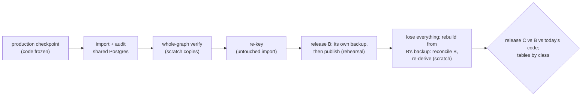

# 7. Stage 2: dry run on the server

Read [6. Stage 1](6-stage-1.md) first; next is [8. Stage 3](8-stage-3.md).

**Goal:** prove the port, the switch and the recovery on full-size data
and the server's own CPU, without touching other sites or the published
dataset. Production keeps running on the Mac.

**Three proofs, one full re-derivation:**

| Proof       | Runs on                                              | Shows                                                                                                                                                                             |
| ----------- | ---------------------------------------------------- | --------------------------------------------------------------------------------------------------------------------------------------------------------------------------------- |
| switch      | an untouched import of the checkpoint                | the ported code gives every stored result (a whole-graph verify run), and the re-key carries the graph over from SQLite's old recipe keys                                         |
| publication | the import, against a rehearsal dataset              | a release takes its own backup, then publishes, with the real locks                                                                                                               |
| recovery    | a fresh database and volume holding only that backup | the Hub being one release ahead is reconciled; everything else re-derives (the one full re-derivation) into a release identical to today's, built against the reconciled baseline |

The verify run is the per-unit proof of the port: it re-runs every current
unit with the ported code on the server's CPU and compares each output and
dependency set with what SQLite stored. Expected: about 0.02% differences,
each inspected (estimate from the re-derivation history). The rebuild is
the end-to-end proof: it re-derives the whole graph from the backup alone.

## Before it starts

- Gate 1 has passed.
- **Rhuidean's prerequisites** are in that repo and recorded there:
  1. Swingset's extra roles in the database onboarding
     ([3. Database code](3-database.md#roles));
  2. **a persistent backup exclusion** for every `swingset*` database.
     Today `mise run infra:backups` finds every database and creates or
     re-enables a daily full dump for each (`dokploy/infra/backups.sh`), so
     a later run would undo a one-off exclusion. The exclusion lives in
     Rhuidean's config, every run honours it, and a run with discovery is
     checked to leave no `swingset*` schedule;
  3. two R2 buckets, `swingset-backups` and `swingset-dev`, with
     bucket-scoped tokens, and the 30-day expiry on `swingset-dev`
     ([4. Hosting](4-hosting.md#backups-and-recovery)). R2 tokens cannot be
     limited to a prefix, so Swingset does not share Rhuidean's bucket;
  4. the enforced proxy/firewall egress rules and the loopback-only
     database relay, with the tests on
     [page 4](4-hosting.md#network-and-volumes). Record actual endpoint
     and port choices; an unimplemented allowlist is a blocker.
- The immutable environment guard and the tunnel tooling exist before
  any rehearsal database is created ([page 10](10-local-development.md#dev-and-production-stay-apart)).

## Steps

1. **Provision** with Rhuidean's tooling: a Swingset project
   (`mise run app:new`), which deploys a Dokploy Compose service
   (`docker-compose`, not a Swarm stack;
   [4. Hosting](4-hosting.md#services-on-dokploy)); a `swingset_dryrun`
   database on the shared Postgres 17, in the C locale, with the real
   roles, marked `environment` = `dryrun` (as is `swingset_drill` later); the services, secrets and alert channels. Add Swingset to
   Rhuidean's inventory. Record each Dokploy fact on
   [that page's checklist](4-hosting.md#dokploy-facts-to-check-not-assume)
   as verified or unavailable.
2. **Make fetching and publishing to the live dataset impossible,** not
   just switched off:
   - the only Hugging Face token writes to a separate rehearsal dataset,
     a full git mirror of the live dataset, so commit ids match;
   - the enforced egress policy allows only the bucket, Hugging Face, the
     alert channel and the dead-man's switch. Test denial of disallowed
     names and direct IP routes from every service using owned endpoints;
   - the out-of-band hold is set during the import.
3. **Freeze production's code.** From this checkpoint until the switch,
   production takes no deploys, so what the dry run proves is what the
   switch replaces.
4. **Transfer and import** a production checkpoint (39 GB, plus about
   2.5 GB of small files and input bundles) with the stage 1 importer into
   `swingset_dryrun` on the shared server, the way the switch will, and
   audit it. Keep the Mac awake for the transfer (see
   [8. Stage 3](8-stage-3.md#steps), step 2). Record the transfer, import
   and audit times, and how the other apps' health checks fared.
5. **Verify, then re-key, on this untouched import,** as the switch will:
   - a verify run of the whole graph, on scratch databases loaded from a
     dump of the import. Inspect every difference; a transform whose output
     really changed (for example a rounding difference on the new CPU
     type) gets a version bump in the port before the switch;
   - then the re-key on `swingset_dryrun` itself, through the worker role.
     Every eligible clean unit must be current afterwards. Bumped
     transforms and their affected consumers stay queued, never re-keyed
     to old outputs. Drain that work before building B and record it
     separately from the recovery drill's full re-derivation.

   Record both times.

6. **Back up, then publish once to the rehearsal dataset.** The rehearsal
   dataset is a full git mirror of the live dataset, so its head carries
   the checkpoint's baseline commit, A; check that first. Choose a
   checkpoint with changes since A, so the gate accepts a new release.
   - Run the scheduled backup job once (backup 1), and its check, foreign
     keys included. Record its size and time.
   - Build release B from `swingset_dryrun` and publish it to the
     rehearsal dataset through the normal path: reservation, its own
     backup (backup 2), push ([4. Hosting](4-hosting.md#publishing-and-backups)).
     The Hub is now one release ahead of backup 1.
7. **The rebuild drill** (the one full re-derivation), from backup 2,
   following [the rebuild order](4-hosting.md#backups-and-recovery)
   exactly:
   - restore only that backup into a fresh scratch database **and a fresh,
     empty state volume**. The drill's services mount no volume the import
     used and cannot reach `swingset_dryrun`, so no surviving file (the
     baseline, `BUILT`, `PUBLISHING`, a manifest, a receipt, Parquet) can
     make recovery pass when the backup lacks it. Before reconciliation,
     compare every restored history row and column against backup 2's
     frozen audit hashes, with only the destination environment identity
     excluded by its explicit rule;
   - the Hub check finds B, the reservation backup 2 holds, and promotes
     it. Only then is B's Parquet downloaded and checked against B's
     manifest, so the baseline is B, complete, and not A;
   - set the bookkeeping tables by their rules, then re-derive everything
     with publishing impossible;
   - load the result into a fresh `swingset_drill` database on the shared
     server, as a real recovery would, and audit it.

   Record each part's time: their sum is the real recovery time.

8. **Compare:**
   - **releases:** build release C from `swingset_drill`, within its
     service's memory limit. Its release gate runs against baseline B, so
     a baseline with missing files fails here. Build release R with
     today's code on the worker VM from the same checkpoint. B, C and R
     must be byte-identical in every published table, except a named list
     of columns such as run ids;
   - **every table, by its class** ([4. Hosting](4-hosting.md#backups-and-recovery)),
     `swingset_drill` against `swingset_dryrun`:

     | Class       | Must hold                                                                                                                        |
     | ----------- | -------------------------------------------------------------------------------------------------------------------------------- |
     | history     | the initial restore matched backup 2 exactly; subsequent changes match the recovery transition list below                        |
     | rebuilt     | the same set of current units, each with an equivalent output and dependency set, by unit key and content digest; ids may differ |
     | bookkeeping | the table matches its reset rule; it is not compared with the import                                                             |

     The recovery transition list names table, key and allowed columns:
     settle the restored reservation, acknowledge B and advance the local
     baseline, settle interrupted runs/admissions, and append new
     recovery, rebuild and verification run records. New generated rows
     referenced by those records are listed too. Backup 2 cannot contain
     its own later registration; reconstruct that record from its checked
     manifest. Preserve every other restored history value and id. Test
     each allowed transition; blanket exclusions for operational tables
     are forbidden.

     A missing history row at the initial check means the backup left it
     out. A current unit that differs means the backup lacked an input or
     the rebuild is wrong. Past rows in rebuilt and bookkeeping tables (superseded
     generations, equivalences, failed attempts) are not expected to
     come back.

   An unexplained difference blocks the switch. A deliberate output change
   needs a named version bump and an independent check; missing history,
   broken references or incomplete verification cannot be waived.

9. **An unknown head blocks.** Run rebuild steps 1 to 4 from backup 1,
   into another fresh database and empty volume. Backup 1 knows only A,
   and the Hub is at B, so this is the lost-backup case: it must block and
   ask for a lost-evidence decision, and write nothing.
10. **Test the lifecycle and the failures,** on the shared server with the
    real Compose file and roles, unless noted:
    - a deploy under a hold, with a migration, then the hold lifted; then
      a rollback to the previous digest, which must be refused, and a fix
      forward;
    - recreate every container on the same volumes;
    - kill a service mid-tick; drop its database connection
      (`pg_terminate_backend`);
    - a hold and resume with both the switch-time operator hold and the
      out-of-band flag; successful and failed deploys with an existing
      operator hold must preserve it;
    - lose the backup's connection partway; crash between rebuild steps;
    - a Postgres restart, on a scratch container with the shared server's
      image and settings, because restarting the shared server stops other
      apps;
    - an alert reaching the owner, and the dead-man's switch firing.

    Each must show no lost commit, no repeated request to the mock source
    and no hold cleared silently. Repeat egress-denial and tunnel tests
    after container recreation.

11. **Egress rehearsal:** use an owned mock source to prove the allowed
    route, redirects, conditional requests, timeouts and Retry-After
    accounting through the real fetch gate. No collection site is
    contacted and no production host is paused. Actual source access
    from the new address remains unproved until the controlled first
    request in [stage 3](8-stage-3.md#steps). This keeps all real request
    accounting in the final production database.

**Scratch databases match the shared server.** They use its Postgres image
digest and its settings (the difference is recorded), except the durability
settings that verify and rebuild scratch turn off. Each gets CPU and memory
limits, so other apps keep their share of the host; the other apps' health
checks are watched during every heavy step.

## Gate 2

- the import's audit passes, and the other apps stayed healthy;
- the whole-graph verify run is clean, or every difference is explained and
  bumped; the re-key on the untouched import passes; times recorded;
- both backups' checks pass; their size and time are recorded;
- B published with its own backup first;
- the rebuild drill from backup 2, from an empty database and volume,
  reconciles B, downloads its Parquet after that, and finishes; releases
  B, C and R and the per-class comparisons are clean; the recovery time is
  recorded;
- recovery from backup 1 blocks on the unknown head;
- the tests in step 10 pass;
- the egress-denial tests and owned-source rehearsal pass, and the
  provisioned SSH tunnel works;
- peak memory per service and for Postgres is recorded, with no
  out-of-memory kill.

| Step                                              | Review                          |
| ------------------------------------------------- | ------------------------------- |
| rehearsal publication, paid resources or deletion | independent check plus receipts |
| other rehearsal work                              | tests and receipts              |

**Rollback:** stop the rehearsal services. Remove only exact owned
services and dry-run databases after an independent check; keep the
receipts and required recovery artifacts. Production never changed.

Next: [8. Stage 3](8-stage-3.md).
