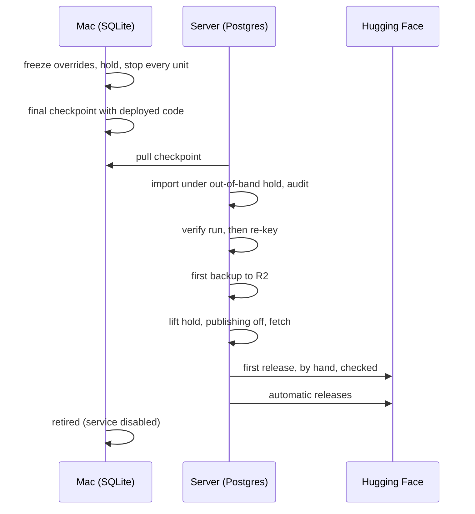

# 8. Stage 3: switch to the server

Read [7. Stage 2](7-stage-2.md) first; next is
[9. After the switch](9-after-switch.md).

**Goal:** the server fetches and publishes; the Mac stops for good.

**Before it starts:** gate 2 has passed, and production has taken no deploy
since the dry run's checkpoint.

## How long the switch takes

No release from the hold until the first release on the server; publishing
has no required cadence, so this is a cost, not a limit. It takes the dry
run's measured transfer, import, audit, verify and re-key times,
plus a first backup, plus 30%. Nothing re-derives: the re-key carries every
current unit over, and only transforms bumped in the dry run re-run.

## Steps

1. **Fence the Mac.** Freeze override edits. Set `operator-hold`, which stops
   the loop, backup and summary units. Confirm every unit has stopped and
   the exclusive lock can be taken. Run no `nixos-rebuild` in the window,
   and confirm a reboot cannot restart a writer.
2. **Final checkpoint** with production's deployed code, under the hold.
   Pull it from the server, so the Mac's sleep cannot interrupt the
   transfer, and verify it remotely. Record the Hugging Face head before
   and after; a changed head or schema stops the switch.
3. **Import and audit** with the out-of-band hold set. Carry the settings
   over without running them: publish mode, loop budgets, calendars.
   Overrides stay files for now; deploy them with the server's code.
4. **Verify, then re-key** ([5. Stage 0](5-stage-0.md#re-keying-at-the-switch)).
   The verify run compares the server's code with the imported results; it
   must be clean apart from transforms bumped in the dry run. Then the
   re-key carries every current unit over, and the bumped transforms queue
   their re-runs.
5. **Back up first:** run the backup job once and its check, and confirm
   the twice-weekly schedule is set.
6. **Start fetching.** Lift the hold with publishing off. Confirm requests
   and new pages within an hour, by `snapshots` and `scheduler_requests`
   times, not only that ticks finish.
7. **First release:** once any bumped re-runs have drained, build by hand,
   independent check, publish. Then turn automatic publishing on with the
   setting that replaces today's `dryRun`.
8. **Retire the Mac worker.** Turn the service off in its Nix settings
   (`services.swingset.enable = false`), rebuild, and remove its token, so it
   stays off after a reboot. It is retired, not held.

## Gate 3

- every loop on the server ran three clean ticks in a row with real work;
- one automatic release published from the server;
- the first backup ran, and its check passed.

## Review and rollback

| Step                               | Review                             |
| ---------------------------------- | ---------------------------------- |
| steps 1 to 6, the switch           | before and after receipts          |
| step 7, publishing from the server | an independent check plus receipts |

**Rollback:** until the server's first fetch, stop the server's services,
confirm it never fetched or published and the Hugging Face head is
unchanged, then lift the Mac's hold on purpose. After the first fetch,
rollback is forward only: rebuild from the latest backup on the server. No tool copies Postgres data back into SQLite, and none should be
improvised.

Next: [9. After the switch](9-after-switch.md).
