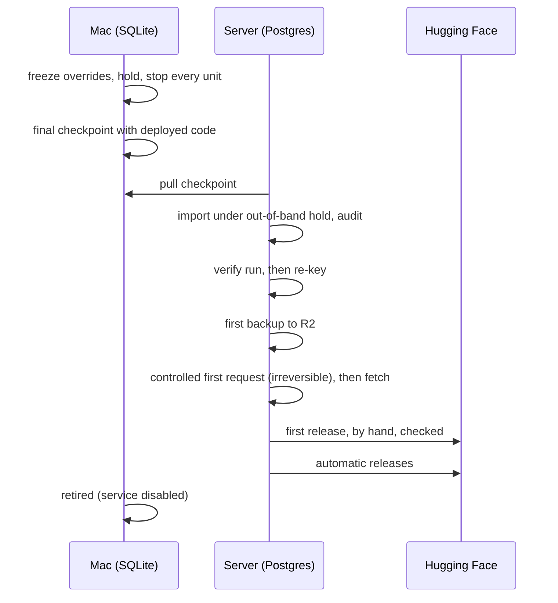

# 8. Stage 3: switch to the server

Read [7. Stage 2](7-stage-2.md) first; next is
[9. After the switch](9-after-switch.md).

**Goal:** the server fetches and publishes; the Mac stops for good.

**Before it starts:** gate 2 has passed, including the rebuild drill, so
the forward-only recovery is proved before the first request attempt removes the
Mac's rollback. Production has taken no deploy since the dry run's
checkpoint. Retire the dry-run databases by exact id with an independent
check, and import into a fresh `swingset` database. The operator runbooks,
tunnel, deploy hold and environment guard are ready; do not defer the
instructions needed to recover the server until after it becomes production.

## How long the switch takes

No release from the hold until the first release on the server; publishing
has no required cadence, so this is a cost, not a limit. It takes the dry
run's measured transfer, import, audit, verify and re-key times,
plus a first backup, plus 30%. The re-key carries eligible clean units
over; bumped transforms and their affected consumers re-run. Include that
measured drain time in the estimate when the dry run finds a difference.

## Steps

1. **Fence the Mac.** Freeze override edits. Set `operator-hold`, which stops
   the loop, backup and summary units. Confirm every unit has stopped and
   the exclusive lock can be taken. Run no `nixos-rebuild` in the window,
   and confirm a reboot cannot restart a writer.
2. **Final checkpoint** with production's deployed code, under the hold.
   Pulling from the server does not stop the Mac from sleeping, so keep it
   awake for the whole transfer: on power, lid open, with
   `caffeinate -dims` running until the copy ends. Use a resumable copy
   (`rsync --partial`), so a sleep costs a restart from where it stopped,
   then check every file against the checkpoint's own digests on the
   server. Record the Hugging Face head before and after; a changed head or
   schema stops the switch.
3. **Import and audit** with the out-of-band hold set, into a database
   marked `environment` = `prod`
   ([10. Local development](10-local-development.md#dev-and-production-stay-apart)). Carry the settings
   over without running them: publish mode, loop budgets, calendars.
   Overrides stay files for now; deploy them with the server's code.
4. **Verify, then re-key** ([5. Stage 0](5-stage-0.md#re-keying-at-the-switch)).
   The verify run compares the server's code with the imported results; it
   must be clean apart from transforms bumped in the dry run. Then the
   re-key carries eligible clean units over. Bumped transforms and their
   affected consumers remain queued until they run under the new versions.
5. **Back up first:** run the backup job once and its check, and confirm
   the twice-weekly schedule is set and that no Dokploy dump schedule
   covers `swingset`.
6. **Controlled first request, then start fetching.** Record the decision
   to contact sources from the new address. With the Mac fenced and the
   ordinary schedulers still held, allow one operator-run request through
   the final database's real admission and fetch gate. Use a stored page's
   validators, the project User-Agent, robots checks and all carried-over
   budgets and spacing; any prerequisite robots request counts too. This
   is the irreversible boundary: an attempt or uncertain outcome counts,
   not just a successful response. Record its request accounting and
   classification. A failure keeps general fetching and publishing held;
   fix forward, preserving Retry-After and all pauses. Never resume the
   Mac after an attempt. Once source access passes, lift only the switch
   hold, with publishing off. Confirm requests and new pages within an
   hour, by `snapshots` and `scheduler_requests` times, not only completed
   ticks. If no page changes, verify served requests and unchanged-content
   accounting instead of manufacturing new data.
7. **First release:** once any bumped re-runs have drained, build by hand,
   independent check, publish. Then turn automatic publishing on with the
   setting that replaces today's `dryRun`.
8. **Retire the Mac worker.** Turn the service off in its Nix settings
   (`services.swingset.enable = false`), rebuild, and remove its token, so it
   stays off after a reboot. It is retired, not held.

## Gate 3

- acquire, plan, derive and release, which tick within the hour, each ran
  three clean scheduled ticks in a row with real work;
- the daily maintain loop and the backup job each ran one clean tick, run
  by hand through the scheduler, so the gate fits in one weekend; their
  first scheduled ticks are watched after it, with an alert if either is
  late;
- one automatic release published from the server at the next eligible
  scheduled build, taking its own backup first; if there are no releasable
  changes, this gate waits rather than manufacturing a release;
- the first backup ran, and its check passed.

## Review and rollback

| Step                               | Review                                                        |
| ---------------------------------- | ------------------------------------------------------------- |
| steps 1 to 6, the switch           | before and after receipts; new-address decision before step 6 |
| step 7, publishing from the server | an independent check plus receipts                            |

**Rollback:** before the server's first request attempt, stop its services,
confirm no request was admitted or sent, none is uncertain, nothing
published and the Hugging Face head is unchanged; then lift the Mac's
switch hold on purpose, preserving prior holds. After an attempt,
rollback is forward only: rebuild from the latest backup on the server,
the procedure the dry run's drill proved
([7. Stage 2](7-stage-2.md#steps), steps 6 to 9). No tool copies Postgres
data back into SQLite, and none should be improvised.

Next: [9. After the switch](9-after-switch.md).
