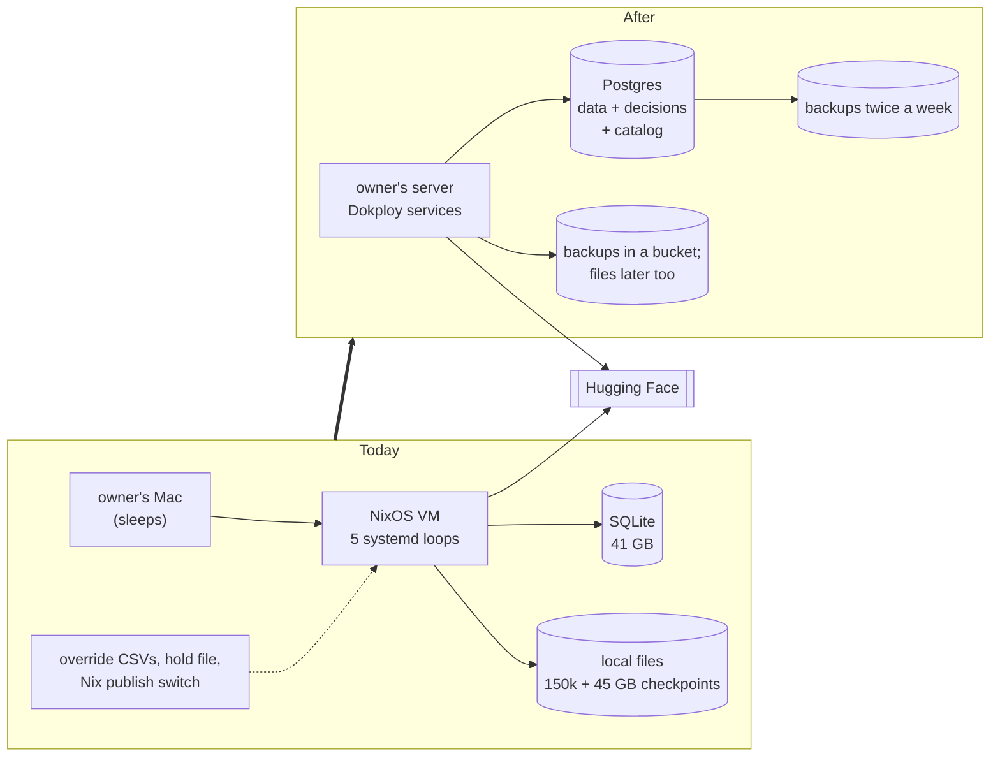
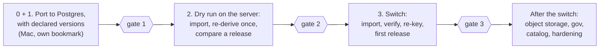

# Move to Postgres and Dokploy

**Start here.** This page is the whole plan in brief. The numbered pages
below give the detail, and are written to be read in order.

Status: design, revised 2026-10-19 after several adversarial reviews and
the stage 0 measurements. Not started. Production stays on SQLite on the
Mac until the switch (stage 3). Decisions:
[D-0263](../../../journal/decisions/0263-postgres-holds-all-state-and-moves-in-four-stages.md)
and
[D-0264](../../../journal/decisions/0264-declared-transform-versions-and-differential-proofs-decide-re-derivation.md).

## What and why

Swingset moves off the owner's Mac onto the owner's server. Postgres
becomes the one place that holds all of Swingset's data **and every
decision**: overrides, exceptions, approvals, holds and settings. Large
files move to object storage, and Dokploy runs the worker. The database is
built to be queried, so a public API can become the main way to reach the
data. Hugging Face stays one export, with the same full releases when
published. The scraping and safety rules become rows in Postgres that can
be changed with approval, without a deploy.

- **The Mac sleeping stops production,** for hours and once for two days.
- **Decisions are scattered** across files, free text and git, where nobody
  can query them.
- **There is no backup off the machine.**
- **The data is worth building on.**

## Before and after

## Read in this order

| #   | Page                                  | Answers                                                                                |
| --- | ------------------------------------- | -------------------------------------------------------------------------------------- |
| 1   | [Requirements](1-requirements.md)     | what the move must do, what it deliberately does not, and the numbers that define done |
| 2   | [Target schema](2-schema.md)          | every table in Postgres, by namespace, and the new `gov` and `catalog` tables          |
| 3   | [Database code](3-database.md)        | how the code talks to Postgres: values that must not change, triggers, locks, roles    |
| 4   | [Hosting](4-hosting.md)               | backups and restore, services on Dokploy, object storage                               |
| 5   | [Stage 0](5-stage-0.md)               | declared versions and a verify run, so code changes stop forcing re-derivation         |
| 6   | [Stage 1](6-stage-1.md)               | the Postgres port, on its own bookmark, tested on the Mac                              |
| 7   | [Stage 2](7-stage-2.md)               | the dry run on the server: one full re-derivation as the proof                         |
| 8   | [Stage 3](8-stage-3.md)               | the switch                                                                             |
| 9   | [After the switch](9-after-switch.md) | object storage, decisions into `gov`, the catalog, hardening                           |
| —   | [Glossary](glossary.md)               | every term the pages use                                                               |

## Requirements at a glance

| Must                                                                 | Must not                                            |
| -------------------------------------------------------------------- | --------------------------------------------------- |
| hold all state and every decision in one Postgres                    | build the API now                                   |
| record each decision as a row: who proposed, who approved, when, why | change the published dataset's format               |
| keep full-fidelity Hugging Face exports possible; same hashes        | change types or split tables during the move        |
| re-derive only when a transform's declared version is bumped         | allow several writers at once, or use an ORM        |
| back up what cannot be rebuilt, twice a week, off the machine        | run two fetchers, even in the dry run               |
| make the scraping and safety rules approved rows in `gov`            | copy data back from Postgres to SQLite              |
| keep today's scraping and safety values as the starting rows         | publish private decisions; require daily publishing |

The full lists, with how each is checked, are on [page 1](1-requirements.md).

## The target schema at a glance

| Namespace  | Tables         | Holds                                                                          |
| ---------- | -------------- | ------------------------------------------------------------------------------ |
| `fetch`    | 23             | hosts, budgets, watches, snapshots, requests                                   |
| `plan`     | 34             | per-event bookkeeping                                                          |
| `evidence` | 13             | parse results, admission, observations, findings                               |
| `derive`   | 20 and 1 view  | derivations, dependency sets, the work queue (about 20 GB)                     |
| `project`  | 29             | the published tables, source events, identity                                  |
| `release`  | 3, plus 4 new  | partitions, manifests, artifacts; candidates, verdicts, publications, baseline |
| `ops`      | 19, plus 1 new | runs, controls, stored objects, backups, alerts                                |
| `gov`      | new            | proposals, approval events, effective views; holds, requeues                   |
| `catalog`  | new            | every published release, queryable, with id redirects                          |

Today's 141 tables move as they are; only their namespace is new. Details
on [page 2](2-schema.md).

## The stages

Each stage ends with a **gate**: a written check, with a receipt, that must
pass before the next starts. Production does not change until the switch.

| Stage                       | Runs on                                | Changes production?                               | Rollback                                                  |
| --------------------------- | -------------------------------------- | ------------------------------------------------- | --------------------------------------------------------- |
| 0 and 1. port, with stage 0 | the Mac, on its own bookmark           | no                                                | nothing to roll back                                      |
| 2. dry run                  | the server, unable to fetch or publish | no; production's code freezes from its checkpoint | delete the services                                       |
| 3. switch                   | the server                             | yes                                               | until the first fetch, restart the Mac; then forward only |
| after the switch            | the server                             | one change at a time                              | each step's own                                           |

### No dates, no waiting periods

Every gate is a set of conditions, and the next stage starts as soon as
they hold. All code (stages 0 and 1) is written and tested beforehand; the
operations, stages 2 and 3, can then run in one session, such as a
weekend. What decides the pace is work, not time:

| Longest steps                                     | Measured or estimated                                                        |
| ------------------------------------------------- | ---------------------------------------------------------------------------- |
| moving the 39 GB checkpoint to the server (twice) | depends on the Mac's upload speed; measured in the dry run                   |
| import and audit of the 41 GB database (twice)    | not measured; measured in the dry run                                        |
| the dry run's full re-derivation                  | 10 to 14 hours on today's VM; the server's time is measured in the dry run   |
| a verify run of the whole graph                   | about 35 minutes at 2 processes on the worker (estimate from measured times) |
| a re-key                                          | not measured; rehearsed in the dry run                                       |
| a full release build                              | about an hour                                                                |

For a single-session run, make every owner decision below before starting.

## Why stage 0

Today any code or runtime change makes every derived result out of date.
Stage 0 makes declared versions decide instead, and checks each change with
a verify run on a copy. The dry run still re-derives everything once, on
purpose, as the proof of the port.

| Event                                                  | Without stage 0                            | With stage 0 (estimate)                                 |
| ------------------------------------------------------ | ------------------------------------------ | ------------------------------------------------------- |
| the dry run                                            | `████████████` 10 to 14 h re-derivation    | `████████████` the same, on purpose: the proof          |
| the switch                                             | `████████████` 10 to 14 h without releases | `█` verify and re-key; gap: hours                       |
| a typical code deploy (9 in the 3 weeks to 2026-10-19) | `█████████` about 7.5 h each               | `▌` about 35 min verify; releases wait, nothing re-runs |

Verify times come from the 2026-10-19
[measurements](../../../journal/investigations/2026/stage-0-measurements-2026-10-19.md).

## Rules for every stage

- **Owner's exception.** The repo normally allows release work or one
  maintenance session a week; the owner made this move the plan of record
  on 2026-10-19. Publishing is not required on any cadence while the move
  runs.
- **Production does not change until the switch.** The port lives on its
  own bookmark, rebased on `main`. If production adds a migration, the port
  adds its Postgres form. From the dry run's checkpoint to the switch,
  production takes no deploys.
- **Count every re-derivation.** There is one, on purpose, in the dry run.
  Any other is reported with its reason.
- **What waits:** the calendar contract, danceconvention.net and
  SwingDirector activations, and row-level result holds, until after the
  switch, unless the owner says otherwise. Keeping the worker safe never
  waits.
- **Review levels,** from AGENTS.md: local code needs tests; a production
  switch needs before and after receipts; deleting data, publishing or
  spending money needs an independent check plus receipts; contacting a
  site from a new address needs a decision record first. No gate asks for
  more.

## Owner decisions still open

Make all of these before starting a single-session run.

| Decision                            | Needed before           | Recommendation                      |
| ----------------------------------- | ----------------------- | ----------------------------------- |
| publish allowlisted decision tables | after the switch        | yes, without author or note columns |
| build the API                       | after the catalog fills | separate work                       |

## Evidence

- [Stage 0 measurements, 2026-10-19](../../../journal/investigations/2026/stage-0-measurements-2026-10-19.md)
- [What the move must carry, 2026-10-19](../../../journal/investigations/2026/platform-survey-2026-10-19.md)
- [Hosting investigation, 2026-09-14](../../../journal/investigations/2026/dokploy-migration-2026-09-14.md)
- [PostgreSQL experiments, 2026-09-14](../../../journal/investigations/2026/postgres-migration-plan-2026-09-14.md)
- [Object storage investigation, 2026-09-14](../../../journal/investigations/2026/dokploy-object-storage-2026-09-14.md)
